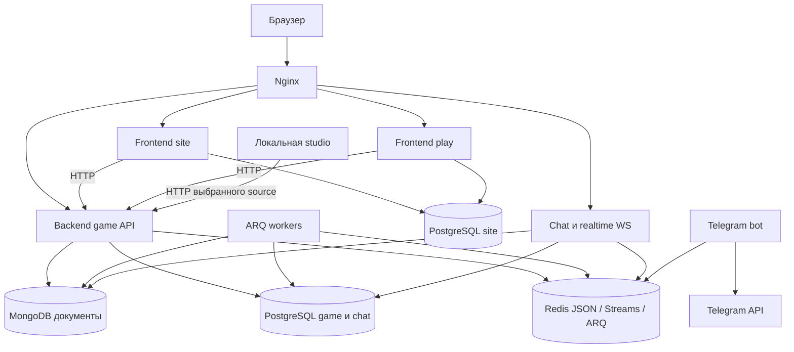

# Аудит 01/10 — Инвентаризация и архитектурная карта Sealed World

Дата: 9 октября 2026 года. Репозиторий: `TurnBasedMMORPG`. Базовый HEAD: `6ccc92561c633f618eb7ee082c36caa44a1400f7`.

**Объект исследования — фактическое рабочее дерево, включая staged и unstaged изменения, а не чистый HEAD.** До аудита уже присутствовали изменения кода, конфигураций, документации и перенос project skills. Они сохранены. Этот аудит добавляет только настоящий отчёт.

Обозначения: **Факт** — найден в файлах или получен статическим измерением; **интерпретация** — архитектурное обобщение наблюдений; **не проверено** — требует исполнения, внешней среды или отдельного углублённого аудита. Пути относительны корню репозитория; `:N` указывает строку в исследованном рабочем дереве. Наличие теста или настройки не означает успешного прохождения проверки.

## 1. Executive Summary

**Интерпретация:** Sealed World — модульное Python-приложение с несколькими процессами, общими библиотеками и смешанной междоменной коммуникацией. Игровые feature-каталоги не являются независимо развёртываемыми микросервисами. Backend API объединяет их в одном FastAPI-приложении; фоновые очереди и chat обслуживаются отдельными процессами. Основания: `src/backend/app.py:21`, `src/backend/core/containers/redis.py:136`, `deploy/compose.game.yml:39`.

Подтверждённые основные границы:

- **Site/account и gameplay:** `src/frontend` — полноценный сервер сайта, владелец пользователей и site persistence; `src/backend` — игровое поведение и game/chat persistence. Они связаны HTTP-клиентами. Это подтверждается `src/frontend/core/database/model_imports.py:1`, `src/frontend/core/api.py:12`, `src/backend/core/database/model_imports.py:6` и раздельными migration jobs в `deploy/compose.site.yml:17`, `deploy/compose.game.yml:17`.
- **Site и play:** один код и образ frontend, два процесса с `FRONTEND_SURFACE=site|play`; это разделение маршрутов и нагрузки, а не два независимых bounded context. Источники: `src/frontend/core/routing.py:16`, `deploy/compose.site.yml:35`, `deploy/compose.site.yml:81`.
- **Game domains:** 23 feature-каталога, включая пустой `tavern`; логические границы проницаемы для прямых импортов. Наряду с ними используются Redis Streams request/reply и publish. Источники: инвентаризация `src/backend/features/`, `src/backend/features/game_session/dependencies.py:7`, `src/backend/core/bus/producer.py:9`.
- **Runtime/storage:** PostgreSQL, MongoDB, Redis/RedisJSON, файловые/S3 generated assets. Владельцы данных преимущественно доменные, но feature и infrastructure физически разделены не везде одинаково. Реестры: `src/backend/core/database/model_imports.py:6`, `src/backend/infrastructure/mongo/bootstrap.py:34`, `src/backend/infrastructure/redis/managers.py`.
- **Дополнительные поверхности:** самостоятельные chat/realtime, локальная studio, Telegram-бот и общая UI-библиотека `src/fastapi_cabinet`. Их нельзя пропускать при следующих аудитах. Входы: `src/backend/chat/app.py:19`, `src/studio/app.py:96`, `src/tg_bot/launcher.py:16`, `src/fastapi_cabinet/__init__.py:1`.

Документация не обеспечивает полную архитектурную карту сама по себе: 67 Markdown-файлов содержат «Раздел в разработке», ряд skills отстаёт от реализации. Graphify существует, но его граф от 06.05.2026 содержит 815 отсутствующих путей из 1 512 уникальных `source_file`. Использовать его как подтверждение текущих связей нельзя (§9–10).

**Не проверено:** реальное покрытие, работоспособность deployment, эксплуатационная топология, доставка/повтор событий, согласованность хранилищ и correctness игровых алгоритмов. Итоговый балл архитектуре и оценка автора не выставляются.

## 2. Масштаб репозитория и документации

### 2.1. Метод измерения

Измерения выполнены до создания этого отчёта. Основной корпус перечислен командой `rg --files --hidden -g !.git -g !.env*`: учитываются существующие неигнорируемые файлы, включая новые файлы рабочего дерева. `.git`, окружения, кэши, логи, секреты и игнорируемые результаты не включаются. Это размер проектного корпуса, **не полный размер каталога на диске** и не размер git history.

Для `docs`, `.agents/skills`, `src`, `tests` дополнительно сделан физический обход каталогов, исключая `__pycache__`; значения совпали. Игнорируемый `graphify-out` измерен отдельно. Код условно определён расширениями `.py`, `.js`, `.ts`, `.css`, `.html`; бинарные assets и JSON-ресурсы в колонку кода не входят. Размеры в байтах, без сжатия. Подсчёт токенов — оценка числа Unicode-символов / 4 … / 3, а не результат токенизатора.

### 2.2. Корпус

| Область | Файлов | Всего байт | Файлов кода | Байт кода |
| --- | ---: | ---: | ---: | ---: |
| Основной проектный корпус | 3 684 | 201 468 363 | — | — |
| `src/` | 2 678 | 124 177 822 | 1 828 | 11 145 421 |
| `src/backend/` | 1 063 | 5 747 536 | 1 027 | 5 348 431 |
| `src/frontend/` | 1 395 | 117 765 070 | 586 | 5 156 699 |
| `src/shared/` | 52 | 119 098 | 52 | 119 098 |
| `src/studio/` | 37 | 306 018 | 35 | 302 969 |
| `src/tg_bot/` | 70 | 60 013 | 70 | 60 013 |
| `src/fastapi_cabinet/` — код | — | — | 58 | 158 211 |
| `tests/` | 352 | 2 873 123 | 352 | 2 873 123 |
| `tools/` | 72 | 447 338 | — | — |

Большой размер frontend в основном относится к некодовым ресурсам; считать его 118 МБ исходного кода было бы ошибкой. Таблица — результат обхода указанных путей, не оценка сложности.

### 2.3. Документация отдельно от кода

| Корпус | Markdown-файлов | Байтов Markdown | Примерно токенов |
| --- | ---: | ---: | ---: |
| Все Markdown основного корпуса | 304 | 847 410 | 185 936–247 915 |
| Без путей с компонентом `archive` | 298 | 830 685 | 182 724–243 632 |
| С компонентом `archive` | 6 | 16 725 | 3 212–4 282 |
| `docs/` | 218 | 574 868 | 118 558–158 077 |
| `docs/` без `docs/archive/` | 213 | 558 610 | 115 463–153 950 |
| `docs/archive/` | 5 | 16 258 | 3 095–4 127 |
| `.agents/skills/` | 64 | 213 077 | 52 520–70 026 |
| `docs/agent-skills/` | 0 | 0 | 0 |
| Игнорируемый `graphify-out/`, отдельно | 607 | 531 265 | Не включён в основной итог |

`docs/` содержит всего 222 файла / 651 889 байт с учётом не-Markdown материалов. `.agents/skills/` — 65 файлов / 213 348 байт: 9 `SKILL.md`, 55 Markdown references (201 275 байт), один дополнительный файл. Учитывать старые удалённые `docs/agent-skills` и новые `.agents/skills` одновременно как активную документацию нельзя. «Без archive» здесь означает расположение, а не подтверждённую актуальность каждого документа.

Основные части `docs/`: `ru` — 103 MD / 122 254 байта; `game-design` — 60 MD / 226 931 байт; `planning` — 41 MD / 168 162 байта; `changelog` — 3 MD / 21 243 байта; `audits` — 2 MD / 8 420 байт. Документация из `.venv`, HTML-сборка `site_docs`, Graphify cache и данный отчёт не включены в эти авторские Markdown-итоги.

## 3. Архитектурная карта

### 3.1. Процессы и коммуникация

Стрелки означают обращение/зависимость, не гарантированное направление каждого сообщения. Схема следует `deploy/compose.site.yml`, `deploy/compose.game.yml`, `deploy/compose.infra.yml`, `deploy/nginx/site.conf.template:120`, `src/backend/chat/core/lifespan.py`, `src/tg_bot/core/container.py:22`. Redis Streams consumers работают и внутри API/chat процессов; на схеме они не выделены в несуществующий отдельный контейнер.

### 3.2. Слои

| Слой | Фактическое расположение и назначение |
| --- | --- |
| Входные адаптеры | Backend `features/*/api`, `events`, workers; frontend `features/*/routes`, `game_features/*/routes`; chat REST и `realtime/api/ws.py:87` |
| Application/orchestration | Feature `services`, `dependencies`, gateways; frontend `SessionContextBuilder` (`session_context_builder.py:63`) и `ResponseDirector` (`response_director.py:10`) |
| Domain/runtime | Например `combat/runtime/engine`, `character/runtime`, `monsters/runtime`, `rift/runtime`; единого обязательного пакета `domain/` нет |
| Integration | `features/*/integrations`, frontend/studio `integrations/backend_api`; семантические переходы, HTTP и event adapters |
| Infrastructure | Backend `infrastructure/<domain>`, `core/database`, `core/containers`; frontend `core/database`; SQL, Redis, Mongo, AI/assets adapters |
| Общий код | `src/shared/{schemas,enums,constants,security,utils,infrastructure}` и самостоятельная UI-библиотека `src/fastapi_cabinet` |

**Интерпретация:** слои отражают модульную организацию, но не строгую clean/hexagonal architecture с технически закрытыми импортами. Например `game_session/dependencies.py:7` напрямую собирает компоненты нескольких features. Shared фактически содержит также logging/metrics/password helpers, а не только DTO, хотя `.agents/skills/turnbasedmmorpg-project/references/project-rules.md` формулирует узкую роль shared.

### 3.3. Физические и логические границы

| Граница | Что реализовано физически | Что остаётся логическим |
| --- | --- | --- |
| Site ↔ game | Разные процессы, images, migration jobs, DB URL; HTTP | Общий репозиторий, shared contracts, согласованное изменение API |
| Site ↔ play | Два контейнера и набора routers | Один образ, исходники, site DB и пользовательская модель |
| Backend features | Python-пакеты и Redis consumer groups | Общий API-процесс, подключения, взаимные импорты; отдельного deploy каждого feature нет |
| API ↔ workers | ARQ queues и worker containers | Общая модель данных и код доменов |
| Chat/realtime | Отдельный FastAPI-процесс | Backend ownership и общие хранилища/контракты |
| Studio | Отдельный локальный app | Повторное использование frontend API clients, CSS/templates и cabinet library |
| Infrastructure domains | Каталоги/менеджеры/репозитории | Не отдельные базы или security principals для каждого домена |

Основания: `deploy/compose.site.yml:35`, `deploy/compose.game.yml:81`, `src/studio/app.py:25`, `src/backend/core/containers/redis.py:136`. Текущая изоляция credentials и сетей в production не проверялась.

## 4. Каталог доменов и их ответственности

### 4.1. Backend

Ниже все 23 каталога `src/backend/features`. Название feature — навигационная единица; **оно не доказывает самостоятельный bounded context**. Корень путей входов в таблице — `src/backend/features/`.

| Домен | Ответственность | Основной вход |
| --- | --- | --- |
| `admin_players` | Административное чтение и генерация персонажей | `admin_players/api.py:22` |
| `arena` | Дуэли, группы, рейтинги, запрос боя | `arena/api/router.py:10`; `arena/events/__init__.py:27` |
| `character` | Персонаж, статус, навыки, active session и combat projections | `character/api/router.py:11`; `character/events/__init__.py:47` |
| `city_services` | Городские услуги, включая комнату таверны | `city_services/api/router.py:10`; `city_services/models.py` |
| `combat` | Жизненный цикл боя, ходы, resolver, результат, аналитика и AI simulation | `combat/api/router.py:27`; `combat/runtime/engine/resolver/__init__.py` |
| `expedition` | Экспедиция, смерть и восстановление | `expedition/service.py:12`; собственного HTTP router не обнаружено |
| `exploration` | Навигация по миру, знания, встречи | `exploration/api/router.py:18` |
| `game_catalog` | Каталог механик/ресурсов, определения character skills | `game_catalog/api/router.py:12`; `game_catalog/skills/` |
| `game_config` | Внутренние игровые настройки | `game_config/api/router.py:6` |
| `game_lobby` | Создание, выбор, удаление персонажей; game tokens | `game_lobby/api/router.py:45` |
| `game_session` | Вход в runtime, возрождение, переходы и сбор добычи | `game_session/api/router.py:14` |
| `generation_ai` | Генерационные задания и внешние AI/assets adapters | `generation_ai/api.py:23`; `generation_ai/workers/arq.py:37` |
| `inventory` | Инвентарь, награды, прочность | `inventory/api/router.py:22`; `inventory/events/__init__.py:43` |
| `items` | Экземпляры/происхождение предметов, генерация и тексты | `items/events/__init__.py:47`; `items/services/`; собственного HTTP router нет |
| `loot` | Заказ и выдача добычи | `loot/events/__init__.py:27`; `loot/workers/arq.py:27` |
| `moderation` | Политика имён | `moderation/name_policy.py:1` |
| `monsters` | Кланы, генерация, группы, encounters и образы монстров | `monsters/api/router.py:24`; `monsters/events/__init__.py:57` |
| `npc` | Состояния/эффекты NPC и переходы | `npc/integrations/__init__.py:1`; `npc/services.py` |
| `rift` | Каталог, генерация, игровые runs, присутствие, encounters; dev/hex поверхности | `rift/api/router.py:27`; `rift/dependencies.py:10` |
| `scenario` | Сценарные узлы, шаги, handlers и переходы | `scenario/api/router.py:20`; `scenario/events/__init__.py:31` |
| `system` | Сборка общесистемных фоновых задач | `system/workers/arq.py:53` |
| `tavern` | Пустой feature-каталог, Python-реализации нет | Текущую комнату искать в `city_services`; не считать отдельным готовым сервисом |
| `world` | Загрузка, генерация и кеш мира | Bootstrap `src/backend/core/containers/game.py:45`; `world/services/`; HTTP router в app не подключён |

### 4.2. Остальные контексты

| Область | Состав и ответственность | Источник |
| --- | --- | --- |
| Site identity | `auth`, `account`, `email`: пользователи, токены, профиль, email verification | `src/frontend/core/routing_site.py:6`; `src/frontend/core/database/model_imports.py:1` |
| Public content/community | `public_site`, `news`, `library`, `feedback`, `surveys` | `src/frontend/core/routing_site.py:15` |
| Cabinet/analytics | `cabinet`, `player_analytics`; registry содержит site ops, accounts, game settings, messaging и feedback | `src/frontend/cabinet.py:1` |
| Gameplay browser | 13 каталогов: arena, character_status, city_services, combat, exploration, game_catalog, game_lobby, game_menu, inventory, rift, scenario, session, tavern; отдельного routed tavern в PLAY_ROUTERS нет | `src/frontend/core/routing_play.py:5`; перечень `src/frontend/game_features/` |
| Chat/realtime | Chat REST, player notices, socket connections, история | `src/backend/chat/app.py:19`; `src/backend/realtime/api/ws.py:87` |
| Studio | Source selector и пять аналитических cabinet modules: content_ops, scenario, exploration, combat, combat_ai_testing | `src/studio/cabinet.py:15` |
| Telegram | Redis announcements/community flow и Telegram menu/commands | `src/tg_bot/core/settings.py`; `src/tg_bot/core/container.py:22` |
| Cabinet framework | Реестр модулей, contracts/widgets, rendering, маршруты и UI assets | `src/fastapi_cabinet/__init__.py:1`; `src/fastapi_cabinet/fastapi.py` |

## 5. Карта междоменных зависимостей

### 5.1. Внешние/публичные контракты

| Контракт | Производитель/потребитель | Где читать |
| --- | --- | --- |
| HTML и HTMX fragments | Frontend → browser | `src/frontend/core/renderer.py`; `src/frontend/game_features/session/services/response_director.py:14` |
| Typed game HTTP | Frontend/studio → backend | `src/frontend/core/api.py:12`, `src/frontend/integrations/backend_api/`, backend `app.py:52` |
| Site-to-game identity | Internal service key, lobby user context, game access/refresh tokens | `src/frontend/core/api.py:90`, `src/backend/core/security.py`, `src/backend/core/game_auth.py`, `src/backend/features/game_lobby/api/router.py:45` |
| Общий response/state contract | `CoreResponseDTO`, `GameStateHeader`, `StateTransitionDTO` | `src/shared/schemas/response.py:21`; доменные DTO в `src/shared/schemas/` |
| Event request/reply и fire-and-forget | Backend domains через `GameEventProducer`/`codex_platform` | `src/backend/core/bus/producer.py:15`; `src/backend/core/lifespan.py:15` |
| ARQ job contract | Очередь, имя task и payload | `src/backend/core/arq.py`, `src/backend/core/arq_container.py`; feature `workers/arq.py`; §7 |
| Realtime | `/ws/realtime`, `player.notice`, chat REST | `src/backend/realtime/api/ws.py:87`; `src/backend/realtime/integrations/notice_publisher.py:101`; `src/backend/chat/app.py:23` |
| Generated asset URL | Site-facing `/static/generated-assets/...`, storage backend локальный/S3 | `src/frontend/integrations/generated_assets.py`; `src/backend/features/generation_ai/integrations/`; `docs/ru/management/deployment-contract.md` |

Nginx содержит маршруты `/ws/chat` и `/ws/realtime` (`deploy/nginx/site.conf.template:151`), но chat app регистрирует realtime websocket router и REST (`src/backend/chat/app.py:23`). Наличие отдельного действующего `/ws/chat` handler не подтверждено — legacy route следует проверить отдельно, не считать гарантированным публичным API.

Shared используется шире DTO: `src/shared/infrastructure/` обслуживает logging/metrics; `src/shared/security/passwords.py` — общую security utility. Статический поиск импортов `src.backend` в `src/frontend`, `src/shared`, `src/studio`, `src/tg_bot` не нашёл прямых абсолютных импортов; это не доказательство отсутствия динамических обходов или любых data-access нарушений.

### 5.2. Полная статическая матрица прямых feature-imports

Из Python AST всех `.py` в `src/backend/features/` извлечены абсолютные `import`/`from src.backend.features.<домен>...`. Учитываются также импорты внутри функций и `TYPE_CHECKING`; относительные/динамические импорты и event edges сюда не входят. Это **карта импортируемости**, не трассировка вызовов и не proof циклических runtime imports.

| Из домена | В другие features |
| --- | --- |
| admin_players | character, items, moderation, monsters |
| arena | character |
| character | expedition, game_catalog, inventory, monsters |
| city_services | character, exploration |
| combat | character, expedition, game_catalog, inventory, items, loot, monsters, rift |
| expedition | character, combat, inventory, items |
| exploration | combat, expedition, game_catalog, monsters, world |
| game_catalog | character, items, monsters |
| game_lobby | character, expedition, inventory, items, moderation, rift |
| game_session | character, combat, expedition, game_lobby, inventory, items, loot, npc, rift, scenario |
| generation_ai | items, monsters, world |
| inventory | character, items |
| items | character, generation_ai |
| loot | expedition, items |
| monsters | character, game_catalog, generation_ai, items |
| rift | combat, generation_ai, items, loot, monsters |
| scenario | character, city_services, inventory, items, npc, rift, world |
| system | character, exploration, inventory, loot, rift |
| world | generation_ai |
| game_config, moderation, npc, tavern | Не обнаружены исходящие импорты указанного вида |

Репрезентативные проверяемые места: `src/backend/features/game_lobby/integrations/system_integrator.py:12`, `src/backend/features/game_session/dependencies.py:7`, `src/backend/features/rift/dependencies.py:10`, `src/backend/features/combat/workers/tasks/victory_finalizer_task.py:13`. Взаимные связи `character ↔ inventory`, `combat ↔ rift`, `generation_ai ↔ world` означают необходимость совместного чтения при аудите контрактов, но сами по себе не доказывают дефект.

### 5.3. События и runtime связи

RedisContainer в обычном режиме создаёт десять feature group runtimes; вариант `stream_enabled_groups` регистрирует одиннадцать routers, включая пустой world router (`src/backend/core/containers/redis.py:136`, `src/backend/features/world/events/__init__.py:1`). Это consumer groups внутри runtime, а не десять отдельных deployment units.

Примеры дополнительных связей, не видимых по матрице импортов:

- Arena → combat: `combat.session_requested` через `src/backend/features/arena/integrations/stream_client.py:17`.
- Loot request: `loot.order_requested`, `src/backend/features/loot/integrations/stream_client.py:9`.
- Scenario → соседние домены: request/reply через `src/backend/features/scenario/integrations/system_integrator.py:274`.
- Gameplay → browser notice: `player.notice` записывается в game stream; chat процесс подключает chat и realtime routers (`src/backend/realtime/integrations/notice_publisher.py:101`, `src/backend/chat/core/lifespan.py:41`).

Полный каталог event names, версии payload, retry/idempotency/dead-letter и допустимые timeout не сертифицированы этим аудитом. Следующий анализ событий должен начинаться с producer, routers и установленного `codex_platform`, а не только с документа `event-bus.md`.

## 6. Persistence и ownership данных

### 6.1. Физические хранилища

| Хранилище | Подтверждённое назначение | Точка проверки |
| --- | --- | --- |
| PostgreSQL site | Users, refresh/email tokens, referral rewards, articles, feedback, surveys, daily player activity | `src/frontend/core/database/model_imports.py:1`; `src/frontend/core/database/session.py:11` |
| PostgreSQL game/chat | Characters/progression, item placement/transactions/resources, world, scenario/NPC, arena, rift memberships, combat facts/rollups, chat indexes/members | `src/backend/core/database/model_imports.py:6` |
| MongoDB | Combat documents, chat message buckets, rift catalog/runtime snapshots, AI task documents, generated monster actor documents | `src/backend/infrastructure/mongo/bootstrap.py:34` |
| Redis/RedisJSON | Active character session, combat/rift/scenario/inventory projections, locks/presence/cache; Streams и ARQ | `src/backend/infrastructure/redis/managers.py`; `src/backend/infrastructure/actor_state/managers/session.py:38` |
| Generated assets | Local/shared volume либо object storage с site-facing serving | `deploy/compose.game.yml:4`; `src/frontend/integrations/generated_assets.py` |
| Ресурсы на диске | Канонические/генерационные fixtures и каталоги | `src/backend/features/game_catalog/`, `src/backend/features/rift/resources/`, `tools/validators/run.py:13` |

Production Compose подставляет `SITE_DATABASE_URL` в frontend и `GAME_DATABASE_URL` в backend (`compose.site.yml:25`, `compose.game.yml:25`). Один PostgreSQL service создаёт default `tbmmorpg_site`, init SQL — `tbmmorpg_game` (`compose.infra.yml:11`, `deploy/postgres/init/01-create-databases.sql:1`). Это две базы на одном сервере в описанной конфигурации; фактические production URL не читались. Собственные Alembic metadata: `src/frontend/alembic/env.py:16`, `src/backend/alembic/env.py:26`.

### 6.2. Доменные владельцы

- `character`/`actor_state`: постоянный персонаж и активная сессия `game:ac:<char_id>`. Actor snapshot — отдельная временная projection, не другое имя active session. Источники: `.agents/skills/turnbasedmmorpg-project/references/project-rules.md`, `src/backend/infrastructure/actor_state/managers/session.py:38`, `tests/backend/core/redis/test_actor_snapshot_manager.py`.
- `items` и `inventory`: item entities/происхождение/транзакции отделены от размещения в инвентаре и runtime view. Точные transaction boundaries требуют отдельной проверки: `src/backend/core/database/model_imports.py:19`, `src/backend/infrastructure/inventory/`, `src/backend/features/inventory/repositories/items.py`.
- `combat`: Redis session/runtime, PostgreSQL finalization/facts/rollups, Mongo full combat document. Источники: `src/backend/infrastructure/combat/`, `src/backend/infrastructure/mongo/combat_documents.py:11`, `src/backend/features/combat/workers/tasks/victory_finalizer_task.py:42`.
- `rift`: SQL settings/node pool/membership, Mongo catalog/snapshots, Redis run/presence/portal/instance. Источники: `src/backend/infrastructure/rift/models.py:12`, `src/backend/infrastructure/rift/managers/session.py:14`, `src/backend/infrastructure/mongo/bootstrap.py:38`.
- `monsters`, `world`, `scenario`, `arena`: собственные infrastructure namespaces, ORM и runtime managers; регистрируются через backend model registry. Источник: `src/backend/core/database/model_imports.py:29`.
- `chat`: SQL thread/member/message index плюс Mongo buckets; archive worker отдельно. Источники: `src/backend/chat/models/`, `src/backend/infrastructure/mongo/chat_buckets.py:22`, `src/backend/chat/workers/archive.py`.

18 infrastructure-каталогов: `actor_commitments`, `actor_state`, `arena`, `combat`, `db`, `expedition`, `exploration`, `game_config`, `game_lobby`, `generation_ai`, `inventory`, `loot`, `mongo`, `monsters`, `redis`, `rift`, `scenario`, `world` (обход `src/backend/infrastructure/`).

**Ограничение вывода:** правило «PostgreSQL source of truth» из backend skill не означает, что каждое runtime изменение немедленно сохранено в SQL. Dirty sync middleware, sweeper и finalizers — отдельные механизмы (`src/backend/core/middleware.py`, `src/backend/features/system/workers/`). Межхранилищная атомарность, восстановление после partial write, TTL и durability не проверены.

## 7. Runtime, workers и deployment

### 7.1. Процессный реестр

| Процесс | Точка входа | Deployment |
| --- | --- | --- |
| Game API | `src.backend.app:app` | `deploy/compose.game.yml:39` |
| Site / play | `src.frontend.app:app`, две surface-конфигурации | `deploy/compose.site.yml:35`, `:81` |
| Chat + realtime | `src.backend.chat.app:app` | `deploy/compose.game.yml:81` |
| Chat archive | `src.backend.chat.workers.archive.ChatArchiveWorkerSettings` | `deploy/compose.game.yml:121` |
| Combat | `src.backend.features.combat.workers.arq.CombatArqSettings` | `deploy/compose.game.yml:142` |
| Combat AI simulation | `src.backend.features.combat.workers.ai_simulation_arq.CombatAiSimulationArqSettings` | `deploy/compose.game.yml:163` |
| System | `src.backend.features.system.workers.arq.SystemArqSettings` | `deploy/compose.game.yml:186` |
| Generation AI | `src.backend.features.generation_ai.workers.arq.GenerationAIArqSettings` | `deploy/compose.game.yml:207` |
| Telegram | `python -m tg_bot.launcher` | `deploy/tg_bot/Dockerfile`; `deploy/compose.tg-bot.yml:4` |
| Studio, локально | `src.studio.app:app` | `deploy/docker-compose.yml:274`; отсутствует в release image workflow |

Дополнительно существует `LootArqSettings` (`src/backend/features/loot/workers/arq.py:27`) с `SYSTEM_ARQ_QUEUE`; отдельного production loot container нет. System settings уже включают `loot_claim_task` (`src/backend/features/system/workers/arq.py:25`). Наличие класса worker не следует приравнивать к реально выделенному процессу.

API startup объединяет database, Redis, AI и game bootstrap (`src/backend/core/lifespan.py:62`). Frontend lifespan создаёт HTTP client и player presence rollup background task (`src/frontend/app.py:144`). Studio создаёт HTTP client и registries выбранных источников (`src/studio/app.py:96`); read-only — документированный контракт, не доказанная end-to-end гарантия доступа.

### 7.2. Инфраструктура

`compose.infra.yml` описывает PostgreSQL 17, Redis Stack, Mongo 8, Nginx и manual certbot (`:4`, `:23`, `:40`, `:62`, `:83`). `docker-compose.yml` — локальный полный стенд, включая Mailpit и studio. `compose.tools.yml` — CloudBeaver/RedisInsight. `docker-compose.observability.yml`, `deploy/prometheus/prometheus.yml`, Grafana provisioning и `deploy/alloy/config.alloy.prod` — observability-конфигурация; факт её использования в production не установлен.

Site и game migration jobs отделены от основных runtime services. Контракт раздельного restart реализован Compose layers; frontend-play при этом принадлежит site layer. Nginx маршрутизирует оба публичных host к соответствующему frontend и общим backend/chat endpoints (`deploy/nginx/site.conf.template:56`, `:196`).

### 7.3. CI/CD — фактическая конфигурация

- `develop` push: `uv sync`, pre-commit, mypy; тесты и docs build в этой job не запускаются (`.github/workflows/ci.yml:20`).
- PR в `main` и push `main`: `uv sync --all-groups`, `tools/dev/check.py --ci`; после main quality — Docker build verification пяти образов (`.github/workflows/ci.yml:44`).
- Release `v*`/manual build: quality gate, публикация site/game/chat/worker/tg-bot/nginx в GHCR; version и SHA tags наряду с `latest` (`.github/workflows/build-images.yml:1`, `:43`).
- Deploy запускается вручную через `workflow_dispatch`, принимает layer и image_ref, копирует deploy config и выполняет Compose по SSH (`.github/workflows/deploy-production.yml:3`, `:111`). Отдельный GitHub Environment approval в YAML не указан; repository protections не проверялись. Manual trigger и обязательное review approval — разные свойства.

Отдельная переносимость требует проверки: `pyproject.toml:35` задаёт локальный `uv.sources` для `codex-ai` вне checkout, а `tools/dev/check.py:8` содержит machine-specific fallback для `codex_core`. Runner найден в текущем `.venv`; это не доказывает успешную установку зависимостей на чистом CI host. Никакие workflow/deploy команды в ходе аудита не запускались.

## 8. Тестовая инфраструктура

### 8.1. Организация

В `tests/` 352 Python-файла, из них **304 файла `test_*.py`**, не 304 test cases. Распределение: backend 215, frontend 64, shared 10, fastapi_cabinet 7, tools 3, unit 2, tg_bot 2, studio 1. Это статический подсчёт файлов; pytest collection не выполнялся.

Основная организация повторяет слои и features. Единой физической лестницы `unit/integration/e2e` нет. В 156 файлах найден литерал `pytest.mark.unit`; `pytest.mark.integration`, `pytest.mark.e2e`, Playwright/Selenium/testcontainers в просмотренном `tests/` не найдены. Это не означает отсутствия проверок взаимодействий: тесты API и integrations часто используют fakes/mocks. Пример: `tests/backend/conftest.py:164` подменяет bootstrap и предоставляет FastAPI TestClient.

Тестовые вспомогательные точки:

- `tests/backend/conftest.py:8`: in-memory FakeRedisClient, pipeline и TTL store; далее backend app fixture с AsyncMock/MagicMock.
- `tests/frontend/conftest.py:7`: отключение DB startup/rollup, TestClient и bootstrap CSRF cookie.
- `tests/backend/features/combat/conftest.py`, `tests/backend/realtime/conftest.py`: доменные fixtures.
- Локальные doubles находятся также непосредственно в feature test modules; например `tests/backend/features/inventory/test_inventory_repository.py` и `tests/backend/features/monsters/services/test_encounter_monster_service.py`.
- `tools/validators/run.py:13`: отдельная проверка item resources, skill resources и scenario fixtures, не pytest suite.

`tests/conftest.py` и `tests/shared/conftest.py`, показанные как целевой layout в `docs/ru/management/testing_strategy.md`, физически отсутствуют. `src/tg_bot/tests/` содержит package placeholder; основная bot-проверка находится в `tests/tg_bot/`. `src/frontend/game_features/rift/routes/test_hex_pages.py` — runtime route, а не автоматически собранный тест, поскольку testpaths ограничен `tests`.

### 8.2. Pytest/coverage и gates

`pyproject.toml`, секции `[tool.pytest.ini_options]` и `[tool.coverage.*]`: Python 3.13, asyncio auto; testpaths `tests`; `test_*.py`; unit/integration markers; `-v --tb=short --cov=src --cov-report=term-missing`; **fail_under = 74**. Долгосрочная цель документа — ≥90%, но действующая настройка 74. **Измеренного текущего покрытия в этом отчёте нет.** Найденный `.coverage` не использован как доказательство свежего результата.

Настройка omit содержит `*/migrations/*`, `*/tests/*`, `*/conftest.py`; каталоги проекта называются `alembic`, поэтому нельзя утверждать, что эта строка автоматически исключает все миграции.

`tools/dev/check.py:20` расширяет `codex_core.dev.check_runner.BaseCheckRunner`: validators и `mkdocs build --clean`. Установленный runner просмотрен в `.venv/Lib/site-packages/codex_core/dev/check_runner.py:470`: CI исполняет включённые lint, types, security, extra checks и test stages. Проектная конфигурация содержит `test-stages = ["unit"]`, но `test-markers = { unit = "" }`: название стадии **не означает фильтр `-m unit`**, задан весь `tests` corpus. Источник: `[tool.codex-check]` в `pyproject.toml`.

Pre-commit включает whitespace/YAML/JSON/large-file checks, Ruff, markdownlint, Bandit, pip-audit, detect-secrets, Dockerfile wrapper и djLint (`.pre-commit-config.yaml:1`). Некоторые hooks исправляют файлы; они не запускались в исследовательском аудите. Mypy non-strict и имеет перечень `ignore_errors` overrides; Ruff исключает tests/tools; Bandit имеет skips, pip-audit — ignore-vuln. Поэтому выражение «все проверки строгие и одинаково охватывают всё дерево» было бы неверным (`pyproject.toml`, соответствующие tool sections).

`tests/backend/features/test_infrastructure_boundaries.py:7` проверяет конкретные location/key-space contracts, но не является универсальным доказательством всех импортных границ; часть проверки Redis prefixes явно пропускает rift (`:74`).

### 8.3. Требования против результатов

**Документировано:** meaningful behavior tests, stronger auth/session/migration/state-transition checks, fakes вместо чрезмерного mocking, integration checks при пересечении внешней границы; E2E после стабилизации. Источники: `.agents/skills/turnbasedmmorpg-quality/references/testing.md:3`, `docs/ru/management/testing_strategy.md:5`.

**Подтверждено:** конфигурация и наличие тестов/fixtures/gates. **Не проверено:** collection count, прохождение suite, coverage, реальное подключение к PostgreSQL/Redis/Mongo в integration tests, browser E2E, история успешных CI runs.

## 9. Система project skills и документации

### 9.1. Навигационный порядок

1. `AGENTS.md:1` → один или несколько `.agents/skills/turnbasedmmorpg-*/SKILL.md` → только относящиеся references.
2. `docs/ru/` — заявленная stable implementation documentation; `mkdocs.yml:2` собирает **только** этот каталог, не весь `docs`.
3. `docs/game-design/README.md:1` — lore, намерения механик и reviewed rules; прямо запрещает трактовать весь каталог как текущую implementation architecture.
4. `docs/planning/README.md:1` — ожидаемая/текущая работа, не stable contracts. Требует по завершении переносить знания в `docs/ru`/changelog и удалять task notes.
5. `docs/changelog/`, корневой `CHANGELOG.md` — история; `docs/archive/` — архив; исходники и конфигурация разрешают спор между описанием и реализацией.

Активные skills: **project, backend, frontend, combat, game-content, rift, studio, quality, release**. Их entrypoints находятся в `.agents/skills/`; прежние files в `docs/agent-skills/` отмечены удалёнными в текущем Git status. `CLAUDE.md:3` теперь направляет к AGENTS. Глобальные skills из домашнего каталога не входят в размер project skills.

### 9.2. Полнота и дублирование

67 документов содержат заглушку «Раздел в разработке». SHA-256 сравнение Markdown выявило девять групп одинакового содержимого. Наиболее крупная — 18 одинаковых `index.md`, включая `docs/ru/index.md`, индексы combat/world/system/game_catalog и frontend game/site features. Другие совпадения: `docs/ru/chat/services.md` и combat services/runtime services; chat/combat DTO; frontend combat и infrastructure combat. Выборочное чтение подтвердило заглушки. Это дублирование шаблонного текста, **не доказательство двух конкурирующих спецификаций**.

Простой статический анализ inline Markdown-ссылок `](...)` нашёл семь отсутствующих локальных targets в `docs/game-design/designer/combat/`: старые `docs/architecture/combat_system_v3/...`, `docs/architecture/combat/README.md`, `../rpg/04_ability_manifesto.md`. Для `.agents/skills` таким же способом битых inline links не найдено. Проверка не охватывает ссылки в code spans, MkDocs symbols, HTML, reference-style links и смысловую актуальность.

### 9.3. Graphify и локальные инструменты

Graphify объявлен как dev dependency `graphifyy>=0.5.4` (`pyproject.toml:75`); установлен каталог `graphifyy-0.5.4.dist-info` в `.venv`. Есть `tools/dev/graphify_wiki.py` и PowerShell launcher, ищущий local venv/uv tool installation (`tools/dev/graphify_wiki.ps1:8`). В `.gitignore:177` output исключён из git corpus.

`graphify-out/GRAPH_REPORT.md:1` датирован **2026-05-06**: 8 553 nodes, 23 709 edges, 147 communities; сам отчёт помечает примерно половину связей как inferred. Из JSON извлечено 1 512 уникальных непустых `source_file`; **815 отсутствуют в текущем checkout**. Примеры: `scratch/check_duplicates.py`, старые backend Alembic migrations и `src/backend/brain/...`. Проверка выполнялась нормальным разрешением Windows-путей, не сравнением строк с разными slash.

Graphify output физически занимает 2 217 файлов / 29 324 639 байт; MD subset приведён в §2. Он не регенерировался: текущая карта построена по исходникам, а regeneration является отдельной вычислительной/семантической задачей. Наличие установленного пакета не подтверждает работоспособность всех Graphify workflows.

Другие локальные инструменты: `tools/dev/check.py`, `tools/validators/`, `tools/map_generator/`, `tools/monsters/`, `tools/world_static_audit.py`. Это вспомогательные entrypoints, а не дополнительные production services; тесты части инструментов находятся в `tests/tools/` и доменных backend tests.

## 10. Выявленные расхождения и неизвестные области

| Наблюдение | Доказательство | Значение для следующего аудита |
| --- | --- | --- |
| Старый путь project skills больше не содержит файлов | `AGENTS.md:3`, текущие `.agents/skills/`, Git status удалённых `docs/agent-skills` | Использовать новую навигацию; не считать изменения отсутствующими из-за старых путей |
| CLAUDE ссылается на отсутствующий design system root | `CLAUDE.md:5`: `docs/design-system/README.md`, `Design System.html`; активного каталога нет | Frontend аудит должен сначала найти текущий CSS/template source и archived reference |
| Rift skill описывает ранний dev harness без DB моделей, фактически есть gameplay API и persistence | `.agents/skills/turnbasedmmorpg-rift/references/implementation-boundaries.md:1`; `src/backend/features/rift/api/router.py:31`; `src/backend/infrastructure/rift/models.py:12` | Стадию и применимость ограничений требуется согласовать с текущими решениями; этот аудит skills не исправляет |
| Frontend reference одновременно запрещает DB access и разрешает site-owned repositories | `.agents/skills/turnbasedmmorpg-frontend/references/feature-architecture.md`, Core Rules; `src/frontend/core/database/session.py:11` | Общее запрещение нельзя применять к собственной site DB без уточнения |
| `src/shared` шире заявленных «только contracts» | Project rules против `src/shared/infrastructure/`, `src/shared/security/` | Проверять ownership фактических общих utilities отдельно |
| Streams не единственная feature boundary | §5 AST matrix; `src/backend/features/game_session/dependencies.py:7` | Аудиты должны включать прямые зависимости, не ограничиваться event catalog |
| Не все RedisJSON paths скрыты infrastructure manager | `src/backend/features/expedition/service.py:194`; `src/backend/features/combat/workers/tasks/victory_finalizer_task.py:294` | Зафиксированное отличие от project rule; корректность и необходимость не оценены |
| Studio docstring описывает shell/пустой registry, но реально зарегистрированы пять модулей | `src/studio/app.py:1`; `src/studio/cabinet.py:1`, `:15` | Не принимать вводный комментарий за текущую функциональность |
| Многие stable docs фактически заглушки, семь design-source links отсутствуют | §9.2; `docs/ru/backend/features/combat/services.md:1` | Для отсутствующих contracts первичны code/tests; docs presence не равна достаточности |
| Graphify содержит старый состав файлов | `graphify-out/GRAPH_REPORT.md:1`, JSON `source_file`; §9.3 | Нельзя считать рёбра актуальными без исходников |
| Требование full quality на push шире фактической develop job | Release skill `references/deployment.md`, CI `.github/workflows/ci.yml:20` | Следующий аудит должен различать policy и enforceable jobs |
| Manual deploy не доказывает approval protection | `.github/workflows/deploy-production.yml:3` | GitHub repository/environment settings остаются неизвестными |
| Nginx сохраняет `/ws/chat`, app явно включает `/ws/realtime` router | `deploy/nginx/site.conf.template:151`; `src/backend/chat/app.py:23`; `src/backend/realtime/api/ws.py:87` | Проверить legacy URL/клиенты отдельно |
| Тестовый layout документа частично целевой | `docs/ru/management/testing_strategy.md`; нет root/shared conftest, unit/integration не разделены повсеместно | Не делать вывод об отсутствующих тестах только по предложенному дереву |
| Переносимость local dependencies/runner не установлена | `pyproject.toml:35`; `tools/dev/check.py:8` | Проверить fresh checkout/install/build отдельно |

Названия `Symbiote Chronicles` в `mkdocs.yml:1`, TurnBasedMMORPG в app metadata и Sealed World в текущем задании также сосуществуют. Это наблюдение о навигации/брендинге, не подтверждённая ошибка продукта.

Не исследованы глубоко: авторизация каждого endpoint; secrets/ACL; delivery semantics; transaction isolation; SQL/query performance; combat balance/formулы; AI nondeterminism; asset licensing; восстановление/backup; migration upgrade на существующей БД; correctness hex/rift changes; все client-side JS flows. Здесь нет выводов об их безопасности или неисправности.

## 11. Навигационный индекс для следующих аудитов

Общий старт: `AGENTS.md` → нужный skill → входы §4/§7 → DTO/schema → integration → persistence → тесты. Не перечитывать весь репозиторий. В таблице `B` означает `src/backend/features`, `TB` — `tests/backend/features`, `D` — `docs/ru/backend/features`; это сокращения только для этой таблицы. «Заглушка» относится к проверенному index, остальные документы каталога могут содержать полезные детали.

| Домен | Документация и skill | Код/тесты | Соседи и отдельная проверка |
| --- | --- | --- | --- |
| admin_players | backend; отдельного D нет | `B/admin_players/api.py`; `TB/admin_players/` | character/items/monsters, internal auth |
| arena | `D/arena/`; backend + combat | `B/arena/api/router.py`, `integrations/stream_client.py`; `TB/arena/` | character/combat, rating transactions |
| character | `D/character/`; backend + combat + game-content | `B/character/events/`, `runtime/`; `TB/character/` | inventory/monsters/catalog, active session sync |
| city_services | backend; отдельного D нет | `B/city_services/api/router.py`; `TB/city_services/` | character/exploration, tavern room ownership |
| combat | `D/combat/` (index — заглушка); combat skill и references | `B/combat/runtime/engine/resolver/__init__.py`, `services/lifecycle_service.py`, workers; `TB/combat/` | character/monsters/loot/rift, finalization/retry/log contracts |
| expedition | backend; отдельного D нет | `B/expedition/service.py`; `TB/expedition/` | character/inventory/items/combat, death/restore |
| exploration | `D/exploration/` (index — заглушка); backend | `B/exploration/api/router.py`, `services/`; `TB/exploration/` | world/monsters/combat/expedition |
| game_catalog | `D/game_catalog/` (index — заглушка), `docs/game-design/rules/skills/`; game-content | `B/game_catalog/api/router.py`, `skills/`; `TB/game_catalog/` | character/items/monsters, resource validators |
| game_config | `docs/ru/backend/features_site/`; backend | `B/game_config/api/router.py`; `tests/backend/infrastructure/game_config/` | frontend game_settings, config propagation |
| game_lobby | `D/game_lobby/` (index — заглушка), backend overview; backend | `B/game_lobby/api/router.py`, integrations; `TB/game_lobby/` | site auth/character/inventory/rift, ownership/game token |
| game_session | `D/game_session/` (index — заглушка); backend | `B/game_session/dependencies.py`, API; `TB/game_session/` | scenario/rift/combat/loot/character, state transitions |
| generation_ai | backend + game-content; storage/document refs | `B/generation_ai/api.py`, integrations, workers; `TB/generation_ai/` | world/items/monsters, codex-ai/provider/assets |
| inventory | `D/inventory/` (index — заглушка); backend | `B/inventory/api/router.py`, repositories; `TB/inventory/` | items/character, placement/resource atomicity |
| items | `D/items/` (index — заглушка), `docs/game-design/rules/items/`; game-content | `B/items/events/`, services; `TB/items/` | generation_ai/inventory/loot, item contract |
| loot | `D/loot/` (index — заглушка); backend | `B/loot/events/`, workers; `TB/loot/` | items/expedition/combat/system, duplicate claim |
| moderation | backend; отдельного D нет | `B/moderation/name_policy.py`; отдельного TB нет | game_lobby/admin_players, validators/call sites |
| monsters | `D/monsters/` (index — заглушка); game-content + combat | `B/monsters/api/router.py`, runtime/resources; `TB/monsters/` | character/items/generation_ai/world/rift |
| npc | backend; отдельного D нет | `B/npc/integrations/`, models/services; `TB/npc/` | scenario/game_session, effects/idempotency |
| rift | rift skill с оговоркой §10; `docs/planning/tasks/rift/` — планы | `B/rift/api/router.py`, `runtime/`, infrastructure/rift; `TB/rift/` | monsters/combat/loot/items, reconcile approved stage |
| scenario | `D/scenario/` (index — заглушка); backend | `B/scenario/api/router.py`, handlers/services; `TB/scenario/` | npc/character/rift/world/city_services, fixture validation |
| system | `D/system/` (index — заглушка); backend + quality | `B/system/workers/arq.py`; `TB/system/` | character/inventory/exploration/rift/loot, queue routing |
| tavern | Отдельный skill/spec не выявлен | Пустой `B/tavern`; начать с city_services | Не планировать независимый runtime audit пустого каталога |
| world | `D/world/` (index — заглушка); backend + game-content | `B/world/services/`, core/containers/game; `TB/world/` | generation_ai/exploration/monsters, bootstrap/resources |
| Site identity/content | `docs/ru/frontend/index.md`, `integrations.md`; frontend | `src/frontend/core/routing_site.py`, features/auth/account/news/etc.; `tests/frontend/features/` | site DB, email, game lobby, auth cookies |
| Gameplay UI | frontend skill, game CSS references | `src/frontend/core/routing_play.py`, game_features/session, templates/static; `tests/frontend/game_features/` | shared DTO/backend clients, transitions/HTMX/JS |
| Chat/realtime | `docs/ru/chat/` (ряд заглушек); backend | `src/backend/chat/app.py`, `realtime/api/ws.py`; `tests/backend/chat`, `tests/backend/realtime` | Redis, Mongo, game auth, socket lifecycle |
| Studio | studio skill и source-switcher references | `src/studio/app.py`, `cabinet.py`, integrations; `tests/studio/` | frontend clients/cabinet library, source isolation/read-only |
| Telegram | release + backend для integration; отдельного project skill нет | `src/tg_bot/launcher.py`, core/settings/container; `tests/tg_bot/` | codex_bot, aiogram, Redis announcements |
| Shared/cabinet | project + frontend | `src/shared/`, `src/fastapi_cabinet/`; `tests/shared/`, `tests/fastapi_cabinet/` | compatibility, consumers, registry/template contracts |
| Deployment/quality | release + quality; `docs/ru/management/` | `.github/workflows/`, `deploy/`, `pyproject.toml`, `tools/dev/check.py` | fresh dependency install, CI protections, real services |

Обязательные внешние зависимости для отдельных следующих проверок: `codex_platform` Streams runtime, `codex_core` check runner, `codex_ai` и AI providers, `codex_bot`/aiogram, PostgreSQL/SQLAlchemy/Alembic, Redis Stack/ARQ, Mongo/PyMongo, FastAPI/AuthX/httpx, S3/boto3. Основание — `pyproject.toml:10`, backend producer и bot launcher. Этот аудит не проверяет сторонние библиотеки по сети и не сертифицирует их текущие версии.

## 12. Оценка полноты исследования

| Критерий | Результат |
| --- | --- |
| Все основные домены | Каталоги backend, site/game frontend, shared, cabinet framework, chat/realtime, studio, bot инвентаризированы |
| Контракты и направления | HTTP, DTO, прямые feature-imports, event/request/reply, ARQ и realtime entrypoints найдены; event schemas не разобраны исчерпывающе |
| Документационный объём | Измерены авторский корпус, skills/references, archive и отдельный Graphify output; метод и исключения приведены |
| Persistence ownership | Найдены ORM registries, migration roots, Mongo families, Redis managers и assets boundary; корректность записи не проверялась |
| Тесты и deployment | Прочитаны pytest/coverage, fixtures, checks, установленный base runner, workflow/Compose entrypoints; execution не проводилось |
| Навигация следующих аудитов | §11 даёт skill/docs/code/tests/neighbors для каждого основного домена |
| Неизвестные области | Явно перечислены в §10 и рядом с ограниченными выводами |

Исследование выполнено поэтапно: инструкции → индексы/метрики → entrypoints и конфигурации → выборочные потоки/ownership → статическая матрица → сверка расхождений. Backend-карту подготовил отдельный исполнитель; ключевые app/Redis/persistence/import и rift-выводы проверены при интеграции. Полного чтения каждого файла, запуска приложения, тестов, контейнеров, генерации Graphify, внешних API и production подключений не было.

**Полнота достаточна для инвентаризации и маршрутизации следующих девяти аудитов.** Она не эквивалентна проверке всей архитектурной корректности. Сам отчёт проверяется на существование указанных code paths и структуру разделов; production code, конфигурации и skills в рамках аудита не изменяются.
