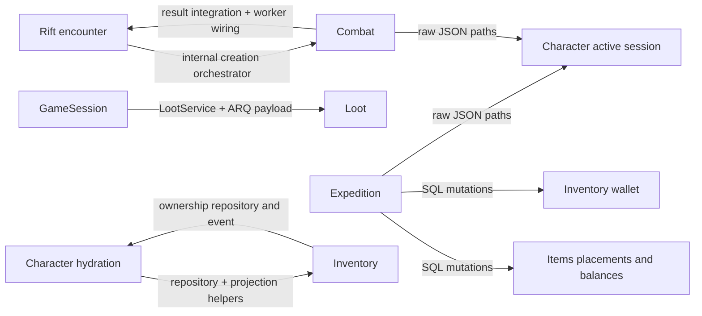

# Аудит 02/10 — DDD, архитектурные границы и архитектурный дрейф

Дата: 9 октября 2026 года. Sealed World / TurnBasedMMORPG. Базовый HEAD: `6ccc92561c633f618eb7ee082c36caa44a1400f7`.

Объект — текущее рабочее дерево, включая существующие staged/unstaged изменения, а не чистый HEAD. Реализация, конфигурации и skills в рамках аудита не исправлялись. Все пути ниже относительно корня репозитория; `:N` — строка в исследованном дереве. Статические факты, архитектурные оценки и непроверенные риски разделены.

**Graphify не использовался, пересборка не выполнялась.** Старый `graphify-out/` не является доказательством ни одной находки. Для задачи достаточно AST, поиска импортов, чтения контрактов и фактических вызовов. Все приведённые зависимости, оценки ownership и выводы о ядре проверены независимо от Graphify по текущим исходникам; старые результаты не изменялись.

## 1. Executive Summary

Фактическая архитектура — модульный монолит с выделенными worker-процессами и смешанными границами: Streams/request-reply, feature integrations, прямые вызовы сервисов и общий доступ к runtime/persistence. Она обеспечивает изоляцию части вычислений, но не обеспечивает заявленную независимость всех доменов.

Главная проблема — не число каталогов и не размеры файлов. **Внутренние схемы хранения и конструкторы соседних доменов стали контрактами потребителей.** Expedition меняет предметы, ресурсы и прогресс персонажа; Combat финализирует результат с прямой сборкой Rift; GameSession собирает LootService и его ARQ payload; Character строит проекцию через внутренние Inventory helpers. Изменение этих внутренних деталей требует согласованных правок в нескольких доменах.

Результат: **10 подтверждённых находок: 3 High, 6 Medium, 1 Low; Critical не подтверждены.** Это не утверждение об отсутствии критических ошибок за пределами охвата. Гонки, потери наград и повторное применение результатов не объявлены доказанными: для них нужны отдельные fault/concurrency-тесты.

Положительный результат: `CombatResolver` уже имеет сохранённый facade при переходе файла в пакет; реальный executor используется in-memory симуляцией. **41 выбранный тест resolver/tunables/simulation прошёл за 2,82 с**, без настоящих PostgreSQL, Redis, MongoDB и HTTP. Для native binding граница перспективна, но ещё зависит от Python DTO, каталога правил, генератора случайных чисел и контекстных настроек. Выделение всего Combat в процесс существенно сложнее замены resolver.

Статический граф: **23 feature-каталога, 821 Python-файл, 78 направленных межfeature-рёбер, 265 import statements**. Один SCC из 11 feature-доменов не означает Python import failure или бесконечную рекурсию. В отдельном анализе runtime top-level module imports межfeature SCC не найдено; это ограниченный статический результат, а не доказательство отсутствия runtime/event cycles.

## 2. Методология и охват

Начальная карта — `audit/01_project_inventory.md`, прежде всего архитектурная карта, зависимости, ownership, skills и индекс. Существенные выводы перепроверены по исходникам. Прочитаны project/backend/quality skills и применимые references: project-rules, feature-architecture, backend-layout, storage-ownership, event-bus, redis-streams, testing; дополнительно combat snapshots и rift implementation-boundaries.

Метод:

1. AST всех `src/backend/features/**/*.py`: абсолютные и относительные импорты; отдельная классификация top-level, `TYPE_CHECKING`, function-local imports. Один import statement с несколькими именами одного target считается один раз для пары source/target/file/line.
2. Проверка `importlib`, `__import__`, ленивых импортов и реестров. Поиск literal `importlib`/`__import__` в features/core не дал совпадений. Ленивые `__getattr__`/function-local imports существуют, например `combat/services/__init__.py:10`. Router registration явно задан в `core/containers/redis.py:11` и `:166`. Отсутствие строк поиска не исключает произвольную рефлексию.
3. Ручной проход по API/dependencies → service/runtime → integration → repository/manager, плюс producer → handler и ARQ enqueue → worker registration. Граф импортов дополнен графом транспортных и persistence-связей; эти графы не смешаны в одной метрике.
4. Проверка всех трёх заданных взаимных пар, цепочек Expedition/GameSession/Items/Monsters/Loot/Scenario, общей инфраструктуры, shared и composition roots.
5. Чтение тестовых doubles, bounded запуск выбранных тестов и проверка ссылок отчёта. Полная suite и production-инфраструктура не запускались.

Степень охвата: полный статический import scan backend features; углублённый анализ ключевых междоменных потоков; выборочная проверка остальных feature entrypoints. Это не line-by-line аудит 821 файла и не повтор инвентаризации frontend/studio/chat. Frontend проверен на обратные импорты backend features и использование shared; прямых текстовых импортов `src.backend.features` там не обнаружено.

## 3. Фактическая карта зависимостей

### 3.1. Полный агрегированный граф Python imports

Число в скобках — число import statements, включая type-only и локальные; не частота вызовов. Всего: 215 top-level runtime, 41 TYPE_CHECKING, 9 function-local. Внутридоменные импорты исключены из таблицы.

| Источник | Цели |
| --- | --- |
| admin_players | character (2), items (5), moderation (1), monsters (5) |
| arena | character (3) |
| character | expedition (3), game_catalog (5), inventory (4), monsters (1) |
| city_services | character (1), exploration (1) |
| combat | character (12), expedition (1), game_catalog (19), inventory (1), items (5), loot (2), monsters (12), rift (3) |
| expedition | character (3), combat (1), inventory (2), items (2) |
| exploration | combat (1), expedition (1), game_catalog (1), monsters (3), world (1) |
| game_catalog | character (1), items (1), monsters (4) |
| game_config | — |
| game_lobby | character (9), expedition (2), inventory (3), items (6), moderation (1), rift (2) |
| game_session | character (8), combat (1), expedition (1), game_lobby (1), inventory (1), items (2), loot (2), npc (2), rift (2), scenario (2) |
| generation_ai | items (1), monsters (1), world (1) |
| inventory | character (3), items (7) |
| items | character (1), generation_ai (7) |
| loot | expedition (2), items (5) |
| moderation | — |
| monsters | character (11), game_catalog (1), generation_ai (15), items (9) |
| npc | — |
| rift | combat (5), generation_ai (3), items (3), loot (1), monsters (8) |
| scenario | character (4), city_services (1), inventory (1), items (3), npc (2), rift (1), world (2) |
| system | character (1), exploration (1), inventory (1), loot (1), rift (1) |
| tavern | —; пустой feature |
| world | generation_ai (10) |

SCC: `character, combat, expedition, game_catalog, generation_ai, inventory, items, loot, monsters, rift, world`. GameSession имеет наибольший feature fan-out — 10; это повод исследовать ответственность, а не само по себе нарушение. Единственный агрегированный SCC включает registry и DTO edges, поэтому его нельзя трактовать как один runtime aggregate.

### 3.2. Транспортный слой, отсутствующий в import-only графе

В таблице сокращение `B/` = `src/backend/features/`. Это наблюдавшиеся отправители и обработчики, а не предположение по имени события.

| Поток | Контракт | Отправитель → обработчик / регистрация |
| --- | --- | --- |
| Scenario → Rift | `rift.entry_requested` | `B/scenario/integrations/system_integrator.py:274` → `B/rift/events/__init__.py:38` |
| Scenario → Combat | `combat.session_requested` | `B/scenario/integrations/system_integrator.py:682` → `B/combat/events/__init__.py:27` |
| Scenario / Exploration → Monsters | `monsters.group_prepare_requested` | `B/scenario/integrations/system_integrator.py:732`, `B/exploration/integrations/encounter_integration.py:255` → `B/monsters/events/__init__.py:57` |
| Combat / Arena → Character | `character.combat_commitments_requested` | `B/combat/integrations/system_integrator.py:80`, `B/arena/integrations/stream_client.py:34` → `B/character/events/__init__.py:109` |
| Scenario → Inventory | `inventory.rewards_grant_requested` | `B/scenario/integrations/system_integrator.py:342` → `B/inventory/events/__init__.py:43` |
| Inventory / Loot → Items | `items.generate_requested` | `B/inventory/services/reward_service.py:122`, `B/loot/integrations/loot_integration.py:130` → `B/items/events/__init__.py:47` |
| Combat → Inventory | `inventory.durability_damage_requested` | `B/combat/workers/tasks/victory_finalizer_task.py:150` → `B/inventory/events/__init__.py:97` |
| Inventory → Character | `character.gear_score_recalculate_requested` | `B/inventory/integrations/stream_client.py:21` → `B/character/events/__init__.py:184` |
| GameSession → System worker / Loot | `loot_claim_task`, dict с `claims`, `char_id`, `summary_items` | `B/game_session/integrations/session_integrator.py:295` → `B/system/workers/arq.py:17`, `:25` |
| GenerationAI → worker → feature task handler | durable task id / зарегистрированный task kind | `B/generation_ai/services.py:232` → `B/generation_ai/workers/tasks.py:17`; registry `B/generation_ai/bootstrap.py:23` |

Streams здесь действительно убирает необходимость вызова internal service отправителем. Но request/reply остаётся зависимостью доступности и payload-контракта. Само наличие транспорта не гарантирует idempotency, bounded latency или корректность повторной доставки.

### 3.3. DI и скрытые связи через storage



`src/backend/core/containers/game.py:54` собирает World/GenerationAI/Monsters/Items/Rift с общей SQL session, выполняет materialization и commit (`:158`), затем scheduling (`:159`). Это допустимое место composition и startup work; сам импорт concrete implementations в composition root не нарушает Clean Architecture. Но преобразование population rules внутри bootstrap (`:95`) — место будущего переноса в feature-owned bootstrap, если оно продолжит расти.

Иная ситуация в `src/backend/features/game_session/dependencies.py:34`: wiring допустим, но знание конструкторов, repositories и schema соседей остаётся распределённым контрактом. Ещё сильнее это выражено в бизнес-worker `combat/workers/tasks/victory_finalizer_task.py:191`: он сам собирает Rift stores, SQL repository, Mongo repository и restore lock. Это не просто техническая регистрация задач.

### 3.4. Направление слоёв в основных исследованных доменах

| Домен / поток | Фактическое направление и оценка |
| --- | --- |
| Combat | API → runtime orchestrator → session service → integrations/managers; отдельно engine DTO → steps. Основной runtime разделён; finalizer выходит за эти границы (A02-02/03) |
| Character | Events/API → services/integrators → repositories и active-session manager; hydration выходит в Inventory helpers, regen также исполняется manager-ом (A02-04/06) |
| Inventory | API/service → repository/session manager и Character state; reward service знает Streams напрямую. `src/backend/features/inventory/services/reward_service.py:36` явно описывает ownership placement, но не все внешние writers ему следуют |
| Expedition | Application lifecycle → SQLAlchemy models нескольких доменов + Redis manager; доменная orchestration и persistence не отделены (A02-01/03) |
| GameSession / GameLobby | Routing/entry → semantic integrators, но DI собирает чужой repository graph (`src/backend/features/game_session/dependencies.py:39`–`:100`). Для входа широкая orchestration закономерна; чужие implementation contracts — нет |
| Rift | API/dependencies → runtime/encounter services → Rift integration/stores; запуск encounter внедряет внутренние Combat/Monsters builders (`src/backend/features/rift/dependencies.py:114`) |
| Items | Events → generation service → ItemFactory + ItemPersistenceIntegration + GenerationAI. `src/backend/features/items/services/generation_service.py:1` показывает отдельные generation/persistence collaborators; необходимо сохранять это разделение, не переносить Item generation в callers |
| Monsters | Group service → ClanFactory → generation builder; builder обращается к repository и ItemGeneration (`src/backend/features/monsters/runtime/generation_builder.py:70`, `:152`, `:217`, `:282`). Название runtime здесь не означает pure engine: это IO orchestration. Extractable unit — calculation/building substep, не весь builder |
| World / GenerationAI | World generator → WorldDataIntegration + task specs/GenerationAI; registry возвращает управление feature-owned handlers. Обратные registration imports допустимы в composition, но привязывают общий bootstrap к набору features |
| Loot | Service/integration → runtime corpse manager; worker → SQL transfer + Expedition. Worker содержит игровые правила holder/wallet, поэтому исключение для чистого technical plumbing не применимо |
| Scenario | ScenarioService → director/evaluator/formatter и system integration (`src/backend/features/scenario/services/scenario_service.py:19`); outbound events отделены от service. Formatter имеет локальные catalog зависимости, не выдаваемые за независимый вычислительный kernel |
| Arena / Exploration / City services | Проверены outbound integrations и events: semantic requests владельцам Character/Monsters/Combat. Полная внутренняя бизнес-логика этих доменов не покрыта данным углублённым проходом |

В частности, low-level адаптер вправе импортировать domain DTO; нарушение определяется исполнением чужих бизнес-решений или раскрытием внутренних contracts, а не правилом «любой infrastructure import плох».

## 4. Подтверждённые нарушения границ

Нормативная база — `.agents/skills/turnbasedmmorpg-project/references/project-rules.md` (Ownership/Boundaries/Shared Contracts), backend `feature-architecture.md` (integrations, запрет чужих internal services/runtime, Redis ownership) и `event-bus.md` (thin handlers). Ни одинаковая структура каталогов, ни обязательный Protocol для каждого класса не требовались.

| ID | Нарушение | Почему это содержательный дефект |
| --- | --- | --- |
| A02-01 High | Expedition меняет чужие persistent aggregates | Знает ItemPlacement/ResourceBalance/ResourceWallet и progression repositories; меняет правила переноса и учёта вне владельцев |
| A02-02 High | Combat ↔ Rift: чужая сборка и несколько completion entrypoints | Внутренний Combat constructor graph известен Rift, Rift constructor graph — Combat worker; результат применяют несколько потребителей |
| A02-03 High | Active session JSON schema стала междоменным API | Expedition/Combat/GameSession задают storage paths, состояния и dirty paths; изменение character storage требует совместных правок |
| A02-04 Medium | Character hydration зависит от внутренней Inventory projection | Character потребляет ORM tuples и builders вместо готового контракта проекции |
| A02-05 Medium | GameSession владеет частью Loot use case и worker payload | Старт claim, формирование payload, имя ARQ task и transition распределены между доменами |
| A02-06 Medium | Character gameplay policy в storage manager и общих core calculators | Manager выполняет regen/refresh policy, core выбирает player/monster формулы; общий слой знает бизнес-различия |
| A02-07 Medium | Event adapters смешаны со сборкой/обработкой use case; transport в service | Повторяются error/ack/reply/wiring; InventoryRewardService знает timeout и Items reply shape |
| A02-08 Medium | Backend runtime DTO размещены в shared | `InventoryRuntimeSessionDTO` содержит dirty/version/runtime поля и используется Redis manager; frontend-потребителя этого типа не найдено |
| A02-09 Medium | AI simulation module объединяет независимые обязанности | Persistence, scheduling, policy loading, training/scoring, roster building, reporting; live AI worker импортирует private helper этого модуля |
| A02-10 Low | Skills отстают от стадии/физической структуры | Rift ограничен ранним harness в инструкции; combat reference указывает прежний resolver.py |

Тяжесть оценивает ущерб изменяемости и независимому развитию, а не предполагаемый production-инцидент. Полные доказательства, исправления и проверки — §11.

## 5. Взаимные зависимости и циклы

### Character ↔ Inventory

Character → `character/integrations/character_state_integrator.py:244` вызывает Inventory repository, получает `(instance, placement)`, затем `:251`–`:253` использует `runtime_item_from_instance`, `build_runtime_session`, `build_active_character_projection`. Это внутренние repository/service helpers, а не объявленный внешний Inventory use case. Изменение ORM результата или projection builder затрагивает Character. Ownership hydration принадлежит Character, но алгоритм item projection должен принадлежать Inventory.

Обратная связь: `src/backend/features/inventory/dependencies.py:9` и `:32` внедряет CharacterRepository; `inventory/api/router.py:31` использует ownership query. Дополнительно `inventory/integrations/stream_client.py:21` публикует character event — это подходящий междоменный контракт. Взаимная бизнес-зависимость понятна: экипировка влияет на персонажа, персонаж владеет инвентарём. Прямой recursive вызов Character → Inventory → Character в проверенной hydration-цепочке не найден. Устранить вредную часть можно Inventory-owned projection query и Character-owned ownership query; общую транзакцию не нужно разрушать ради транспорта. Трудоёмкость средняя, A02-04.

### Combat ↔ Rift

Rift → `src/backend/features/rift/dependencies.py:137` собирает `CombatCreationOrchestrator`, `CombatLifecycleService`, `CombatSystemIntegrator`, `CombatLootPreorderService`; `rift/services/encounter_service.py:110` вызывает `create_from_request`. Экспорт класса из пакета не превращает внутренний orchestration graph в устойчивый внешний API.

Combat → `src/backend/features/combat/integrations/system_integrator.py:234` и worker `combat/workers/tasks/victory_finalizer_task.py:172` применяют Rift result. Третье место — `src/backend/features/game_session/integrations/session_integrator.py:335`. `RiftRuntimeIntegration.apply_combat_result` — семантическая граница, но ручная сборка её storage-зависимостей Combat worker-ом разрушает заменяемость реализации.

Это **цикл игрового workflow** «войти в бой → закончить бой → вернуться в Rift», а не доказанная рекурсия. `src/backend/features/rift/integrations/runtime.py:410`–`:416` проверяет active encounter, `:479`–`:493` снимает связь, поэтому последовательные дубли имеют защиту. Атомарность конкурентного применения несколькими entrypoints не доказана. Нельзя записывать «двойная награда» как подтверждённый дефект. Минимум: публичный Combat start port/factory; один владелец completion policy с общим idempotent Rift apply contract; retries могут иметь несколько доставщиков. Сложность высокая, A02-02.

### GenerationAI ↔ World

`src/backend/features/world/services/generator_service.py:6` зависит от GenerationAI service; `world/tasks_ai.py:7` — от DTO/registry. Обратное ребро `generation_ai/bootstrap.py:15` регистрирует World task handler, вместе с Items и Monsters (`:9`, `:12`, `:23`). Это extension registration; оно не означает, что генератор рекурсивно вызывает собственный consumer.

Registry допускает разные task implementations и сохраняет domain-owned handlers. Нежелательная сторона — добавление домена требует менять центральный GenAI bootstrap. **Observation O02-01**, а не архитектурная авария: перенос списка регистраций в application composition root может убрать обратное ребро без нового транспорта и без изменения механики задач. Малый/средний объём; публичность service API следует закрепить отдельно.

### Expedition, GameSession, Items, Monsters, Loot, Scenario

* Expedition → Items/Inventory/Character — не только imports, но SQL writes (§11 A02-01); общий unit of work оправдан для атомарного перемещения, размещение чужих правил в Expedition — нет.
* GameSession → Loot — local import `LootService` (`session_integrator.py:267`), claim (`:278`), ARQ (`:295`), active-session transition (`:306`). Это дополнительная orchestration surface, A02-05.
* Loot → Items через `items.generate_requested` в `loot/integrations/loot_integration.py:130` сохраняет feature boundary; однако `src/backend/features/loot/workers/tasks/loot_claim_task.py:214` напрямую обновляет ItemPlacement, `:248`–`:269` — ResourceWallet. Это дополнительное проявление ownership-проблемы A02-01. Общая SQL transaction и проверки повторов полезны; сами по себе они не инкапсулируют правила владельца.
* Monsters → Items/GenerationAI образует content construction workflow; сильнее связывают внутренние Character math keys в `src/backend/features/monsters/resources/traits.py:8` и Character runtime imports. При изменении actor math следует проверять Monsters, а не считать его независимым по имени каталога.
* Scenario → Rift/Combat/Monsters/Inventory преимущественно через семантический integration с events (§3.2). `src/backend/features/scenario/engine/formatter.py:6`–`:7` напрямую зависит от Character resources и ItemCatalogService: локальная связь представления/каталога, не доказательство записи чужого aggregate.
* `system/workers/arq.py:25` — реестр задач, а не доменный диспетчер, принимающий решения за все features. Размещение нескольких worker functions в одном процессе допустимо.

## 6. God Objects и cohesion

Метрики ниже получены из текущих файлов AST/подсчётом строк; число методов включает private helpers. Imports — уникальные `ImportFrom.module`, включая type/local; это вспомогательный показатель, не измерение runtime coupling.

| Кандидат | Измерение и обязанности | Вердикт и естественная граница |
| --- | --- | --- |
| CombatAiSimulationRunService / модуль | 2 148 строк модуля, 23 метода основного класса, 17 импортируемых модулей; CRUD run, очередь, policy, simulation, training, scoring, report | Подтверждён низкий cohesion модуля, A02-09. Пакет `ai_simulation/{runs,live,training,scenarios,reports,policy_mapping}` с прежним facade оправдан уже сейчас |
| ExpeditionService | 804 строки, 31 метод, 21 import module; run lifecycle + чужие SQL transfers + corpse + progression + Redis + respawn | Реальный междоменный концентратор. Сначала выделять owner contracts, затем package lifecycle/rewards/death; простое перемещение методов не исправит A02-01/03 |
| CombatSessionService | 732 строки, 43 метода, 14 import modules; API use cases, intent, results/recovery | Не доказанный God Object: есть store, turn manager, view, result archive делегаты (`session_service.py:46`, `:75`). Не дробить только по LOC; поддерживать эти seams |
| CombatLifecycleService | 538 строк, 25 методов, 10 import modules; подготовка actor/session snapshot, создание/cleanup | В основном cohesive lifecycle/projection. Возможный будущий пакет builders + lifecycle, но обязательное выделение сейчас не обосновано |
| CombatViewService | 1 653 строки, 71 метод, 9 import modules | Много presentation helpers, ответственность связная; размер не доказывает God Class. Выделять по самостоятельным view contracts при изменениях |
| CombatRuntimeOrchestrator | `runtime_orchestrator.py:16`–`:40` — маршрутизация view/result | Thin facade, не центр всех обязанностей Combat. Дополнительная абстракция сама по себе не дефект |
| GameSessionService / integrator | service: routing/entry/respawn/result; integrator 498 строк, 19 методов, 19 import modules; feature fan-out 10 | Часть fan-out естественна для session routing. Loot implementation и соседний constructor graph должны уйти за owner facades, A02-05; всю orchestration удалять не надо |
| ScenarioSystemIntegrator | 847 строк, 42 метода; несколько сценарных cross-feature flows | Cohesion по сценарию сохраняется, но возможен пакет по семантическим clients. Сейчас Observation; доказательства самостоятельного God Object недостаточны |
| CombatResolver | facade + orchestrator + steps/support | Уже реализован принцип «файл → пакет при сохранении контракта». Дополнительное дробление не требуется |

Особенно показателен fan-in simulation-модуля: его использует не только admin simulation API/worker, но и live `src/backend/features/combat/workers/tasks/ai_turn_task.py:10`, импортируя `_policy_from_training_row`. Изменение отчёта/обучения затрагивает импортируемый live gameplay модуль. Это конкретнее, чем утверждение «2 148 строк — плохо».

## 7. Shared / contracts / infrastructure ownership

### Shared

В `src/shared` не обнаружено прямых импортов backend/frontend. API schemas действительно связывают стороны: например `PanelDTO` передаётся через `src/shared/schemas/character_status.py:8`, создаётся backend `character/services/status_service.py:12`. Нельзя автоматически объявлять его frontend-only view model по слову panel: здесь это реальный server-driven API contract.

`src/shared/security/passwords.py` используется backend security и frontend auth; metrics/logging — cross-cutting. Они шире буквального «only models/enums» в project skill, но не являются скрытым игровым доменом. **O02-02: допустимость shared cross-cutting utilities требует уточнения формулировки политики, а не механического удаления.**

Иная ситуация: `src/shared/schemas/inventory.py:86` содержит `InventoryRuntimeSessionDTO` с `risk_run_id`, `is_dirty`, `dirty`, `version`, `updated_at`. `src/backend/infrastructure/inventory/managers/session.py:20` читает его из Redis, `:25` записывает; Inventory services и Character projection работают с этим типом. Поиск типа в frontend не дал потребителя. Это конкретный backend runtime contract в shared, A02-08. Не переносить весь `inventory.py`: публичные view DTO должны остаться доступными клиенту.

`CombatModifiersDTO`/`CombatSkillsDTO` участвуют в вычислениях resolver. Их доступность через shared сама по себе не делает их wire ABI для Rust; перед extraction нужен отдельный snapshot contract, а не переиспользование всех Pydantic полей без проверки.

### Infrastructure и core

Импорт feature DTO инфраструктурным адаптером может быть нормальным направлением зависимости inward: например type-only `combat/managers/session.py:14`. Re-export actor-state models/repositories (`src/backend/infrastructure/actor_state/repositories/character.py:1`) сам по себе не дублирует таблицу или владельца. Но такая оболочка не изолирует consumer от Character repository contract.

`src/backend/infrastructure/actor_state/managers/session.py:419`–`:462` не только сериализует: выбирает vital profile, вызывает refresh/regen, ставит `fill_if_default=True`; `:545` обращается к private `_is_full`. Аналогичная orchestration regen есть в `character/integrations/character_state_integrator.py:261`. Вычислитель один, но policy entrypoints распределены между storage и feature, A02-06.

`src/backend/core/calculators/data/attribute_rule_profiles.py:24` устанавливает monster HP coefficient и удаляет regen; `:30`–`:45` выбирает player/monster profiles. Это чистая, тестируемая, но бизнес-логика в core, который по skill должен содержать infrastructure primitives. Разумный выход — feature-owned/shared backend calculation contract с явно согласованным владельцем правил, не frontend shared.

### Прямые RedisJSON операции из задания

В `expedition/service.py:194` и `victory_finalizer_task.py:294` операции выполняются через `CharacterSessionManager.patch_fields`, а не прямой Redis socket. Однако **это всё равно реальный обход schema ownership**: storage path задан вызывающим доменом. Вызов generic manager не выполняет требование «stable nested sections через semantic methods». Worker содержит игровые переходы/смерть/loot, поэтому техническое исключение для plumbing здесь неприменимо. Одобренное исключение в прочитанных правилах не найдено.

`CharacterSessionManager.patch_fields` (`src/backend/infrastructure/actor_state/managers/session.py:119`) использует non-transactional pipeline; `mark_dirty` — отдельное действие (`:130`). Это показывает отсутствие одной атомарной semantic operation на данном пути, но ещё не доказывает потерю state в реальном сценарии. Нужна отдельная concurrency/failure проверка; §11 не объявляет её результат заранее.

## 8. Testability и extraction readiness

### Выполненные проверки

Команда выбранного прогона:

```powershell
.venv\Scripts\python.exe -m pytest -o addopts= -p no:cacheprovider tests/backend/features/combat/runtime/engine/test_resolver_trigger_contract.py tests/backend/features/combat/runtime/engine/test_tunables.py tests/backend/features/combat/test_simulation.py -q
```

Итог: **41 passed in 2.82s, exit 0**. Запуск был ограничен внешним subprocess timeout 50 с. `-o addopts=` исключает глобальный coverage gate из точечной проверки; конфигурация и порог coverage не менялись. Это не full quality gate и не оценка общего покрытия.

Первые sandbox-прогоны останавливались на async setup; bounded диагностический повтор показал stack `socket.accept → _fallback_socketpair → asyncio.proactor_events._make_self_pipe → pytest_asyncio fixture`. Он прекращён по timeout 25 с. Затем тот же выбранный набор успешно прошёл в разрешённом запуске вне sandbox. Поэтому зависание не классифицировано как дефект симулятора. Тесты используют in-memory actors, fake managers и mocks, а не реальные сервисы. `tests/backend/conftest.py` содержит FakeRedisClient и отдельно mocked lifespan для API fixture; наличие этих doubles не подтверждает Redis Lua/транзакции.

### Четыре архитектурных эксперимента

| Изменение | Что уже помогает | Реальные препятствия и правки вне цели |
| --- | --- | --- |
| Только CombatResolver → Rust binding | `runtime/engine/resolver/__init__.py:25` имеет единственный resolve_exchange; orchestrator/steps не выполняют DB/Redis вызовы; контрактный тест проходит | Pydantic ActorStats/PipelineContext/InteractionResult; in-place mutation (`orchestrator.py:46`); catalog lookup (`support/trigger_activator.py:151`); глобальный random (`math_core.py:30`, `:38`); ContextVar tunables (`tunables.py:58`). Нужен adapter explicit input/output + rules/tunables/RNG state, сохранение trace/trigger semantics. Внешние изменения: tests, binding/package build; по возможности без Inventory/Rift изменений |
| Combat → отдельный процесс/контейнер | Уже есть event entrypoint, ARQ workers, snapshot-oriented runtime | Rift напрямую создаёт Combat orchestrator; Combat worker собирает Rift и Expedition; общие AC documents, commitments, SQL/Mongo providers; GameSession reconciliation; payloads/dictionaries не оформлены как отдельный versioned remote API. Изменятся Rift, GameSession, Character adapters, deployment/composition и retry contracts. Это не перенос одной папки |
| Заменить внутреннюю реализацию Rift | `RiftRuntimeIntegration` предоставляет semantic methods, apply checks encounter id | Потребители собирают его stores/repositories, узнают session keys/meta fields; Combat/GameSession знают completion metadata. Сначала Rift-owned factory/port и согласованная outcome schema. Замена generation алгоритма внутри Rift проще полной замены persistence/runtime |
| Combat и Inventory параллельно двумя агентами | Domain directories, event durability boundary, самостоятельные math tests | Общие Character active-session fields, shared inventory/modifier DTO, projections, item semantics, finalization/reward flows; изменение этих контрактов требует координации. Листовая работа в resolver и inventory layout возможна независимо, смена actor/item schema — нет |

Native readiness оценена только для **resolver**, не для всей AI training/simulation подсистемы. Отсутствие IO в вычислительном пути не делает функцию полностью чистой: mutable context, ambient tunables и RNG влияют на воспроизводимость. Их явное включение в boundary желательно перед binding, но не требует немедленного внедрения Rust.

Общий SQL session в монолите может быть преимуществом транзакционной целостности. Минимальное исправление ownership — owner-owned semantic methods с shared unit of work; автоматическая замена всех вызовов на Streams способна ухудшить атомарность. При следовании строгой event-only политике это решение следует явно согласовать, а не молча вводить исключение.

## 9. Архитектурный дрейф относительно project skills

| Правило / описание | Проверенный факт | Классификация |
| --- | --- | --- |
| Backend: не обращаться к чужим internal services/runtime | Rift вызывает Combat creation, GameSession создаёт LootService, Character использует Inventory helpers | Действующий инвариант нарушен, A02-02/04/05 |
| Redis key-space/schema ownership только у managers | Paths active session заданы Expedition/Combat/GameSession | Действующий инвариант нарушен, A02-03 |
| Event handlers — только transport, без manual wiring | Combat и Character handlers собирают зависимости/ack/errors | Действующий инвариант нарушен, A02-07; это не нарушение DDD автоматически, а конкретный обязательный adapter contract |
| services/runtime вызывают semantic integration, не request напрямую | InventoryRewardService делает Items request и разбирает reply | Действующий инвариант нарушен, A02-07 |
| Core — primitives, без game behavior | Attribute profiles содержат player/monster policy | Нарушение заявленного ownership, A02-06 |
| Shared — только stable cross-side contracts | Runtime inventory DTO; отдельно logging/security utilities | Runtime DTO — A02-08; utilities — неоднозначность политики O02-02 |
| Rift approved stage — local harness, no DB models | `rift/api/router.py:31`, `infrastructure/rift/models.py:12`, runtime repositories уже существуют | Устаревшее описание стадии, A02-10; не доказательство неавторизованной реализации |
| Combat snapshots reference: `runtime/engine/resolver.py` | Текущий resolver — package с прежним facade | Устаревший физический путь; сама эволюционная декомпозиция соблюдена |
| Snapshot/calculator ownership | Resolver получает ActorStats; snapshot/StatsEngine/BasePowerAssembler разделены | В основном подтверждено для исследованного пути; аудит формул/баланса не проводился |

Документированного актуального исключения, разрешающего raw JSON paths в рассматриваемых feature services/workers, не найдено. Одновременно история одобрений автора не восстановлена полностью, поэтому нельзя выводить из старого Rift skill, что текущий код «написан без разрешения».

Skills не редактировались: пользователь поручил аудит и отчёт. A02-10 и O02-02 — конкретные темы будущей актуализации, а не внесённые изменения.

## 10. Подтверждённые сильные решения

1. **Сохранённый facade при декомпозиции resolver.** `src/backend/features/combat/runtime/engine/resolver/__init__.py:3`, `:29`; реализация шагов в orchestrator/steps/support. Контрактный trigger test исполнился успешно. Это непосредственно соответствует принципу «файл → пакет», без массовой смены consumers.
2. **Реальный executor можно исполнять in-memory.** `src/backend/features/combat/runtime/simulation/simulator.py:39` принимает executor/intent provider/collector; `:50` запускает bounded loop. Прошли тесты реального executor, live stepping, limits, остановки и telemetry. Изолированная проверка поведения существует фактически.
3. **Настройки расчёта представлены snapshot.** `src/backend/features/combat/runtime/engine/tunables.py:15`, `:66`, `:74`: immutable dataclass, context manager с reset, отдельная async загрузка. Можно отделять Redis загрузку от math; тесты подтверждают defaults и restoration после exception.
4. **Семантические event clients уже работают как границы.** Arena/Exploration/Scenario/Loot отправляют задания владельцам (§3.2); отправителю не нужен их runtime constructor. Не следует заменять эти границы прямыми вызовами ради устранения event-кода.
5. **CombatSessionService уже делегирует.** `session_service.py:46`–`:79` разделяет queueing, view, archive, store. Утверждение «весь Combat — один God Service» не соответствует коду.
6. **Rift result имеет semantic gate.** `rift/integrations/runtime.py:410` проверяет active encounter и mismatch. Это полезная защита от последовательных повторов; её надо сохранить при централизации completion policy, дополнительно проверив concurrency.
7. **Composition root отделяет commit от scheduling.** `core/containers/game.py:158`–`:159`; `core/database/session.py:58` предоставляет manual-session context для такой последовательности. Наличие общего bootstrap не равно доменному god dispatcher.
8. **Shared API не зависит от backend реализаций.** Поиск обратных imports в shared/frontend не обнаружил direct backend-feature imports. Public DTO можно использовать клиентом отдельно от feature service classes. Исключение — misplaced runtime типы, а не полная несостоятельность shared.

## 11. Реестр находок с severity и доказательствами

Трудоёмкость — ориентир в инженерных днях с focused tests, не обещание срока. При изменении транспортной/транзакционной модели оценка растёт. Уверенность относится к наблюдаемой архитектурной связи, а не к недоказанной аварии.

### A02-01 — High — Expedition и Loot worker нарушают ownership persistent state

* Домены: Expedition, Loot, Items, Inventory, Character.
* Доказательства/цепочка: `src/backend/features/expedition/service.py:12`–`:18` → чужие модели/repository; `:372`–`:399` меняет ItemPlacement; `:402`–`:442` переносит ResourceBalance в ResourceWallet и пишет transactions; `:444`–`:465` использует Character progression/skill repositories; `:478`–`:549` переносит предметы/ресурсы в corpse.
* Второй writer: `src/backend/features/loot/workers/tasks/loot_claim_task.py:189` → ExpeditionService и SQL UoW, `:214` → update(ItemPlacement), `:248`–`:269` → wallet buckets. Правила классификации ресурсов по prefix присутствуют и здесь (`:167`), и в Expedition (`service.py:28`), поэтому владельца transfer/bucket policy особенно важно определить явно.
* Инвариант: feature владеет persistence/rules, взаимодействие через semantic boundary. Общее владение SQL session не разрешает дублировать правила соседей.
* Последствия: изменение placement/wallet/progression требует редактировать Expedition; unit tests вынуждены знать SQL/ORM соседей; один агент может сломать чужой transfer contract.
* Минимум: Inventory/Items-owned operations `secure_run_gains`/`move_run_gains_to_corpse`, Character-owned progression operation; передавать общий unit of work, сохранив transaction scope. Expedition остаётся orchestration владельцем run.
* Риск/трудоёмкость: высокий при переносе reward accounting, 4–7 дней. Не дробить commit на independent requests без отдельного решения.
* Уверенность: высокая. Дополнительные тесты: transfer conservation, repeated death/safe-sync, rollback на середине переноса, projection refresh после commit; реальные SQL constraints нужны в integration suite.

### A02-02 — High — Combat/Rift зависят от внутренних constructor graphs

* Домены: Rift, Combat, GameSession; косвенно Monsters/Loot.
* Доказательства: `src/backend/features/rift/dependencies.py:137` → CombatCreationOrchestrator + lifecycle + system + loot preorder; `rift/services/encounter_service.py:110` вызывает его; `combat/workers/tasks/victory_finalizer_task.py:191`–`:205` вручную собирает Rift SQL/Mongo/Redis dependencies. Completion callers: `combat/integrations/system_integrator.py:234`, finalizer `:172`, `game_session/integrations/session_integrator.py:335`.
* Инвариант: чужие internals не являются внешним API; implementation replacement должна локализоваться у владельца.
* Последствия: новый параметр/хранилище Rift меняет Combat; внутренний split Combat меняет Rift; completion policy и metadata интерпретируются несколькими потребителями.
* Минимум: Combat-owned start facade/factory; Rift-owned construction; один владелец completion policy и общий idempotent apply contract. Допустимы несколько retry/delivery adapters, но не несколько копий решений.
* Риск/трудоёмкость: высокий, 4–8 дней. Нельзя удалять recovery entrypoints без сценариев восстановления.
* Уверенность: высокая в coupling, средняя в оценке стоимости; race не подтверждён. Тесты: duplicates и параллельные completion/recovery, defeat/draw, restart между Combat finalization и Rift apply.

### A02-03 — High — RedisJSON schema активного персонажа протекает наружу

* Домены: Character, Combat, Expedition, GameSession.
* Доказательства: `src/backend/features/expedition/service.py:194`, `:606`, `:631`; `combat/workers/tasks/victory_finalizer_task.py:294`–`:313`; `game_session/integrations/session_integrator.py:306`. Все задают `$.sessions.*`, `$.state`/`$.location.*` и отдельные dirty paths → `src/backend/infrastructure/actor_state/managers/session.py:119`.
* Инвариант: storage keys/paths/TTL принадлежат manager, feature использует semantic operation.
* Последствия: внутренняя схема AC стала общим контрактом; storage migration затрагивает gameplay services и workers; transition и dirty marking не представлены одной semantic boundary.
* Минимум: Character-owned semantic operations для finalization/death/respawn/loot completion; manager инкапсулирует paths и согласованное dirty marking. Бизнес-решение о результате остаётся у feature, AC storage mutation — у owner.
* Риск/трудоёмкость: средний/высокий, 2–4 дня. Не обещает автоматически решить все гонки Redis.
* Уверенность: высокая. Тесты: старые observable state transitions, dirty targets, failure между patch и mark, конкурентный refresh/respawn/finalizer на реальном RedisJSON.

### A02-04 — Medium — Character зависит от внутренней формы Inventory hydration

* Домены: Character, Inventory.
* Доказательства: `src/backend/features/character/integrations/character_state_integrator.py:26`–`:27`, `:244`–`:254`; reverse repository wiring `inventory/dependencies.py:9`, `:32`.
* Цепочка: Character integrator → Inventory repository tuples → private-to-feature projection helpers → CharacterSessionItemsDTO; reverse ownership query → CharacterRepository.
* Инвариант: соседний внутренний repository/runtime representation не должен становиться внешним контрактом.
* Последствия: рефакторинг Inventory ORM/projection требует Character changes; изменение Character ownership query отражается на API соседнего feature.
* Минимум: Inventory-owned projection query и Character-owned ownership query; не переносить все repositories в shared. Event `gear_score_recalculate_requested` сохранить.
* Риск/трудоёмкость: средний, 2–3 дня. Уверенность высокая. Тесты: hydrate equipped/backpack/expedition items, ownership denial, empty inventory; unit contract + focused SQL integration.

### A02-05 — Medium — Loot orchestration частично находится в GameSession

* Домены: GameSession, Loot, System worker.
* Доказательства: `src/backend/features/game_session/integrations/session_integrator.py:263`–`:303`: local import LootService, claim_all, сборка claims, literal `loot_claim_task`; worker registration `src/backend/features/system/workers/arq.py:25`.
* Инвариант: use case и worker payload принадлежат feature; service consumer не собирает internal workflow соседа.
* Последствия: изменение Loot claim result/worker payload требует GameSession правок; retry/scheduling policy сложно проверить независимо от session transition.
* Минимум: Loot-owned claim-and-schedule semantic operation с типизированным результатом для routing; GameSession сохраняет решение следующего экрана. Не создавать CRUD wrapper.
* Риск/трудоёмкость: средний/высокий, 2–4 дня. Уверенность высокая. Тесты: empty claim, repeated claim, enqueue failure после reservation, отсутствие queue, transition только при допустимом outcome; реальный ARQ/Redis integration для retry.

### A02-06 — Medium — Gameplay policy смешана со storage/core

* Домены: Character, Inventory, Combat/Monsters calculators, actor_state infrastructure.
* Доказательства: `src/backend/infrastructure/actor_state/managers/session.py:419`–`:462`, `:506`, `:545` → CharacterVitalsCalculator/profile/private helper; `src/backend/core/calculators/data/attribute_rule_profiles.py:24`–`:45` → monster/player HP/regen rules. Второй regen orchestration path: `character/integrations/character_state_integrator.py:261`.
* Инвариант: infrastructure реализует persistence, feature владеет gameplay policy; core не содержит доменных правил.
* Последствия: storage operation способна изменить vitals по правилам/времени; изменение persistence adapter или math ownership требует знания игровых defaults; extraction core тащит Character internals.
* Минимум: Character service вычисляет обновлённые vitals через существующий calculator, manager атомарно сохраняет; backend calculation rules получают явного владельца и вход profile. Не дублировать формулы.
* Риск/трудоёмкость: средний, 2–4 дня. Уверенность высокая. Тесты: fixed-clock regen, equipment/max-vitals refresh, no double regeneration, roundtrip persistence; Redis integration для атомарного обновления.

### A02-07 — Medium — Transport adapters содержат use-case wiring и обратную утечку транспорта

* Домены: Character, Combat, Inventory/Items.
* Доказательства: `src/backend/features/combat/events/__init__.py:37`–`:57` создаёт graph и fail/reply flow; `character/events/__init__.py:73`–`:104` открывает UoW, собирает repos/services, формирует ack/failure; `inventory/services/reward_service.py:122`–`:135` напрямую request/timeout/parsing Items reply.
* Инвариант: обязательные thin handlers и semantic stream clients в backend skill.
* Последствия: обработчики сложно тестировать без app-state wiring; error/reply policy повторяется; изменение транспорта влияет на reward service.
* Минимум: owner-owned handler service/factory и outbound Items request adapter. Не переносить ack mechanics внутрь чистого domain engine.
* Риск/трудоёмкость: средний, 2–3 дня для показанных путей; полная миграция всех handlers отдельно. Уверенность высокая. Тесты: ack/error/correlation/timeout, failed reply delivery, повтор события; integration с Streams требуется для доставки, unit для use case.

### A02-08 — Medium — Inventory runtime schema в cross-side shared

* Домены: Inventory, Character projection, shared.
* Доказательства: `src/shared/schemas/inventory.py:86`–`:101`; `src/backend/infrastructure/inventory/managers/session.py:6`, `:20`–`:25`; `inventory/services/projection.py:22`–`:52`. Поиск `InventoryRuntimeSessionDTO` в frontend не дал совпадений.
* Инвариант: shared содержит cross-side contracts, не backend runtime internals.
* Последствия: dirty/version/Redis shape выглядит общим контрактом; internal storage refactor затрагивает общий schema module и провоцирует reuse не по назначению.
* Минимум: переместить только backend runtime/projection types к владельцу, оставить API view DTO в shared; обновить backend imports и контракт сериализации. Отсутствие frontend type reference — статическое свидетельство, не доказательство отсутствия внешнего неучтённого consumer.
* Риск/трудоёмкость: низкий/средний, 1–2 дня. Уверенность высокая в текущем репозитории. Тесты: Redis roundtrip и frontend/API response contract; production data migration только если меняется shape, а не Python path.

### A02-09 — Medium — Simulation module имеет несколько независимых причин изменения

* Домен: Combat, admin simulation и live AI worker.
* Доказательства: `src/backend/features/combat/services/ai_simulation_service.py:54` persistence/run facade; `:174` scheduling; `:473` live execution; `:914` synthetic training; `:975` battle training; `:1231` scenarios; `:2027` policy conversion; `:2072`, `:2108` reports. Live consumer: `combat/workers/tasks/ai_turn_task.py:10` импортирует `_policy_from_training_row`.
* Инвариант: cohesion и независимые leaf responsibilities, внутренний helper не должен быть неявным API другой подсистемы.
* Последствия: admin report/training и live AI разделяют import surface; изоляция изменений и ревью нескольких агентов затруднены. Это не утверждение, что каждый метод класса принадлежит чужому домену.
* Минимум: пакет с сохранённым facade; policy conversion выделить в явный общий Combat contract; training/scenarios/reports отделить от run storage orchestration.
* Риск/трудоёмкость: средний, 2–4 дня. Уверенность высокая. Тесты: существующие simulation/admin/worker contracts плюс policy mapping; live worker не должен импортировать training/report implementation. Новая инфраструктура не нужна.

### A02-10 — Low — Architecture guidance содержит устаревшие anchors

* Домены: Rift, Combat, project skills.
* Доказательства: `.agents/skills/turnbasedmmorpg-rift/references/implementation-boundaries.md:1` описывает initial harness/no DB; `src/backend/infrastructure/rift/models.py:12` и `src/backend/features/rift/api/router.py:31` — фактическая более поздняя реализация. `.agents/skills/turnbasedmmorpg-combat/references/snapshots.md:8` указывает прежний resolver.py, фактически `runtime/engine/resolver/__init__.py`.
* Инвариант: агенты должны получать актуальную границу разрешённой реализации и устойчивые navigation anchors.
* Последствия: будущие агенты могут ошибочно запрещать обычную работу или принимать старый план за текущую архитектуру.
* Минимум: сверить актуальные owner decisions, обновить stage summary и physical links, сохранить историческую стадию как историю. Не выводить approved decisions из одного существования кода.
* Риск/трудоёмкость: низкий, 0,5–1 день после получения источника решения. Уверенность высокая в расхождении, неполная в истории авторизации. Runtime-тест не нужен; нужны link check и review владельца правил.

### Наблюдения вне списка дефектов

* **O02-01:** GenerationAI registry registration — допустимая extension wiring с централизованным editing point (§5); перемещение composition необязательно сейчас.
* **O02-02:** shared security/logging/metrics — полезные cross-cutting modules при более узком буквальном skill; решить policy, не удалять автоматически.
* **O02-03:** readiness native resolver ограничена ambient RNG/catalog/tunables; это препятствие планируемой extraction, не требование сейчас внедрять иной язык.
* **O02-04:** конкурентное Rift completion и patch/dirty partial failures требуют integration proof. Нельзя считать corruption подтверждённым.
* **O02-05:** `src/backend/features/loot/workers/arq.py:27` и `system/workers/arq.py:53` используют SYSTEM queue с разными registries; текущий `deploy/compose.game.yml:186` запускает SystemArqSettings. Не доказана одновременная работа несовместимых consumers; это latent config risk при выборе другого entrypoint.

## 12. Предлагаемый порядок исправления

1. **Закрепить наблюдаемые контракты A02-01/02/03/05 тестами перед переносом:** ownership/transfers, finalization, death/respawn, claim/retry. Согласовать владельцев state transition и unit of work. Не начинать с массовой смены каталогов.
2. **Закрыть AC schema boundary (A02-03)** семантическими операциями и contract tests. Это уменьшает общую поверхность параллельной работы.
3. **Изолировать persistent mutations Expedition (A02-01)**, сохранив общую SQL transaction и accounting invariant. После этого можно безопаснее разделять death/reward flows.
4. **Стабилизировать Combat ↔ Rift (A02-02)**: start facade/factory, completion policy, recovery/idempotency tests. Только затем оценивать процессное выделение Combat.
5. **Вернуть Loot claim orchestration владельцу и Inventory projection в контракт (A02-05/04)**. Уменьшить constructor knowledge GameSession, не ломая navigation.
6. **Устранить локальное смешение слоёв (A02-06/07/08)**, затем декомпозировать AI simulation по обязанностям (A02-09). Не превращать каждую CRUD-функцию в отдельный gateway.
7. **Актуализировать skills (A02-10, O02-02)** с owner decisions. Добавить узкие architecture checks: запрет новых foreign internal imports вне утверждённого wiring, raw JSON paths вне managers, backend runtime DTO в shared. Допустимые исключения описывать конкретно, не глобальным wildcard.

Для native resolver достаточно отдельного этапа: explicit calculation snapshot + RNG/rules/tunables → parity corpus → binding. Для отдельного Combat процесса сначала устранить A02-02/03/05 и определить ownership сохранения результата; микросервисный редизайн для этого аудита не предлагается.

## 13. Неопределённости и ограничения аудита

* AST импортов не является точным call graph: учитывает неисполняемые/type-only ветки; не охватывает все значения, конструируемые рефлексией. Transport overlay подтверждён по показанным ключевым потокам, не является исчерпывающим каталогом всех сообщений.
* Нулевое число межfeature SCC в top-level module scan не доказывает отсутствие runtime recursion, deadlock request/reply или ошибочной очереди. Проверенных оснований утверждать такие дефекты нет.
* Не проверены production retries, Redis Lua atomicity, transaction isolation, crash recovery, внешние consumers и deployment settings. Конкурентные state corruption гипотезы вынесены в observations.
* Полная test suite, coverage, performance, security review и correctness боевых формул вне задачи; успешные 41 тест не сертифицируют остальные домены.
* Размеры/строки относятся к изменённому рабочему дереву на дату проверки. Репозиторий не фиксировался новым commit; последующие изменения могут сдвинуть anchors.
* Нет полной истории owner approvals Rift. Старая инструкция классифицирована как drift, а не основание отменять реализацию.
* Graphify не использовался и не пересобирался. Ни одно ребро из старого Graphify не перенесено в реестр дефектов. Вся карта и все существенные выводы получены независимо.

### Architecture Health Summary

| Направление | Оценка по доказательствам |
| --- | --- |
| Domain isolation | **Частичная, требует исправления междоменных writes.** Event boundaries работают (§3.2), но Expedition/Character/GameSession потребляют чужие internals (A02-01/04/05) |
| Dependency direction | **Неоднородная.** Вычисления отделены от IO; storage/core содержат gameplay policy, handlers и services смешивают transport (A02-06/07) |
| Contract stability | **Средняя для facade/API, низкая для runtime storage.** Resolver import сохранён; AC JSON paths и соседние constructor graphs протекают наружу (A02-02/03) |
| Testability | **Хорошая у проверенного combat kernel, ограниченная у cross-store flows.** 41 тест прошёл; concurrency/SQL/Streams границы требуют отдельных integration tests |
| Parallel development readiness | **Приемлема для локальных leaf changes, слабее для schema/lifecycle changes.** Общие AC/Inventory DTO и distributed completion требуют координации (A02-02/03/08/09) |
| Native engine extraction readiness | **Перспективна для CombatResolver после явного data/RNG/rules contract.** Facade и in-memory executor подтверждены; весь Combat пока не готов к независимому процессу без изменений потребителей (§8) |

Аудит формирует план исправлений, но не реализует его. Приоритет — восстановить ownership и устойчивые семантические контракты, сохранив работающие вычислительные и событийные границы.
