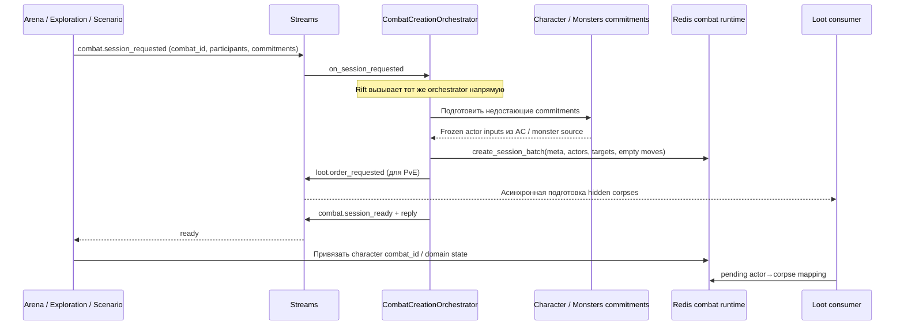
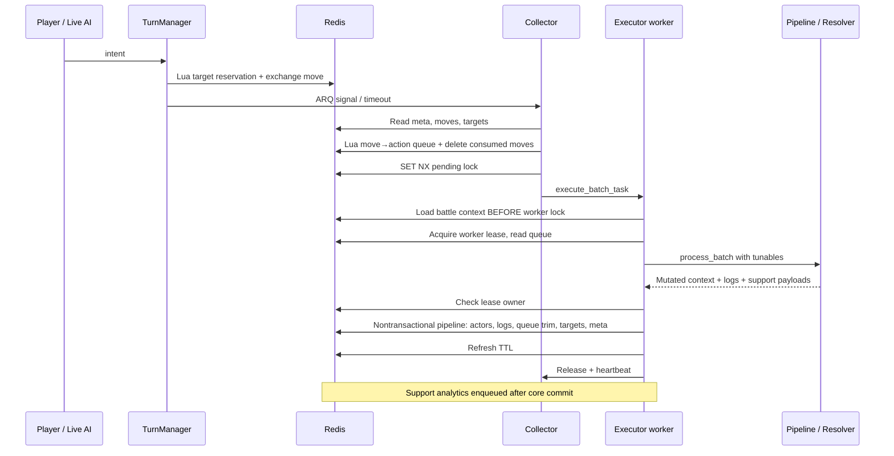
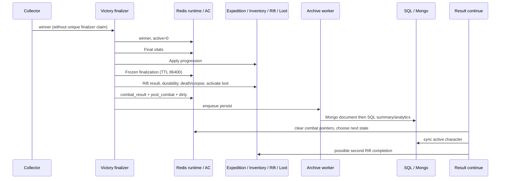

# Аудит 03/10 — Combat Engine, Runtime и жизненный цикл боя

Дата: 9 октября 2026 года. Базовый HEAD: `6ccc92561c633f618eb7ee082c36caa44a1400f7`. Объект: текущее рабочее дерево Sealed World / TurnBasedMMORPG, включая ранее существовавшие изменения. Это исследовательский аудит: исходники, тесты, конфигурации и skills не исправлялись. Добавлен только этот отчёт. Пути ниже относительны корню репозитория; `:N` обозначает строку проверенного файла.

## 1. Executive Summary

Вычислительное ядро и жизненный цикл имеют разную степень надёжности. У ядра есть отдельный resolver, явный pipeline и in-memory executor, используемый симуляцией. Но завершение боя не является единой восстанавливаемой операцией: повторный finalizer повторно начисляет опыт, ошибка после `active=0` может оборвать выдачу результата, а запись exchange несколькими Redis-командами не обеспечивает заявленную атомарность.

Выделено **9 новых дефектов/подтверждённых failure contracts: 4 High и 5 Medium**, а также **4 группы непроверенных рисков: 1 High и 3 Medium**. Critical не подтверждены. Отдельно локально воспроизведено применение crit-bleed при парировании (A03-13). Это не означает, что все failure scenarios были запущены на настоящей инфраструктуре.

Приоритет стабилизации — идемпотентность результатов и согласованное сохранение runtime, затем доставка отложенных результатов и проверки отказов. Массовый перенос каталогов или смена языка этих проблем не решают. Архитектурные замечания A02-02/03/06/07/09 не переименованы в новые дефекты; ниже отделены новые поведенческие доказательства от уже известного нарушения ownership.

Термин «подтверждено по коду» означает установленную ветку и последствия при явно заданных входах/сбое. Это не утверждение, что такой инцидент наблюдался в production. Конкурентные повреждения и вероятность отказов без управляемого интеграционного эксперимента остаются рисками.

## 2. Методология и охват

Прочитаны AGENTS.md, навыки экономичного делегирования, Combat, Backend, Quality, Rift и правила диагностических работ; применены соответствующие references. Навигация: `audit/01_project_inventory.md`, `audit/02_architecture_boundaries.md`. A02-02/03/06/07/09 перепроверены по актуальному коду. Устаревший Graphify не читался и не регенерировался.

Работа разделена на независимые проверки ядра, Redis/workers, AI/tests и интеграции ведущим. Существенные выводы о финализации, Redis commit, создании, Rift и Loot повторно сверены ведущим по исходникам. Анализ — чтение исполняемых путей, поиск callers, проверка DTO и реальных Redis-команд, инспекция существующих тестов и ограниченные попытки их запуска (§9). Это не полный аудит безопасности, нагрузочный тест или повторный аудит соседних доменов.

Сокращения файлов в тексте: `combat/...`, `character/...`, `rift/...` и имена соседних feature — под `src/backend/features/`; `infrastructure/...` — под `src/backend/`; одиночное `manager` в разделах runtime — `src/backend/infrastructure/combat/managers/session.py`; `executor_task.py`, `collector_task.py`, `victory_finalizer_task.py`, `ai_turn_task.py`, `ai_simulation_task.py`, `finalization_persist_task.py` — `src/backend/features/combat/workers/tasks/`; `session_integration.py` — `combat/integrations/`; `system_integrator.py` без иного префикса — `combat/integrations/`; `inventory_service.py` — `inventory/services/`. Engine-файлы в §4/А03-13 указаны относительно `src/backend/features/combat/runtime/engine/`. Эти сокращения не обозначают другие одноимённые модули.

Проверены публичные combat endpoints, инициаторы Arena/Exploration/Scenario/Rift, commitments Character/Monsters, live worker graph, вычислительный pipeline, архив результата, XP/Expedition, durability/Inventory, preorder/activation/claim Loot. Источники deployment: `src/backend/core/arq.py:11`, `combat/workers/arq.py:25`, `combat/workers/ai_simulation_arq.py`.

Git первоначально отказал в чтении из-за владельца checkout; статус прочитан с разовым `-c safe.directory=...`, без изменения глобальной конфигурации. В дереве много пользовательских staged/unstaged файлов; аудит их не очищает и не включает в свои результаты.

## 3. Combat lifecycle и sequence diagrams

### 3.1. Создание



Реальные входы:

| Инициатор | Цепочка и контракт | Точка отказа |
| --- | --- | --- |
| Arena | `arena/services/duel_service.py:446,467` → stream client `:27` → `combat.session_requested`; ready handler `arena/events/__init__.py:27` обновляет match | Match уже существует, но создание/ready/link раздельны; ready event не является commit всех участников |
| Exploration | discovery `exploration/runtime/encounter/discoveries/monster.py:50,114` → request/reply; `encounter_service.py:111-125` допускает retry и attach | Timeout не означает, что combat не создан; retry того же request достигает повторного create |
| Scenario | `scenario/integrations/system_integrator.py:632-705`: restore vitals, monster group, commitments, request; `scenario_service.py:351,387` затем enter prepared combat | Ошибка между ready и enter; TTL передаётся из Scenario |
| Rift | `rift/services/encounter_service.py:88-120` → creator напрямую → set active encounter → presence → AC link | Эти записи не общая транзакция; проверка existing encounter не является конкурентным claim |
| Combat API | `combat/api/router.py:36,95,138`: view/moves/continue; самостоятельного create endpoint здесь нет | API работает с уже привязанной сессией; view может запускать recovery |

`CombatCreationOrchestrator.create_from_request` (`:36-150`) сохраняет предоставленный `combat_id` либо создаёт UUID, проверяет наличие player commitments и загружает snapshots. `CharacterCombatCommitmentIntegration` (`character/integrations/combat_commitment_integration.py:44-92,95-144`) применяет regen до копирования AC; monster input читает через repository. `ActorCommitmentManager` (`infrastructure/actor_commitments/manager.py:48-51,70-110`) даёт временные UUID snapshots; batch save — pipeline без transaction. Это projection, не долговременный боевой журнал.

Lifecycle (`combat/services/lifecycle_service.py:98-142,157-203`) собирает actors/teams/targets, делает deepcopy raw/loadout/skills, строит stats, записывает ссылки Rift/Arena и policy ID. Сохранение происходит **до** publish ready и независимо от связи персонажа с боем. При повторе с тем же ID create перезаписывает runtime (§11, A03-04).

### 3.2. Ход



`session_service.py:202-204` → `turn_manager.py` → manager registration; `collector.py:46-112` → `collector_task.py:63-83`; executor `executor_task.py:59-147`. Очередь действий читается, а не удаляется перед вычислением; удаление через LTRIM входит в commit. Это полезно до начала записи, но не защищает от частичного commit.

### 3.3. Завершение и возврат



Владельцы переходов:

| Переход | Владелец / store / контракт | Отказ или ограничение |
| --- | --- | --- |
| Persistent character → AC | Character, SQL → Redis AC; state integrator | AC — текущая рабочая версия, SQL обновляется по sync; это не синхронные копии |
| AC/monster → commitment | Character/Monster builders, временный RedisJSON | Regen/time входит в подготовку; snapshot TTL может истечь до загрузки |
| Commitment → session | Combat lifecycle, Redis hash+JSON | Несколько ключей, без create-if-absent и общей транзакции |
| Intent → action | Turn manager/collector, Lua | Локальные атомарные операции, не end-to-end exactly-once |
| Action → exchange | Executor, память | Нет IO в resolver; process crash до commit сохраняет старый runtime |
| Exchange → Redis | Combat manager | Запись всех actors и queue trim не атомарны |
| Победа → finalization | Finalizer, Redis + междоменные writes | active=0 устанавливается раньше обязательных последствий |
| XP → progression | Character/Expedition, AC/SQL | Additive operation без combat dedupe |
| Результат → архив | Persist task, Mongo → SQL | Последовательный retry переносим; общей транзакции двух stores нет |
| Результат → следующий экран | Session/system integrator, AC → sync | Patch, dirty, SQL sync, Rift callback разделены |
| Cleanup | `lifecycle_service.py:76-79`, manager `:891-904` | В исследованных live paths caller `complete_session` не найден; основная фактическая очистка — TTL |
| Потеря runtime → recovery | API view → archive lookup → missing transition | Возвращает UI из зависшего состояния, но не восстанавливает потерянный незавершённый бой |

## 4. Resolver / Pipeline / calculations

Вычислительная цепочка: `runtime/processors/executor.py:51` → `runtime/engine/pipeline.py:53-82` → `resolver/__init__.py:25-55` → `resolver/orchestrator.py:47-82`. Pipeline применяет pre-обработку, актуализирует dirty stats, вызывает resolver и post-обработку. Resolver вычисляет accuracy → crit → evasion/parry с early return → block → ranged defense → damage → healing → control. Damage выделен в raw/physical/pure/elemental/final clamp/event steps (`resolver/steps/damage/damage_step.py:29-39`).

Resolver сам не читает Redis/SQL; сохранение persistent state находится выше, в integration/worker. Но это не функция только от двух чисел: нужны ActorStats, mutable context/result, catalog rules, tunables и RNG. `math_core.py:26-38`, `resolver/support/token_awarder.py:22-29`, `target_resolver.py:108`, `feint_service.py:75` используют random; `tunables.py:55-70` даёт ContextVar. Worker загружает tunables на batch (`executor_task.py:106-108`), поэтому два batch одного боя могут использовать разные настройки при административном изменении.

Контролируемый RNG необходим, но для полного replay недостаточен: нужны исходный snapshot, упорядоченные intents, версия catalog/rules, tunables каждого batch, RNG state и правила порядка targets/effects. Архив finalization/аналитика не является сам по себе полным replay journal. Readiness к замене ядра: facade полезен, однако сначала необходим явный переносимый input/output contract и корпус parity cases; смена языка здесь не предлагается.

Executor создаёт копии snapshots для волны (`runtime/processors/executor.py:223`), рассчитывает взаимодействия и затем применяет результат к live in-memory actors. Это существенная mutation semantics: порядок волн и дополнительных interactions входит в input replay. Effect application проходит через catalog/factory/modifier service, ставит active/expire exchange и сохраняет modified source keys (`ability_service.py:1089-1144`); UID создаётся `uuid.uuid4()` (`effect_factory.py:80`). Даже при одинаковых бросках byte-identical DTO сравнение требует нормализации UID либо отдельного генератора идентификаторов.

Выявлен конфликт понятий accuracy success и фактического контакта. `_mark_accuracy_success` намеренно сохраняет `is_hit=True` перед dodge/parry для mastery/tokens; crit-effect condition ошибочно трактует тот же флаг как контакт. Локально создан dot_bleed при `is_parried=True`; подробности А03-13. Исправление не должно лишать игрока предусмотренного accuracy/crit token — контакт необходимо выделить отдельно.

Boundary observations: resistance_cap присутствует в `src/shared/schemas/modifier_dto.py:228`, но `resolver/support/armor_math.py:158-168` и `steps/damage/elemental.py:31-38` его не применяют; `final_clamp.py:35-43` удерживает floor damage. Combat reference отмечает cap как pending, поэтому это **Observation о незавершённом правиле**, не подтверждённая ошибка баланса. Перед активацией cap нужны случаи resistance=0/0.85/1/>1 по каждому каналу. Порядок resolver stages фиксирован кодом, но вся система не канонизирует произвольный порядок входных targets/rules; менять этот порядок без parity cases нельзя.

`InMemoryBattleState.seed` (`runtime/simulation/state.py:37`) не передаёт отдельный RNG в `InMemoryCombatSimulator.step` (`simulator.py:72-81`). `family_pressure.py:222` отдельно вызывает global random.seed. Следовательно, обещание «одинаковый seed ⇒ тот же бой независимо от других задач» текущим контрактом не обеспечено. Для regression: два одинаковых input snapshot с одинаковым seed до/после чужих random calls и два параллельных simulation runs; сравнивать outcomes/HP/log facts отдельно от UUID. Это ограничение determinism/extraction, не утверждение о расхождении всех существующих seeded training tests.

Субъективный игровой баланс не классифицируется как дефект.

Дополнительно проверены ownership периодических эффектов и выбора целей: `ability_service.py:171-173,614,1441` использует active/expire exchange, `modifier_application_service.py:64-82,191` удаляет конкретные temp sources и помечает stats dirty; executor `:592-638` обслуживает periodic/control cleanup. `target_resolver.py:29-108` поддерживает direct/self/allies/enemies/random_enemy_N, исключает dead actors из групповых списков и ограничивает random sample числом доступных целей. Healing (`resolver/steps/healing.py:31-69`) использует stage gate, диапазон magical_damage ±10% либо override, crit×1.5 и пишет result; изменение HP принадлежит последующему применению результата. Это проверка расположения и порядка механизмов, не исчерпывающая сертификация всех сочетаний каталога и произвольных отрицательных/нечисловых inputs.

## 5. Snapshot и state ownership

| Представление | Роль и изменяемые данные | Версии / согласованность |
| --- | --- | --- |
| SQL Character / Expedition / Inventory | Долговременные персонаж, владение, progression, предметы | Транзакции соседнего домена не охватывают combat Redis |
| Active Character Redis | Текущие vitals, domain state, sessions, pending progress, items projection | Dirty generation помогает sync, но patch+mark и compare+clear не единая операция |
| Actor commitment | Замороженный вход raw/loadout/skills/vitals | Временный snapshot; отдельные SET+EXPIRE |
| Combat Redis actors/meta/moves/targets | Фактическая authority для незавершённого боя | Не восстанавливается из SQL как полноценный бой; step_counter не CAS version |
| BattleContext | Рабочая mutable копия всех actors | Десериализуется до lock, затем меняется executor |
| Finalization Redis | Снимок результата, TTL сутки | Повтор SET переписывает payload; не ledger side effects |
| SQL summary + Mongo document | Долговременный результат/тяжёлый отчёт | Unique combat_id в SQL; read-then-insert/update, не атомарный SQL UPSERT |

Во время exchange изменяются hp/en/stamina, tactics, tokens/token_progress, ability_cooldowns, feints, exchange_counter, statuses, xp_buffer, raw, stats, explanation (`session_integration.py:417-440`). **Stats фактически сериализуются в Redis**, вопреки фразе «in-memory only» в combat snapshot reference. Это уточнение drift A02-10, не новый gameplay defect.

`commit_session` записывает всех actors, а не только dirty actors. Dirty stats — сигнал пересчитать производные характеристики в памяти; AC dirty — сигнал синхронизации персонажа. Это разные механизмы, ни один не даёт блокировки всему жизненному циклу.

Live TTL по умолчанию 3600 (`combat/game_config.py:47`); `refresh_session_ttl` (`manager:244-256`) отдельно продлевает meta/targets/queue/logs/analytics/actor/move keys. Переданный при создании custom TTL не записан как индивидуальная политика refresh: refresh использует default. При истечении actor keys восстановление старой математики из AC некорректно: AC содержит не все изменения незавершённого боя. Finalization cache живёт 86400; persist task при missing cache только возвращается (`finalization_persist_task.py:27-31`).

AC `patch_fields` → `mark_dirty` — отдельные операции (`actor_state/managers/session.py:119-160`). `clear_dirty` читает generation и затем отдельно очищает (`:166-171`); вызывается после SQL sync (`character/integrations/system_integrator.py:42-84`). Подтверждена неатомарность, но потерю конкурентного обновления без interleaving-теста не объявляем наблюдавшимся фактом (A03-10).

## 6. Workers, retries, locks и concurrency

Combat queue — `tbmmorpg:arq:combat`, 30 jobs, timeout 60 s, keep_result=0; registry содержит collector, executor, live AI, chaos, finalizer, support, persist (`core/arq.py:11`, `combat/workers/arq.py:25-33,63-73`). Simulation имеет отдельную queue/registry и task-specific timeout/max_tries=1. Startup собирает зависимости, но в просмотренных startup functions нет сканера незавершённых finalization steps.

Проверена установленная `.venv/Lib/site-packages/arq/worker.py:610-640`: `Retry`, `RetryJob`, неявное cancellation могут идти на повтор при retry_jobs; обычное Exception становится failed/finished. Поэтому `raise RuntimeError` нельзя описывать как гарантированный автоматический retry. `logged_task` только логирует и пробрасывает (`src/shared/infrastructure/log_task_wrapper.py:42-66`); swallowed error finalizer до него не доходит. Производственная версия внешнего platform inheritance отдельно не сертифицирована.

| Сценарий | Реальная защита | Остаток / статус |
| --- | --- | --- |
| Два действия одного персонажа | Lua резервирует target и пишет exchange move (`manager:392-425`) | Это не request-id dedupe всех API intents; два разных допустимых target могут дать два действия |
| Повтор HTTP хода | Проверки состояния/target; удалённый intent не переносится второй раз | После нового доступного target тот же HTTP payload не распознаётся как старый запрос |
| Два collector | Lua transfer проверяет существование move перед enqueue/delete (`:473-545`); pending SET NX ограничивает executor dispatch | Victory branch не имеет аналогичного claim |
| Два executor | Pending→worker lease; owner-aware release Lua | Snapshot read до lock; нет CAS/fencing в commit (A03-09) |
| Crash после расчёта до save | Action ещё в Redis queue, исходные actors не менялись | Для продолжения нужен доступный job/сигнал; restart сам не доказывает повтор |
| Crash в save | Нет общей transaction | Частичный state+queue/meta возможен (A03-03) |
| Crash после полного save до ack | LTRIM удалил actions, повтор читает остаток | Core action не нужно повторять; support enqueue/heartbeat могли не состояться |
| Повтор finalizer | У отдельных downstream операций есть guards | XP guard отсутствует (A03-01), finalizer как целое не идемпотентен |
| Finish одновременно с TTL | TTL refresh при commit | Нет атомарного freeze всех ключей; отсутствующие actors могут дать неполный payload |
| Повтор Rift result | active_encounter_id empty/mismatch guards | Последовательный повтор безопасен; конкурентное read→save не CAS |
| Повтор Expedition death | SQL lock/status и processed death_corpse marker | Это гарантия узкой операции, не XP и не Redis+SQL общей транзакции |

Lease owner формируется из миллисекунд (`executor_task.py:45`), поэтому уникальность между процессами математически не гарантирована. Это дополнительное ограничение A03-09, а не доказанный инцидент. Check owner и commit — два await; безопасное удаление чужого lock само по себе не предотвращает stale writes.

## 7. Live AI и simulation parity

Live AI и симуляция разделены по инфраструктуре, но используют общий боевой executor/resolver. Live worker импортирует `_policy_from_training_row` из большого simulation service (`ai_turn_task.py:10` → `ai_simulation_service.py:2027`), что подтверждает A02-09. Сам размер файла не gameplay defect: нужны отдельные причины изменения — run CRUD/scheduling, policy conversion, training, scenario preparation, reporting.

Наличие общего resolver означает parity вычислительных правил, но не доказывает parity scheduler/timeout/RNG/policy loading и окружения. Synthetic training следует оценивать как proxy environment, а не как независимое доказательство production balance. Подробности проверки AI и фактических тестов — §9.

Live path (`ai_turn_task.py:51-109`) загружает весь battle context, проверяет active/alive и реальные missing targets, выбирает processor по policy ID, вызывает turn-level planner, затем register_moves_batch через общий TurnManager. Planner распределяет конечные ресурсы между targets; ошибка decide_turn приводит к per-target fallback, ошибка fallback пробрасывается. В рамках runtime job действует общий 60-секундный timeout; отдельного interruptible бюджета CPU на один policy evaluation здесь нет. Context может устареть до регистрации, поэтому окончательные проверки должны оставаться в общей границе хода.

Policy cache локален worker process (`ai_turn_task.py:118-140`). Ошибка SQL lookup policy до bundled fallback не обрабатывается как fallback; invalid row TypeError/ValueError обрабатывается. Это ограничение отказоустойчивости live AI: DB outage может сорвать ход. Требуемая проверка — DB failure при непустом policy_id и сохранение корректной игры/явного failure outcome. Здесь не утверждается, что fallback обязан скрывать любой сбой конфигурации.

Fast simulator (`simulator.py:72-81`), live simulator (`live_simulator.py:180-185`) и battle training (`ai/training/battle_environment.py:45-55`) используют CombatExecutor. Synthetic `ScoringEnvironment` (`ai/training/environment.py:1-8,43-65`) прямо документирует tag-based reward и не исполняет бой. Training success/score этого режима не подтверждает damage или scheduler parity. Сценарии и reports преобразуют inputs/telemetry, не должны становиться вторым источником damage rules.

Декомпозиция нужна для A02-09 по runs/scheduling, scenarios, live simulation orchestration, synthetic/battle training, policy mapping и reports с сохранением facade. Самим `CombatResolver`, `CombatExecutor`, policy DTO и in-memory adapters не требуется новый инфраструктурный слой лишь ради разбиения файлов.

Обнаружен отдельный failure-path live-simulation job: загрузка policy выполняется до блока обработки ошибок (`ai_simulation_task.py:46`, try `:82`, mark_failed `:107-123`). Ошибка policy setup не проходит стандартную запись failed (A03-08).

## 8. Междоменные контракты

| Домен | Реальный Combat-контракт | Owner результата и требуемая идемпотентность |
| --- | --- | --- |
| Character | AC→commitment; finalizer update_vital; patch result state; continue→sync | Character владеет AC/SQL; повтор XP и stale finalizer не должны перезаписывать новый прогресс |
| Monsters | Builder отдаёт combat input из monster source; runtime instances разделяются lifecycle | Monster generation не запускается внутри resolver |
| Items | Loot запрашивает generated item instances через свой integration | Владение предметом устанавливается доменом Items/Inventory, не damage calculator |
| Inventory | `CombatDurabilityPolicy` (`:36-59`) строит damage event с combat/char key, arena исключается | Inventory владеет durability; sequential duplicate guard есть, общий crash-safe ledger отсутствует |
| Loot | До боя fire-and-forget preorder; после боя pending map→activate; позднее отдельный claim | Combat решает какие погибшие actors дают loot; Loot отвечает за corpses/items/claim |
| Expedition | apply_progress, mark_death_pending, finalize_death_corpse | SQL pending progress и death ownership; XP требует combat-key, corpse имеет run-key guard |
| Rift | Прямой create; finalizer apply_combat_result; continue может вызвать его повторно | Rift владеет run/node/presence; Combat передаёт реальный outcome |
| Arena | request/ready match contract, result routing | RatingService.apply_match_result существует, но production caller поиском не найден; post result отдаёт rating_delta=None |

Rift `runtime.py:410-416` отвергает пустой/чужой active encounter. Victory сохраняет instance, затем run session, затем presence (`:479-498`); defeat очищает encounter/travel без открытия node events (`:426-450`). Это полезная исправленная outcome policy. Но continue path всё ещё передаёт literal `result="victory"` (`combat/integrations/system_integrator.py:259-267`). В штатном завершённом пути guard делает второй вызов no-op; при missing-runtime recovery или частичной первой финализации нельзя считать такой fallback достоверным результатом. Это углубление A02-02 и риск A03-11, а не утверждение, что каждое поражение сейчас считается победой.

Expedition death использует `for_update`, status active→death_pending, marker `death_corpse:<run_id>` (`expedition/service.py:173-227`). Эти механизмы следует сохранить. В Inventory проверка idempotency предшествует writes, marker пишется **после** Redis set, SQL commit и AC sync (`inventory_service.py:197-235`); после успешного окончания последовательный дубль отсеивается, crash до marker требует отдельного regression test.

Loot claim (`loot/workers/tasks/loot_claim_task.py:67-95`) переносит владение в SQL раньше удаления Redis corpse. Это правильная направленность authority, но комментарий «PG fails → ARQ retries» не доказывает retry policy (§6). Полный аудит самого claim вне охвата.

Отсутствие caller рейтинга — Observation, не доказательство сломанного объявленного правила: `arena/services/rating_service.py:77`, поиск `apply_match_result(` в src/tests дал только определение; `combat/services/post_battle_router.py:112-128` формирует placeholder. Для включения рейтингового PvP нужен отдельный end-to-end contract test. Прямые Python-вызовы не предлагается повсеместно заменять событиями: SQL atomicity и owner operation важнее транспорта.

## 9. Тесты и фактические результаты проверок

**Полная suite не прошла и не объявляется прошедшей.** Завершён один узкий запуск: **3 passed in 2.81s**, exit 0. Он проверил trigger event contract и два результата VictoryChecker:

```powershell
$env:PYTHONDONTWRITEBYTECODE='1'
.\.venv\Scripts\python.exe -m pytest -o addopts= -p no:cacheprovider tests/backend/features/combat/runtime/engine/test_resolver_trigger_contract.py tests/backend/features/combat/runtime/engine/test_victory_checker.py -q
```

`-o addopts=` отключает глобальную coverage-инструментацию для узкой проверки; файл pyproject и threshold не менялись. Процент покрытия не измерен. `-p no:cacheprovider` и PYTHONDONTWRITEBYTECODE ограничили побочные записи.

Другие фактические попытки с той же командной основой:

| Выборка после `-p no:cacheprovider` (пути под `tests/backend/features/combat/`) | Наблюдение |
| --- | --- |
| `test_ai_config.py test_ai_integration.py test_ai_simulation_admin.py test_simulation.py test_battle_training_environment.py` | 2 PASSED, затем нет продвижения около 60 с на `test_ai_config.py::TestCombatAiConfigNamespace::test_manager_exposes_typed_reads`; Ctrl-C, exit 1 |
| `test_simulation.py test_ai_runtime.py test_ai_training.py test_ai_memory.py test_battle_training_environment.py test_ai_integration.py` | 21 PASSED, затем нет продвижения около 60 с на `test_simulator_runs_1v1_through_real_executor`; Ctrl-C, exit 1 |
| `runtime/engine/test_resolver_trigger_contract.py runtime/engine/test_tunables.py runtime/engine/test_victory_checker.py -q` | 3 PASSED, остановлен на async `TestLoader::test_load_with_none_returns_defaults`; exit 1 |
| `test_runtime_processors.py::test_crit_bleed_trigger_is_cancelled_when_attack_is_parried -q` | `uv run pytest` не стартовал из-за доступа к cache; прямой `.venv` запуск не завершился более 60 с и был остановлен |

Не суммировать эти числа как уникальное покрытие: выборки пересекаются. Причина остановки async tests не диагностирована; это не доказательство deadlock Combat и не test assertion failure. Предыдущие 41 passed из A02 не перенесены как результаты текущего аудита.

Дополнительно помощник выполнил два локальных вызова через `.venv\Scripts\python.exe -c` без сохранения тестового файла: `_effect_conditions_met` для `{is_hit=True,is_crit=True,is_parried=True}` вернул True; `_apply_queued_effects` с двумя test-builder actors и queued `dot_bleed` с conditions `{is_hit:True,is_crit:True}` дал `1 ['dot_bleed']`, оба exit 0. Ведущий повторно проверил соответствующие кодовые ветки; это локальная проверка post-phase, не успешный end-to-end pytest.

Матрица существующего покрытия (наличие тестов, не утверждение их прохождения):

| Поведение | Проверенные тестовые anchors | Что не доказано |
| --- | --- | --- |
| Creation / repeated monster instances | `test_lifecycle_service.py`, repeated snapshots `:330`; `test_events.py` | Duplicate create progressed session и crash midway |
| Intent validation / target reservation | `test_turn_manager.py`, `test_session_store.py`, `test_runtime_processors.py` | Real RedisJSON concurrency, повтор HTTP по request id |
| Exchange / trigger / effect order | `test_runtime_processors.py`; bleed/parry `:5540`; `runtime/engine/test_resolver_trigger_contract.py` | Полная suite и все комбинации effects не выполнены |
| Tunables / RNG | `runtime/engine/test_tunables.py`; `test_ai_training.py:34`; `test_battle_training_environment.py:62` | Per-battle RNG isolation, live replay через restart |
| Snapshot roundtrip | `test_runtime_processors.py:1894,1913,1932`, `test_session_store.py` | Частичные RedisJSON writes/expiry |
| Finalization / rewards | `test_victory_finalizer_task.py`, `test_experience_finalizer.py:122,229`, `test_post_battle_router.py` | Duplicate XP, fault after winner, cross-store transaction |
| Recovery / result return | `test_api_and_view.py:1344,1455,1466,1564,1610,1668` | UI recovery не равно восстановлению потерянного боя |
| AI decisions / resources | `test_ai_runtime.py:647,701,727,752,806,818`, `test_ai_integration.py:290,323` | Policy DB outage и ошибка setup до try |
| Simulation parity / reports | `test_simulation.py:765,799,850,928,959`, `test_battle_training_environment.py:62,83,97` | Production scheduler/ARQ/fault parity |
| Simulation failure handling | `test_ai_simulation_admin.py:849,1408,1592` | Pre-try policy loader failure |

Отсутствие теста не считается доказательством дефекта. Новые тесты не создавались; необходимые входы и assertions перечислены для будущих исправлений в §11–12.

## 10. Performance observations

Это статические оценки, **не измеренные bottlenecks**. N — actors, B — actions в batch, E — активные effects/rules, K — дополнительные target/counter interactions.

* Resolver имеет фиксированное число основных stages и elemental branches; стоимость растёт с triggers/effects. Executor может обрабатывать дополнительные counter/offhand/mass-target interactions, поэтому оценка полного batch ближе к O(B·(E+K)) плюс scans actors/targets, чем к O(B) с малой константой. Ограничения chain/target selection следует измерять на реальных сценариях.
* Создание Redis session: `7+4N` команд в pipeline (`manager:89-108`), без учёта commitments/config/Streams. Это число команд, не round trips.
* Загрузка executor context: HGETALL meta плюс batch из `2N+1` actor/move/queue reads (`session_integration.py:328-350`, manager `:551-557`); потом lock EVAL, отдельный LRANGE actions и GET owner.
* Commit типичного actor update даёт семь JSON writes на actor (meta merge, feints, statuses, xp, raw, stats, explanation), плюс HSET logs, LTRIM, meta и условные target/death операции (`manager:608-650`). TTL — дополнительный HGETALL и `5+2N` EXPIRE. Нет selective write только изменившихся actors.
* Логи группируются через предварительное чтение/merge; context и finalization повторно сериализуют raw/stats/explanation. Finalization builder читает всех actors и всю выбранную analytics/log history. Размер одного боя в байтах не измерялся; он зависит от N, loadout/effects и длины истории, фиксированную цифру отчёт не выдумывает.
* Potential hotspots: stats rebuild при частом dirty, deepcopy/DTO/json roundtrip, полные actor writes, рост log/analytics payload. Для приоритета нужны CPU/memory/Redis latency профили — этап №9.

## 11. Подтверждённые дефекты

Все ниже подтверждены исполнением веток по исходникам; если интеграционное воспроизведение не запускалось, это отмечено. Severity относится к последствиям, не к измеренной частоте.

### A03-01 — High — Повтор finalizer повторно начисляет XP

* **Доказательства/цепочка:** `collector_task.py:76-83` enqueue без unique job claim → `victory_finalizer_task.py:69-107` → `experience_finalizer.py:69-92` → `expedition/service.py:103-128` либо `actor_state/managers/session.py:606-650`. Последние прибавляют reward; combat_id в apply_progress не передаётся. `set_winner` не удаляет xp_buffer; finalizer cleanup не вызывает.
* **Инвариант:** один бой — одно применение progression каждого персонажа. **Последствие:** повторный положительный reward. Два collector могут прочитать active до первого finalizer, а последовательный повтор вручную/доставкой также достаточен.
* **Воспроизведение:** один завершённый combat с положительным xp_buffer, два вызова finalizer до expiry actors; сравнить progression после каждого. Runtime-эксперимент не запускался, additive ветка установлена однозначно.
* **Минимум исправления:** authoritative owner operation с ledger `(combat_id, char_id, reward-kind)` и возобновляемыми finalization steps. Один ephemeral lock не решает crash/retry.
* **Regression:** sequential duplicate, concurrent duplicate, crash после XP до snapshot; суммарный delta строго один. **Уверенность:** высокая. **Связь:** новые correctness-доказательства рядом с A02-02/03, не повтор архитектурной формулировки.

### A03-02 — High — Ошибка финализации оставляет закрытый бой без завершённых последствий

* **Цепочка:** finalizer `:71` → manager `:228-232` ставит `active=0`; затем vitals/XP/build/cache/side effects/persist enqueue; `:133-134` ловит Exception без raise. Collector `:46-50` больше не запускает завершение inactive боя.
* **Инвариант:** закрытый бой должен иметь сохранённый результат и восстановимую выдачу. **Последствие:** например, Redis/SQL ошибка после winner до cache оставляет runtime finished, без post_combat/архива/задачи persist; обычный task return воспринимается как success.
* **Воспроизведение:** fault в `_commit_player_vitals_to_active_sessions` либо apply_progress; проверить active=0, отсутствие finalization/persist job и штатный return. Инфраструктурная инъекция не запускалась.
* **Минимум:** pending/finalizing/finalized, журнал шагов и reconciler/retry; сначала идемпотентность A03-01, затем повтор. **Regression:** fault на каждой границе, восстановление после restart; итог и rewards не теряются/не удваиваются. **Уверенность:** высокая.

### A03-03 — High — Commit exchange не атомарен

* **Цепочка:** `executor_task.py:120-127` → `session_integration.py:401-474` → `combat/managers/session.py:608-650`: `pipeline(transaction=False)`, actor mutations, logs, LTRIM, targets, meta отдельными командами. Owner check вне записи.
* **Инвариант:** actor state, queue consumption, step и результат одного exchange должны меняться согласованно. **Последствие:** при частичном выполнении можно получить actors от нового обмена при старой очереди либо trimmed queue со старыми meta. Повтор расчёта не имеет exchange ledger.
* **Характер:** подтверждённое отсутствие заявленной атомарности; реальное повреждение при сетевом/серверном отказе не воспроизведено. Остановка только Python после отправки всего pipeline не обязана обрывать Redis: тест должен управлять выполнением команд/соединением/ошибкой Redis.
* **Минимум:** атомарный version/fencing-aware commit с учётом семантики ошибок RedisJSON, либо иной transactional state contract; простой MULTI не обещает rollback runtime errors Redis. **Regression:** отказ после k-й команды, отсутствие actor key, повтор batch; invariant all-or-consistent-recoverable. **Уверенность:** высокая в дефекте контракта, средняя в конкретном production failure schedule.

### A03-04 — High — Повтор create с тем же combat_id сбрасывает существующий бой

* **Цепочка:** creator `:40,102-108` → lifecycle `:54-58` → manager `:81-108`: без проверки существования перезаписывает actors/targets/moves и удаляет action queue/logs/analytics. Exploration retry сохраняет request (`encounter_service.py:221-237`); ready publish/reply происходит уже после create.
* **Инвариант:** повтор одного запроса создания не уничтожает достигнутый прогресс. **Последствие:** потеря HP/effects/очереди/истории при повторном запросе существующего ID; HSET meta также не очищает все старые поля.
* **Воспроизведение:** create C, выполнить один exchange, повторить тот же create C; проверить восстановление исходных actors и удалённую историю. Реальный Redis не запускался; reset-команды прямые.
* **Минимум:** claim по combat_id + проверка неизменного input fingerprint, возврат существующего результата и recovery частично созданного боя. **Regression:** repeat before/after ready, после первого exchange, concurrent creators, crash mid-create. **Уверенность:** высокая.

### A03-05 — Medium — Поздний loot preorder не попадает в завершённый результат

* **Цепочка:** creator `:115-124` → `loot/integrations/stream_client.py:18-34` только publish; finalizer → post router `:62-69,257-283` однократно читает pending map и активирует известные corpses; loot handler `:52-59` позже пишет map без callback финализации.
* **Инвариант:** успешный бой с подготовленной наградой должен связать её с результатом независимо от задержки consumer. **Последствие:** если бой окончен до записи map, routing получается return без loot, а поздние corpses остаются hidden.
* **Характер:** подтверждённый отсутствующий handoff при установленном порядке событий; частота/production инцидент не измерены. **Воспроизведение:** задержать loot consumer, завершить короткий PvE, затем разрешить preorder; проверить visibility и post_combat.
* **Минимум:** durable rendezvous loot-ready + combat-finished либо восстановимый этап активации, не блокировка математики генерацией предметов. **Regression:** оба порядка событий и повтор каждого. **Уверенность:** высокая в ветке, средняя в полном пользовательском эффекте до integration test.

### A03-06 — Medium — После commit потеря enqueue support оставляет архив без analytics facts

* **Цепочка:** executor `:127-129,155-175` сначала commit, затем enqueue support; ошибка enqueue проглатывается. `runtime/support/result_support_task.py:16-24` — отдельная запись analytics; finalization builder `:25-30` читает доступные facts.
* **Инвариант:** сохранённый exchange должен иметь восстанавливаемый машинный факт. **Последствие:** при отказе enqueue action уже удалён, support payload остаётся только в памяти и теряется; архив неполон. Дополнительная гонка support vs freeze описана в §12.
* **Воспроизведение:** queue.enqueue_job для support бросает exception после успешного commit; затем freeze finalization. **Минимум:** core fact в согласованном commit/outbox; barrier expected sequence перед freeze. **Regression:** enqueue failure, задержка support, duplicate support; ожидаемые seq присутствуют один раз. **Уверенность:** высокая; отказ очереди не инъецировался.

### A03-07 — Medium — Durability marker не защищает повтор после частично успешного применения

* **Цепочка:** finalizer `:150-169` → Inventory apply durability `inventory_service.py:197-235`: check marker, Redis set, SQL save/commit, AC sync, затем marker. Policy передаёт корректный стабильный idempotency key (`durability_policy.py:56-59`).
* **Инвариант:** одно событие combat durability меняет износ не более одного раза. **Последствие:** сбой после SQL commit до marker, затем повтор — ещё одно уменьшение durability; завершённый sequential duplicate, наоборот, отсеивается.
* **Воспроизведение:** fault в AC sync после commit; повторить тот же event, before=10, damage=0.1, ожидать 9.9, реализация допускает 9.8. **Минимум:** dedupe ledger в одной SQL transaction с authoritative mechanics; Redis проекции обновлять повторяемо. **Regression:** fault до/после commit/marker и concurrent requests. **Уверенность:** высокая по порядку writes; интеграционный тест не запускался. Это узкая Combat consequence, не полный Inventory audit.

### A03-08 — Medium — Ошибка загрузки policy обходит failed-состояние simulation run

* **Цепочка:** `ai_simulation_task.py:43-46` вызывает `_policy_payload_from_training_run` до try `:82`; `_mark_failed` вызывается только в обработчиках ниже `:107-123`.
* **Инвариант:** завершившаяся ошибкой job должна отразить terminal failure в run. **Последствие:** missing/invalid policy source или ошибка чтения до try оставляет run без штатного failed update до отдельного stale cleanup.
* **Воспроизведение:** запустить job с отсутствующей/невалидной training policy; проверить run status после исключения. **Минимум:** включить setup policy в тот же failure lifecycle; записывать failure с run_id. **Regression:** missing row, invalid policy, DB error при setup, cancellation. **Уверенность:** высокая в обходе handler; интеграционный запуск не выполнялся. **Связь:** новый failure-path, A02-09 остаётся отдельным cohesion finding.

### A03-13 — Medium — Crit-bleed применяется после парирования/уклонения

* **Характер:** подтверждённый локальным исполнением post-phase дефект; полный pipeline pytest не завершился.
* **Доказательства/цепочка:** catalog `src/backend/features/game_catalog/combat/resources/triggers/definitions/rules/weapon_triggers.py:12-23` содержит crit→dot_bleed; `resolver/support/trigger_activator.py:71-77` задаёт только is_hit/is_crit conditions; `resolver/orchestrator.py:50-59,76-82` сохраняет is_hit после parry/dodge; `ability_service.py:1354-1369` принимает эти conditions, `:1089-1144` материализует эффект без дополнительного contact guard.
* **Инвариант:** контактный эффект критического удара не применяется при отменившей контакт защите. Существующий `test_runtime_processors.py:5540-5571` явно ожидает пустые target effects при сохранённых accuracy/crit tokens.
* **Воспроизведение:** result is_hit=true, is_crit=true, is_parried=true; queued dot_bleed с двумя положительными conditions → локальный `_apply_queued_effects` создал `dot_bleed`. Для end-to-end: forced accuracy/crit success, dodge false, parry true, weapon_serrated_bleed_crit. Аналогичный случай нужен для dodge.
* **Последствие:** у защищённой цели появляется нежелательный статус; размер фактического DoT при damage_ref=0 здесь не измерялся, ненулевой урон без проверки не заявляется.
* **Минимум:** отдельная contact semantics/condition для on-contact effects, не удаление намеренно начисляемых mastery tokens. **Regression:** существующий parry test, dodge, block-as-contact, successful crit, normal noncrit. **Уверенность:** высокая для materialization; end-to-end нужно завершить после восстановления test environment.

## 12. Непроверенные риски

### A03-09 — High — Stale executor context и отсутствие fencing

**Предполагаемая гонка, уверенность средняя.** `executor_task.py:59-71` читает context до lock, `:120-127` проверяет lease до отдельного commit; manager `:918-933` TTL=60 и GET owner, commit `:608-650` без version predicate. Возможны stale read, полученный во время чужого commit, и expiry между check/write. Последствия — lost update/неверный queue trim. Нарушается единственность writer для версии snapshot. Минимум: читать под lease и проверять epoch/version атомарно с commit. Regression: два worker с barriers read/acquire/check/save, expiry и restart; один stale commit должен быть отвергнут. Production corruption не доказана.

### A03-10 — Medium — AC dirty generation не является CAS

**Подтверждён неатомарный контракт; конкурентная потеря предполагается, уверенность средняя.** `actor_state/managers/session.py:119-171`, consumer `character/integrations/system_integrator.py:42-84`. Schedule: clear читает G; новый mark пишет G2; старый clear обнуляет marker. Дополнительно whole-document update (`character_state_integrator.py:129,134,271`) может затереть combat patch. Инвариант — dirty новой версии не очищается подтверждением старой. Минимум semantic mutation+mark и compare-clear в одной atomic operation. Regression: controlled interleaving sync/finalizer/refresh, а также crash между patch и mark. Углубление A02-03/06, а не повтор ownership finding.

### A03-11 — Medium — Частичный/конкурентный Rift completion

**Предполагаемый риск, уверенность средняя.** `rift/integrations/runtime.py:410-416,479-498` read guard затем разные instance/session/presence writes; `system_integrator.py:259-267` второй вход с literal victory. Последовательный завершённый повтор no-op; два одновременных старых чтения этим не исключаются. Crash между save_run_session и presence может сделать следующий retry no-op до восстановления presence. Missing combat recovery не имеет доказательства победы, но может дойти до второго completion. Минимум Rift-owned idempotent result/version operation и восстановление последствий по outcome, не синтетическая победа. Regression: finalizer/continue parallel, crash после каждого save, defeat/missing-runtime. Связь A02-02/O02-04; повреждение не заявлено доказанным.

### A03-12 — Medium — Freeze может обогнать support analytics; TTL и archive retry ограничены

**Предполагаемая гонка, уверенность средняя.** Support и heartbeat ставятся после executor commit (`executor_task.py:127-147`), worker concurrency=30; finalizer читает facts без barrier (`finalization_builder.py:25-30`). Успешно поставленный support может завершиться после freeze. Cache expiry до persist также не восстанавливается (`finalization_persist_task.py:27-31`). SQL archive «upsert» — SELECT→INSERT/UPDATE (`finalization_repository.py:22-33`), unique combat_id предотвращает дублирующую строку, но concurrent insert может завершить одну job ошибкой. Минимум expected seq/outbox, устойчивый finalization payload и conflict-safe persistence. Regression: задержанный support, недоступный Mongo/SQL, concurrent persist, expiry. Это не основание считать каждый существующий архив неполным.

## 13. Сильные решения, которые следует сохранить

1. Resolver не выполняет Redis/SQL IO; вычислительная граница пригодна для изолированных тестов и parity corpus. Facade уже отделён от orchestrator/steps; переписывать весь resolver ради размера не требуется.
2. Один production executor используется in-memory simulation. Это существенно сильнее двух независимо реализованных damage моделей, хотя scheduler parity требует отдельных проверок.
3. Lua exchange registration и intent→action transfer проверяют/изменяют связанные данные в одной серверной операции. Для повторного transfer уже удалённого intent существует реальная защита.
4. Owner-aware lock release не удаляет чужую аренду; HSETNX начального AI seed/started marker ограничивает повторный старт (`manager:238-242`). Не расширять эти локальные гарантии до exactly-once всего боя.
5. Finalization отделён от живых actor keys, имеется archive fallback Redis→SQL (`result_archive_service.py:16-37`). Это помогает восстановить экран уже сохранённого результата после потери runtime.
6. Rift проверяет active encounter identity и отличает defeat от victory; последовательный повтор после завершения отвергается. Expedition death имеет SQL row/status и processed marker. Эти guards не заменять более слабым fire-and-forget.
7. SQL combat_id unique и повторное обновление существующего archive row полезны для последовательных повторов; Mongo хранит тяжёлый документ. Не обещать общей Mongo/SQL transaction.
8. Durability policy и post-battle outcome builder отделяют правила последствий от damage math. Их узкие контракты стоит сохранить, усиливая доставку и идемпотентность.

## 14. Реестр находок и связь с аудитом №2

| ID | Severity | Характер | Предмет / связь |
| --- | --- | --- | --- |
| A03-01 | High | Подтверждён по коду | Duplicate XP; новое поведение к A02-02/03 |
| A03-02 | High | Подтверждён по коду | Невосстанавливаемый failure path финализатора |
| A03-03 | High | Контракт подтверждён, сбой не воспроизведён | Неатомарный exchange commit |
| A03-04 | High | Подтверждён по коду | Destructive duplicate create |
| A03-05 | Medium | Установлен путь при задержке consumer | Поздняя добыча не активируется |
| A03-06 | Medium | Подтверждён failure path | Потеря support fact после enqueue error |
| A03-07 | Medium | Подтверждён failure window | Повтор durability после commit до marker |
| A03-08 | Medium | Подтверждён failure path | Policy setup вне failed handler |
| A03-09 | High | Риск | Stale worker/fencing |
| A03-10 | Medium | Риск | Dirty CAS/full replacement; A02-03/06 |
| A03-11 | Medium | Риск | Rift completion; A02-02/O02-04 |
| A03-12 | Medium | Риск | Support freeze/TTL/archive concurrent persistence |
| A03-13 | Medium | Локально воспроизведён | Crit-bleed при parry; новый engine defect |

A02-02 подтверждён несколькими completion entrypoints; A02-03 — raw AC writes; A02-06 — regen внутри actor state manager, вызываемый до commitment; A02-07 — сборка зависимостей/ошибок в stream handler; A02-09 — private policy helper live worker из simulation service. Их архитектурные формулировки не включены в число новых дефектов. A02-10 дополнен расхождением документации о persistence stats.

## 15. Ограничения и уровень уверенности

Ни настоящие RedisJSON/ARQ/SQL/Mongo fault injections, ни production traffic, ни нагрузочные измерения не выполнялись. Статический порядок команд доказывает отсутствие атомарного контракта и reachable failure branch, но не частоту инцидентов. Оценки race conditions требуют управляемых concurrent tests. Полный security review, баланс и deployment certification вне охвата. Локальная установленная ARQ реализация не гарантирует идентичность production окружения.

Не выполнялись исправления и новые тесты; отчёт даёт входы/ожидаемые результаты для следующего общего плана стабилизации. Файловые anchors относятся к этому рабочему дереву; последующие правки могут сдвинуть строки. Отсутствие найденного caller ограничено текущим src/tests и не исключает внешних consumers.

### Combat Health Summary

| Направление | Доказательная оценка |
| --- | --- |
| Correctness | Локально подтверждён crit-effect contact defect A03-13; lifecycle имеет duplicate/failure дефекты A03-01/02/04 |
| Determinism | Контролируемый RNG и фиксированные rules/tunables необходимы; полноценный live replay contract не доказан |
| State consistency | Недостаточная при отказах: multi-key commit и межstore последствия не атомарны |
| Concurrency safety | Локальные Lua guards полезны; fencing/finalizer claim/AC CAS не обеспечены |
| Recovery readiness | Есть archive/UI fallback; незавершённая финализация и потерянный live runtime не восстанавливаются целиком |
| Testability | Хорошая граница ядра и doubles; 3 выбранных sync-теста прошли, async-запуски не завершены; infrastructure guarantees требуют настоящих интеграционных тестов |
| AI simulation parity | Общий executor/resolver подтверждён; это не доказательство полной parity scheduling/RNG/training proxy |
| Native engine extraction readiness | Перспективна на уровне resolver facade после явного RNG/rules/tunables/DTO contract; весь Combat lifecycle к независимой замене пока не готов |
