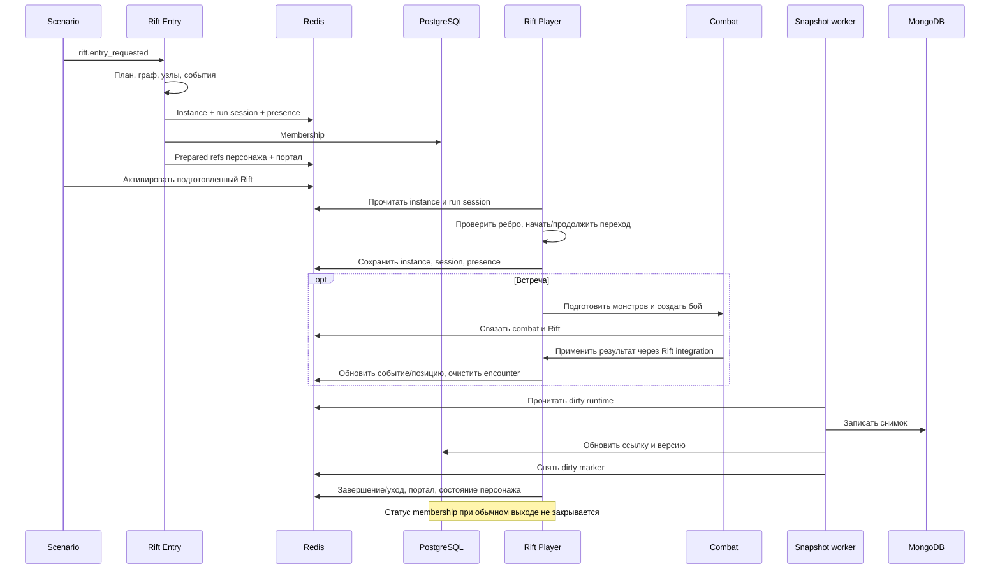

# Аудит 04/10 — Rift, World, Exploration, процедурная генерация и игровые графы

Дата: 9 октября 2026 года. Проект: Sealed World / TurnBasedMMORPG.
Базовый HEAD: `6ccc92561c633f618eb7ee082c36caa44a1400f7`.

**Объект — текущее рабочее дерево, включая существующие изменения, а не чистый HEAD.** Исходники, тесты и настройки не изменялись. Настоящий файл сохраняет результат проведённого аудита; исправления не применялись.

Пути в отчёте относительны корню репозитория; `:N` обозначает строку исследованного дерева. Приложенное задание обрывалось в разделе 11 на «Severity: Critical /», поэтому использованы уровни High / Medium / Low с отдельным обозначением неподтверждённых рисков.

## 1. Основной результат

Главные проблемы — обход игровых проверок Rift, восстановление отсутствующего боя как победы, неполное сохранение прохождения и отключённый лимит Exploration XP. **Critical не подтверждены.** Это не утверждение об отсутствии критических проблем вне исследованного охвата.

Подтверждены 14 находок: 6 High, 7 Medium, 1 Low. Ещё семь записей отдельно описывают риски, неподключённые и экспериментальные контракты либо вопросы, требующие продуктового решения.

Завершённые профильные наборы: **96 тестов прошли**. Дополнительно выполнены проверки воспроизводимости и локальные сценарии с хранилищами в памяти. Реальные PostgreSQL, MongoDB, Redis, внешние AI и сетевые клиенты не использовались для проверок.

## 2. Методология и ограничения

Источники — текущие реализации, конфигурации, тесты и применимые project skills. Применены навыки экономичного делегирования, Rift, Backend, Quality, загрузки project skills и ограничения диагностических изменений. Три независимых направления исследования: Rift/runtime/persistence; World/Exploration/геометрия; GenerationAI. Ведущий проверил существенные доказательства и междоменные контракты.

`audit/01_project_inventory.md` и `audit/02_architecture_boundaries.md` использованы для навигации; `audit/03_combat_runtime.md` — для смежных контрактов. Их оценки не принимались за доказательства. Graphify не использовался и не пересобирался.

Охват: `src/backend/features/rift/`, `src/backend/infrastructure/rift/`, World, Exploration и их инфраструктура, GenerationAI, `tools/map_generator/`, `tools/world_static_audit.py`, профильные тесты. Combat, Monsters, Character, Scenario, Loot и GameSession исследованы в пределах взаимодействий с этими подсистемами. Отдельный security-аудит и глубокий межхранилищный аудит не проводились.

Соседний `gen_game_map` не исследовался. Выводов о качестве отсутствующего в исследованном runtime сезонного генератора нет. Не проверены production deployment, реальные задержки, доставка событий при падениях, поведение настоящих хранилищ под конкурентной нагрузкой и полное покрытие тестами.

## 3. Реестр реализованного и проектируемого

| Подсистема | Состояние | Фактическая реализация |
| --- | --- | --- |
| Основной Rift | Реализован и используется | Генерация графа, персональное прохождение, переходы, события, реальные бои, сердце, выход, снимки |
| Hex Rift | Экспериментальный / dev-only | Отдельный генератор и маршруты, состояние сервиса в памяти процесса, имитация боя |
| World | Реализован частично | Квадратная география, регионы, зоны, статические игровые узлы D4, SQL и Redis-проекция |
| Генератор внешних регионов | Реализован отдельно, не подключён к production generation | `WorldRegionNodeGenerator`, тесты и аудитный инструмент |
| Exploration | Реализован частично | Перемещение, встречи, взаимодействия и прогресс; часть discovery-результатов — заглушки |
| Knowledge | Реализован, частично отключён сборкой зависимостей | Сервис лимитов, runtime manager, SQL-модель и worker есть; ограничитель XP не включается |
| GenerationAI | Реализован и используется | Реестр задач, SQL-жизненный цикл, Mongo payload, ARQ, JSON и изображения |
| `tools/map_generator` | Локальные инструменты | Изображения, климатические карты, регионы, швы, пиксельные дороги |
| Сезонный генератор мира | Не обнаружен в исследованном runtime | Внешний репозиторий не исследовался |
| Ранний Rift local harness из skill | Устаревшее описание стадии | Навык отстаёт от существующих runtime и persistence |

World имеет координатное пространство 105×105, регионы 15×15, зоны 5×5. Полная генерация создаёт 49 региональных оболочек и 441 зону; обычный игровой seed содержит 225 статических узлов D4. Это не означает наличие 11 025 доступных игровых локаций. Основания: `src/backend/features/world/runtime/config.py:5`, `src/backend/features/world/services/generator_service.py:170`, `src/backend/features/world/loaders/village_loader.py:30`.

`LLMWorldGenerator.run` не вызывает отдельный `_generate_d4_capital` и не подключает `WorldRegionNodeGenerator` для внешних регионов. География, биомы и угроза оболочки определяются фиксированными полями и якорями, а не сохранённым seed сезона. Ресурсные, торговые и случайные Rift-discovery ветки Exploration частично представлены заглушками: `src/backend/features/exploration/runtime/encounter/policy.py:20`, `src/backend/features/exploration/runtime/encounter/discoveries/resource.py:1`.

## 4. Жизненный цикл Rift



Entry создаёт новый instance и UUID сессии, готовит контекст мощности персонажа и привязывает прохождение. Игровой экран объединяет общий instance с персональными позицией, посещением и переходом. Encounter выбирает уже материализованный клан, затем непосредственно вызывает создание Combat. После боя Rift меняет событие или завершает переход.

Последовательный повтор результата после успешной очистки `active_encounter_id` возвращает no-op. Это полезная защита, но она не делает несколько записей атомарными. Источники: `src/backend/features/rift/services/entry_service.py:37`, `src/backend/features/rift/services/encounter_service.py:88`, `src/backend/features/rift/integrations/runtime.py:394`.

Выход проверяет exit policy и положение/готовность цели, записывает результат, меняет портал и состояние персонажа, очищает refs. Starter-death flow имеет отдельную интеграцию с GameSession и сбросом персонажа. Удаление персонажа вызывает отдельный abandon path. Эти пути нельзя считать одной транзакцией с обычным завершением. Источники: `src/backend/features/rift/services/player_service.py:98`, `src/backend/features/game_session/integrations/session_integrator.py:156`, `src/backend/features/game_lobby/integrations/system_integrator.py:637`.

## 5. Подтверждённые находки

| ID | Severity | Проблема |
| --- | --- | --- |
| A04-01 | High | Игровой Rift API принимает клиентское управление событиями, исходом переходного боя и характеристиками |
| A04-02 | High | Восстановление отсутствующего Combat превращается в победу Rift |
| A04-03 | High | Новое прохождение без действий не получает снимок для восстановления |
| A04-04 | Medium | Обычный выход оставляет PostgreSQL membership активным |
| A04-05 | Medium | Повторная доставка entry создаёт новое прохождение |
| A04-06 | Medium | Повторный start перезаписывает активный переход |
| A04-07 | Medium | Одинаковый seed Rift не воспроизводит граф между процессами |
| A04-08 | High | Лимит XP за изучение локации отключён в обычной сборке |
| A04-09 | Medium | Exploration продолжает успешный ответ после отказа перемещения |
| A04-10 | Medium | Публикация World в Redis не обеспечивает актуальную полную проекцию |
| A04-11 | High | JSON-задача GenerationAI застревает между двумя лимитами повторов |
| A04-12 | High | Ошибка первоначального сохранения Mongo оставляет задачу без входного payload |
| A04-13 | Medium | GenerationAI допускает done без сохранённого результата |
| A04-14 | Low | world_static_audit.py использует устаревший аргумент конструктора |

### A04-01 — клиент управляет игровыми исходами

**High; подтверждено кодом, уверенность высокая.** Игровые endpoints используют DTO и dispatcher с возможностями локального harness:

- `force_event="none"` принимается до случайного броска перехода;
- `resolve_transition_combat` принимает результат клиента, по умолчанию `victory`;
- `resolve_blocker` предпочитает `payload.attributes` характеристикам персонажа.

Защита `run_action` запрещает ручное разрешение текущего node combat, но не переходного боя. Проверен путь маршрут → DTO → сервис → dispatcher. Воспроизводимые входы: действующий `travel_id` и принудительное отсутствие события; действие разрешения переходного боя; завышенная характеристика при проверке препятствия. Ожидаемый инвариант — исход боя и характеристики определяет сервер. Нарушение — переход или проверка препятствия проходят по клиентскому утверждению.

Основания: `src/backend/features/rift/api/router.py:56`, `src/backend/features/rift/dto/runtime.py:17`, `src/backend/features/rift/services/player_service.py:64`, `src/backend/features/rift/runtime/actions/dispatcher.py:46`, `src/backend/features/rift/runtime/actions/dispatcher.py:199`, `src/backend/features/rift/runtime/navigation/screen_builder.py:772`. Передать также в аудит №7. Исправление не применено.

### A04-02 — отсутствие результата боя трактуется как победа

**High; подтверждено локальным исполнением, уверенность высокая.** Если Combat runtime отсутствует и архивный результат не найден, API запускает recovery. `recover_missing_combat_session` идёт через общий возврат персонажа, который вызывает Rift с буквальным `result="victory"`.

Выполнен локальный сценарий с настоящими `CombatSystemIntegrator` и `RiftRuntimeIntegration`, заменёнными хранилищами и без результата боя. Исходные данные: `state=combat`, `prev_state=rift`, `combat_id=lost-combat`, активное node-entry событие охраны и закрытые ворота. Результат:

```text
return_state = rift
event_state = cleared
gate_state = open
encounter_id = None
```

Это подтверждает игровое последствие, ранее обозначавшееся как риск смежного контракта. Проверка не является сетевым или межхранилищным тестом. Ожидаемый инвариант — отсутствие результата не открывает ворота и не очищает обязательное событие.

Основания: `src/backend/features/combat/api/router.py` (обработка `CombatSessionNotFound`), `src/backend/features/combat/integrations/system_integrator.py:163`, `src/backend/features/combat/integrations/system_integrator.py:259`, `src/backend/features/rift/integrations/runtime.py:453`. Связь с A02-02 и смежным риском аудита 03; новое доказательство касается синтетического outcome, а не всей конкурентности финализации.

### A04-03 — начальное прохождение не сохраняется в Mongo

**High; подтверждено путём записи, уверенность высокая.** Entry вызывает `save_run_session_runtime(mode="redis_and_db")`, который пишет Redis без dirty marker и создаёт membership. `save_instance_runtime` даже в таком режиме не сохраняет Mongo-снимок. Sweeper выбирает dirty-сессии.

Сценарий: подготовить или начать Rift, не выполнять действий, дождаться часового TTL либо потерять Redis. Membership существует, а снимка нет. Реальное ожидание TTL не проводилось. Ожидается возможность восстановления начатого прохождения; нарушение — отсутствие восстановимого snapshot при существующей активной membership.

Основания: `src/backend/features/rift/services/entry_service.py:54`, `src/backend/features/rift/integrations/runtime.py:55`, `src/backend/features/rift/integrations/runtime.py:148`, `src/backend/infrastructure/rift/managers/session.py:14`, `src/backend/infrastructure/rift/managers/session.py:127`.

### A04-04 — membership остаётся активным после выхода

**Medium; подтверждено кодом, уверенность высокая.** `_exit_rift` меняет Redis run, портал и персонажа, но не вызывает `mark_status` membership. Snapshot flush обновляет позицию и ссылку, а не lifecycle status.

Сценарий: завершить Rift, затем проверить SQL membership — он остаётся `active`. Функция восстановления по участнику продолжает выбирать его. Восстановление старого прохождения зависит от состояния снимка и вызова recovery; автоматическое возвращение каждого вышедшего игрока не заявляется. Ожидается терминальный membership status, исключённый из active restore.

Основания: `src/backend/features/rift/services/player_service.py:173`, `src/backend/features/rift/integrations/runtime.py:141`, `src/backend/infrastructure/rift/repositories/state.py:61`, `src/backend/infrastructure/rift/repositories/state.py:109`. `close_rift_on_exit` записывается как намерение, но сам по себе не удаляет instance.

### A04-05 — entry не идемпотентен

**Medium; подтверждено кодом, уверенность высокая.** `prepare_from_scenario` каждый раз создаёт UUID, даже при одинаковом `request_id`. Повтор события создаёт ещё instance, session и membership; последние ссылки персонажа заменяют предыдущие.

Воспроизводимый сценарий: два последовательных вызова с одинаковыми `char_id`, `request_id` и seed. Ожидается одно логическое прохождение; текущий код создаёт два. Это отдельная проблема от конкурентного входа двух разных игроков. Сбой между записью runtime и привязкой персонажа также оставляет осиротевший run.

Основание: `src/backend/features/rift/services/entry_service.py:86`.

### A04-06 — повторный start уничтожает прежний travel

**Medium; подтверждено кодом, уверенность высокая.** `start_travel_runtime` проверяет соседство и доступность ребра, затем безусловно заменяет `active_travel`. Сервис не запрещает start во время текущего перехода или привязанного боя; `_exit_context` проверяет ссылки instance/session, но не состояние персонажа и статус run.

Сценарий: начать переход, получить прерывание боем, снова вызвать start к открытому соседу. Старая запись перехода заменяется. Ожидается явный отказ либо предусмотренная операция отмены.

Основания: `src/backend/features/rift/runtime/navigation/screen_builder.py:134`, `src/backend/features/rift/runtime/navigation/screen_builder.py:347`, `src/backend/features/rift/services/player_service.py:154`.

### A04-07 — межпроцессная невоспроизводимость seed

**Medium; подтверждено исполнением, уверенность высокая.** Локальный RNG используется, однако список кандидатов для ветки строится из `set[str]`. Его порядок зависит от Python hash seed.

Проверка одинакового `seed="audit04-repro"`, одинаковой конфигурации и `void_cells=10` в трёх процессах:

| PYTHONHASHSEED | Finish |
| --- | --- |
| 1 | z01:4_2 |
| 2 | z01:4_2 |
| 3 | z01:1_4 |

Множества void-узлов также различались. Сравнивались структурные данные, поэтому различие UUID здесь не причина. Критерий регрессии — одинаковый нормализованный граф при разных hash seeds. Проверка использовала `_runtime` из существующего `tests/backend/features/rift/runtime/test_zone_generation.py` и отдельные Python-процессы; файлы тестов не менялись.

Основание: `src/backend/features/rift/runtime/generation/zone_instance.py:848`. Дополнительный обход множества защищённых узлов существует в этой же реализации.

### A04-08 — Knowledge XP cap не включается

**High; подтверждён дефект wiring, уверенность высокая.** `ExplorationEncounterService` ищет `integration.redis`. `EncounterIntegration` принимает Redis, но сохраняет только созданный manager, без `self.redis`. В результате `_knowledge=None`, вызов `cap_rewards` пропускается.

Сценарий проверки: штатная сборка зависимостей и многократные действия в одной локации сверх бюджета. Ожидается ограничение награды; текущая ветка передаёт её напрямую в progression. Количественный сценарий накопления XP не исполнялся.

Основания: `src/backend/features/exploration/services/encounter_service.py:46`, `src/backend/features/exploration/integrations/encounter_integration.py:63`, `src/backend/features/exploration/services/encounter_service.py:285`.

### A04-09 — отказ перемещения игнорируется

**Medium; подтверждено кодом, уверенность высокая.** `move_player` возвращает `False`, если целевая Redis-локация отсутствует. Gateway игнорирует результат, после чего возвращает целевой экран или сохраняет встречу в целевой локации.

Сценарий: цель существует при `resolve_move`, но отсутствует при записи. Персонаж остаётся на месте, ответ описывает другой узел. Проверка должна подменить результат перемещения на `False` и запретить последующую публикацию целевого encounter. Нужен отказ или ответ о фактической позиции.

Основания: `src/backend/features/exploration/gateway/exploration_gateway.py:63`, `src/backend/features/exploration/integrations/system_integrator.py:44`.

### A04-10 — World cache не имеет полного контракта публикации

**Medium; подтверждено кодом, уверенность высокая.** Подтверждены два поведения:

- AI handlers обновляют SQL, но не обновляют Redis-локацию; игровое содержимое остаётся прежним до нового прогрева.
- Прогрев только записывает текущие активные узлы. Старые ключи не удаляются; частичные ошибки pipeline превращаются в уменьшенный счётчик без отказа всей публикации.

Сценарии: изменить описание через AI и прочитать ту же локацию из Redis; деактивировать SQL-узел и прогреть карту; вернуть ошибку для одной записи pipeline. Ожидается согласованная актуальная проекция либо явный отказ публикации.

Основания: `src/backend/features/world/tasks_ai.py:98`, `src/backend/features/world/services/cache_service.py:26`, `src/backend/infrastructure/world/location_store.py:35`. Дополнительный риск: Redis прогревается до завершающего SQL commit bootstrap (`src/backend/core/containers/game.py:75`, `:158`); последующий rollback может оставить уже опубликованные данные.

### A04-11 — несовместимые лимиты повторов GenerationAI

**High; код и локальная проверка условия, уверенность высокая.** Для ошибки JSON-схемы сервис разрешает минимум восемь попыток. SQL claim допускает задачу только при `attempts < max_attempts`; у World JSON specs `max_attempts=4`.

После четвёртой ошибки сервис ставит `cooldown`, но следующий worker уже не может забрать задачу. Локальная проверка дала:

```text
after_attempts = 4
service_retry_limit = 8
service_will_cooldown = True
repository_can_claim_again = False
```

Ожидается достижение следующей попытки либо конечного `failed`, а не недоступный `cooldown`. Полный SQL/ARQ сценарий не исполнялся. Monster flavor с собственным лимитом 8 этим конкретным случаем не затронут.

Основания: `src/backend/features/generation_ai/services.py:216`, `src/backend/features/generation_ai/repositories.py:104`, `src/backend/features/world/tasks_ai.py:169`.

### A04-12 — первоначальный payload может быть потерян

**High; подтверждено кодом, уверенность высокая.** Ошибка Mongo при создании payload перехватывается; SQL-задача остаётся доступной с `mongo_status=write_failed`. При отсутствии Mongo-документа hydration возвращает объект без необходимых входных данных. Обработчик World требует эти данные, а reenqueue не восстанавливает исходный spec.

Сценарий: ошибка `create_task_document`, успешный SQL commit, последующая обработка задачи. Ожидается восстанавливаемая постановка либо отказ создавать исполняемую задачу без входа. Проверка с настоящей Mongo не выполнялась.

Основания: `src/backend/features/generation_ai/repositories.py:221`, `src/backend/features/generation_ai/repositories.py:249`, `src/backend/features/world/tasks_ai.py:55`.

### A04-13 — done возможен без сохранённого результата

**Medium; подтверждено кодом, уверенность высокая.** `mark_done` устанавливает статус, затем `_record_result_payload` подавляет ошибку Mongo. Worker подтверждает SQL-транзакцию. Полный JSON-результат задачи при этом отсутствует.

Доменный `apply_result` выполняется раньше, поэтому это **не доказательство потери уже применённого игрового контента**. Подтверждена потеря результата/истории задачи при статусе завершения. Сценарий: отказ `record_result` после успешного доменного apply; проверить SQL status и доступность полного payload.

Основания: `src/backend/features/generation_ai/repositories.py:159`, `src/backend/features/generation_ai/repositories.py:261`, `src/backend/features/generation_ai/workers/tasks.py:31`.

### A04-14 — статический аудит World сломан

**Low; подтверждено по сигнатурам, уверенность высокая.** Инструмент вызывает `LLMWorldGenerator(data, ai=None)`, тогда как конструктор принимает `generation_ai`. После успешных импортов вызов несовместим с сигнатурой. Полный CLI-запуск не завершён; отказ в точке конструктора установлен прямым сравнением кода.

Основания: `tools/world_static_audit.py:230`, `src/backend/features/world/services/generator_service.py:165`. Проверка после устранения проблемы окружения — инструмент должен пройти создание генератора и выполнить собственные инварианты.

## 6. Графы, hex-grid и ограничения генерации

Основной Rift использует **четыре направления квадратной сетки**. Доступность определяется passage edges, состоянием ворот и условиями сердца, а не одним соседством координат. Генератор соединяет защищённые узлы, наращивает ветви и добавляет временные shortcuts. Наличие циклов после открытия shortcuts не является ошибкой, а недостижимость сердца до победы над охраной — предусмотренное ограничение.

Прошедшие тесты проверяют сохранение пути после void mask, достижимость охраны, открытие сердца после события, отсутствие обхода охраны, размещение служебных узлов, переходы между зонами и работу временных препятствий. Это выборочная доказательная проверка, а не доказательство для всех возможных presets. Источники: `src/backend/features/rift/runtime/geometry.py:5`, `src/backend/features/rift/runtime/generation/zone_instance.py:394`, `tests/backend/features/rift/runtime/test_zone_generation.py:34`.

Hex-прототип использует **odd-r offset, pointy-top**. Neighbor lookup возвращает шесть направлений, выходы за прямоугольную границу обозначаются `None`. Кольца и радиусы вычисляются обходом соседей в пределах допустимой области; на границе кольцо закономерно обрезается. Применение формулы `6r` ко всем таким кольцам было бы неверной проверкой. Источники: `src/backend/features/rift/runtime/hex/generation/builder.py:176`, `:2079`.

Дополнительная проверка сеток `1×1`, `1×9`, `9×1`, `2×2`, `10×10`, `17×19` подтвердила для **2360 направленных связей** границы, уникальность соседей, обратное направление и согласованность `get_hex_direction`. Исполнялись извлечённые из исходника функции без изменения файлов; это проверка функций соседства, не всей генерации.

Ограничения и различия реализаций:

- World navigation — четыре квадратных соседа; auto-route явно выключен (`src/backend/features/exploration/runtime/navigation.py:300`).
- A* в локальных map tools строит дороги по пиксельной карте и не является игровым pathfinding.
- Совпадение терминов «карта» и «узел» не делает эти реализации случайным дублированием.
- Hex builder имеет ограниченные попытки сборки и выбрасывает ошибку при невозможной конфигурации; сервис может пробовать новые seeds, когда seed не задан (`builder.py:643`, `src/backend/features/rift/services/hex_runtime_service.py:42`).
- Локальные map scripts используют глобальный `random.seed`; их воспроизводимость нельзя переносить на гарантии backend runtime. Примеры: `tools/map_generator/detailed_world_generator.py:12`, `tools/map_generator/simple_map_generator.py:9`, `tools/map_generator/climate_map_generator.py:8`.
- Сериализация Rift snapshots имеет `schema_version` и отклоняет неподдерживаемую схему; это не равно проверке согласованности версий между всеми хранилищами (`src/backend/infrastructure/rift/repositories/snapshots.py:72`).
- Cube/axial преобразования не являются контрактом рабочего World или основного Rift. Отдельный Manhattan helper в hex builder не следует автоматически считать hex distance: кольца используют другой, соседский обход.
- Штатный World не генерирует всю сезонную географию из пользовательского seed; fixed geography и AI enrichment — разные операции.

## 7. Ownership, persistence и восстановление

| Данные | Фактический владелец |
| --- | --- |
| World регионы, зоны, узлы, контент | PostgreSQL |
| Игровая проекция World, presence игроков/боёв | Redis |
| Rift общий instance: граф, события, сердце | Redis runtime |
| Rift персональная позиция, travel, encounter | Redis run session |
| Rift membership, lifecycle index, snapshot refs | PostgreSQL |
| Rift резервный снимок instance и сессий | MongoDB |
| Active character state и ссылки на Rift/Combat | Character-owned Redis session |
| GenerationAI status, attempts, identity, asset refs | PostgreSQL |
| GenerationAI вход, полный результат и история | MongoDB |
| Изображения | Файловое либо объектное хранилище |

Для Rift фактическая актуальная игровая истина находится в Redis, а PostgreSQL хранит индекс. Формулировка project skill «PostgreSQL — source of truth» сама по себе не обеспечивает восстановление runtime. Instance и session имеют часовой TTL; presence — производные Redis-наборы. Mongo хранит снимок instance и набора sessions с версией; PostgreSQL — ссылку и version summary. Snapshot записывается до обновления SQL refs; восстановление читает снимок по instance, а не выполняет доказанное разрешение конфликта двух версий.

Restore lock ограничивает одновременное восстановление одного instance, но не является общим lock для движения, результатов боя и snapshot writes. Источники: `src/backend/features/rift/integrations/runtime.py:182`, `:245`, `src/backend/infrastructure/rift/repositories/snapshots.py:31`.

### Обязательные сценарии отказов

| Сценарий | Установленный результат / предел проверки |
| --- | --- |
| Два игрока одновременно входят в один Rift | Штатный scenario entry создаёт разные UUID. Совместный вход в один instance не доказан как готовая пользовательская механика; shared структуры требуют отдельных тестов |
| Повтор entry одного игрока | Подтверждён новый run при том же request_id: A04-05 |
| Игрок отключается во время перехода | Disconnect не отменяет серверные записи; recovery зависит от сохранённых refs и последнего снимка. Live disconnect test не выполнен |
| Worker падает после изменения узла | Instance/session/presence сохраняются отдельными шагами; требуется инъекция ошибки после каждого шага |
| Combat завершён, Rift не получил результат | Durable finalization и повторный возврат существуют, но синтетический outcome recovery ошибочен: A04-02 |
| Результат применяется повторно | Последовательный завершённый повтор no-op; конкурентные старые чтения не исключены: A04-15 |
| Instance исчезает при активном игроке | Снимок может восстановить runtime; для нового run без действий снимка нет: A04-03 |
| Redis и Mongo различаются по версии | Активный Redis читается первым; общей процедуры проверки/слияния версий не доказано |
| Instance существует, run session отсутствует | Короткий путь восстановления instance не гарантирует восстановление потерянной сессии; необходим отдельный regression scenario |

Последний случай следует из `require_run_session` → `restore_rift_instance`: restore возвращает успех при уже существующем instance, после чего повторно запрашивается всё ещё отсутствующая session. Это дополнительное ограничение восстановления, для которого сквозной тест не исполнялся.

## 8. Риски и частичные контракты — отдельно от подтверждённых production-дефектов

| ID | Оценка и статус | Сценарий / проверяемый инвариант |
| --- | --- | --- |
| A04-15 | High, риск конкурентности | Два обработчика результата читают одинаковый active_encounter_id и независимо сохраняют instance/session. Barrier-test параллельных finalizer/return должен подтвердить одно логическое применение |
| A04-16 | High, риск отказа | XP сердца начисляется до записи завершения и очистки ссылок. Инъекция ошибки после начисления и повтор complete должны доказать отсутствие второй награды |
| A04-17 | Medium, риск потери снимка | Между snapshot write и clear_dirty приходит новое движение. Новая dirty revision должна сохраниться |
| A04-18 | Medium, риск публикации | После SQL commit не выполняется ARQ enqueue; либо asset/Mongo write выполнен, а SQL откатился. Проверить recovery очереди и очистку несвязанных результатов |
| A04-19 | Medium, неподключённый генератор | У внешнего WorldRegionNodeGenerator road_cells пуст, тогда как межрегиональный выход требует дороги с обеих сторон. Проверять при подключении; это не поломка доступного сейчас D4 |
| A04-20 | Low, dev-контракт | Hex movement проверяет соседство и walkable, но не edge masks; ответы действий возвращают полный state. Старый next_floor расходится с текущим single-floor heart layout |
| A04-21 | Требует продуктового контракта | Exploration local map помечает существующие соседние локации известными без обращения к персональному knowledge. Дефект только при требовании персонального тумана войны |

Основания:

- A04-15: `src/backend/features/rift/integrations/runtime.py:410`, `:479`. Существующий guard не атомарен с последующими сохранениями. При падении после сохранения session повтор может завершиться no-op до исправления presence.
- A04-16: `src/backend/features/rift/services/player_service.py:192`. Это конкретный failure/concurrency сценарий; нормальный последовательный повтор после полной очистки refs не объявлен уязвимым.
- A04-17: `src/backend/features/rift/integrations/runtime.py:287`. Dirty снимается без сравнения revision записанного snapshot с текущей записью.
- A04-18: `src/backend/features/generation_ai/workers/tasks.py:33`, `src/backend/features/generation_ai/services.py:169`, `src/backend/features/generation_ai/repositories.py:55`, `src/backend/features/generation_ai/integrations/codex_ai_executor.py:98`. In-memory список pending очищается до постановки; постоянный scanner pending/cooldown в production worker не обнаружен. Mongo/asset writes до SQL commit не имеют доказанной компенсационной очистки.
- A04-19: `src/backend/features/world/runtime/node_graph.py:49`, `src/backend/features/world/services/navigation_service.py:84`. Граничные ворота D4 дополнительно закрыты; отсутствие нынешнего прохода во внешний мир не классифицируется само по себе как дефект.
- A04-20: `src/backend/features/rift/services/hex_runtime_service.py:104`, `:146`, `src/backend/features/rift/api/hex_test_router.py:84`, `src/backend/features/rift/runtime/hex/generation/builder.py:2486`. Finish получает rift_heart_room; mock combat создаётся для других slots, а старый next_floor требует cleared combat tile. Тест прямо фиксирует single-floor heart, поэтому недоступность старого next_floor не объявлена production blocker.
- A04-21: `src/backend/features/exploration/services/navigation_service.py:105`, `:235`. Полные title/description/threat/services выдаются для существующего cached node; требование персонального fog-of-war не установлено как обязательный текущий контракт.

## 9. Exploration и доступность перемещения

Обычная навигация разрешает только цели из рассчитанных exits и проверяет наличие целевой локации. World navigation учитывает активность соседей, passability, blocked/gated направления с обеих сторон и ограничения межрегиональных дорог. Основания: `src/backend/features/exploration/services/navigation_service.py:46`, `src/backend/features/world/services/navigation_service.py:60`.

Gateway сначала возвращает активную встречу, если она есть; иначе валидирует переход, рассчитывает travel encounter и меняет позицию. Это ограничение не отменяет A04-09. Knowledge/discovery, карта соседних клеток и лимиты progression — разные контракты; наличие SQL-модели знаний не доказывает их включение в каждый путь.

Для аудита №7 передаются A04-01 и проверка привязки переданного `char_id` к авторизованному персонажу. В исследованных Rift dependencies такая проверка не обнаружена; полноценный анализ сетевой доступности и penetration testing не проводились. Отдельный security-аудит провайдеров AI не выполнялся.

## 10. GenerationAI: данные, ассеты и публикация

Фактический pipeline:

1. Registry регистрирует handlers items/monsters/news/world.
2. Постановка создаёт/переиспользует SQL identity задачи и сохраняет большой payload в Mongo.
3. ARQ job забирает task по id с SQL claim и увеличением attempts.
4. Handler строит request; сервис проверяет output kind и наличие схемы для JSON.
5. Executor обращается к AI; JSON и изображения идут разными путями.
6. Handler валидирует и применяет результат к доменным данным.
7. Записываются результат задачи, SQL status и follow-up tasks.
8. Worker выполняет SQL commit и затем ставит отложенные задачи.

Источники: `src/backend/features/generation_ai/bootstrap.py:23`, `src/backend/features/generation_ai/services.py:81`, `src/backend/features/generation_ai/workers/tasks.py:17`.

Pipeline использует JSON-схемы и повторную доменную валидацию. World batch проверяет отсутствие пропущенных ожидаемых ID (`src/backend/features/world/tasks_ai.py:98`). Поэтому утверждение «любой неполный AI JSON сразу попадает в runtime» не подтверждается.

Разделение результатов:

- игровые графы и базовые характеристики не создаются текущим Rift encounter через AI;
- активный Rift выбирает готовые кланы (`src/backend/features/monsters/services/monster_group_service.py:277`);
- AI обогащает тексты, lore и изображения;
- одинаковый seed мира не делает внешнюю генерацию текста/изображений детерминированной;
- наличие GenerationAIService в Rift dependency wiring не означает reachable генерацию AI в боевом пути;
- проверка текста на изображении записывает metadata, но не служит блокирующим условием публикации (`src/backend/features/generation_ai/integrations/codex_ai_executor.py:90`);
- полноценная стадия проверки и атомарной публикации целого нового мира не обнаружена.

Ошибки провайдера переходят в cooldown/failed по сервисному лимиту, но A04-11 нарушает согласованность этого лимита с claim. Потеря Mongo payload и посткоммитная постановка разобраны отдельно в A04-12/13/18. Временные и уже записанные ассеты могут остаться после неуспешного apply/commit; автоматическая общая компенсационная очистка не доказана.

## 11. Контракты соседних доменов

**A02-02 подтверждается текущим кодом:** Rift зависит от внутреннего Combat creation orchestrator; Combat собирает Rift integration и знает её инфраструктуру. Кроме worker, результат повторно передают Combat return и GameSession Loot return. Семантическое имя `apply_combat_result` уже существует, но аргументы и сборка зависимостей сохраняют тесную связь с внутренним устройством Rift.

| Сосед | Фактический контракт |
| --- | --- |
| Scenario | Событие rift.entry_requested, подготовленные refs и активация |
| Combat | Прямое создание боя через orchestrator; результат через Rift integration и внутренние metadata |
| Monsters | Подготовленная группа из материализованного habitat/clan pool, actor commitments |
| Character | Владение active session, состоянием, location и refs на Rift/Combat |
| Loot / GameSession | Послебоевой flow, claim и повторный возврат результата в Rift |
| GenerationAI | Регистрация и обработка контентных задач; не генерация текущего Rift encounter |

Источники: `src/backend/features/rift/dependencies.py:139`, `src/backend/features/rift/services/encounter_service.py:88`, `src/backend/features/combat/workers/tasks/victory_finalizer_task.py:172`, `src/backend/features/combat/integrations/system_integrator.py:242`, `src/backend/features/game_session/integrations/session_integrator.py:335`, `src/backend/features/scenario/integrations/system_integrator.py:245`.

Worker вычисляет реальный winner-based result, тогда как fallback возврата передаёт literal victory. Массовая замена вызовов на Streams не следует из результатов аудита: сначала нужны корректные outcome, idempotency и failure-контракты. Сам выбор синхронного транспорта не является доказанной причиной всех проблем.

## 12. Выполненные проверки

Полностью завершившийся запуск ведущего:

```powershell
.venv/Scripts/python.exe -B -m pytest -o addopts= -p no:cacheprovider tests/backend/features/rift/runtime/test_zone_generation.py tests/backend/features/rift/test_hex_generator.py -q
```

Результат: **85 passed in 110.65s**.

Дополнительно завершились 11 синхронных тестов:

```text
tests/backend/features/world/test_node_graph.py
tests/backend/features/world/test_theme_service.py
tests/backend/features/world/test_threat_service.py
```

Итого 96 тестов в полностью завершённых профильных наборах. `-o addopts=` отключил глобальную coverage-инструментацию для ограниченного прогона; конфигурация и coverage threshold не менялись. `-B` и отключение pytest cache ограничили побочные записи.

Дополнительные проверки без изменения файлов:

- одинаковый Rift seed в трёх процессах с PYTHONHASHSEED 1/2/3: структуры различаются, A04-07;
- проверка 2360 направленных hex-связей: пройдена;
- сценарий отсутствующего боя на настоящих Combat/Rift integrations с хранилищами в памяти: событие cleared, ворота open, A04-02;
- локальная проверка retry-limit GenerationAI: сервисный лимит 8 против claim-порога 4, A04-11.

### Незавершившиеся и заблокированные запуски

| Проверка | Результат |
| --- | --- |
| Широкий Rift набор на системном Python | Collection остановлен import errors, включая fastapi/codex_core |
| Широкий Rift набор через .venv | Собраны 174 теста; остановлен на незавершающемся асинхронном тесте после отдельного PASSED |
| Суженный Rift services/integrations/infrastructure | Собраны 60 тестов; асинхронный запуск не завершился, остановлен |
| Широкий World/Exploration профиль | Собраны 120 тестов; первый асинхронный тест не завершился, остановлен |
| GenerationAI общий набор | Collection блокировался импортом scripts в test_asset_backfill.py |
| GenerationAI целевой набор | Асинхронный тест не завершился; запуск остановлен |
| uv-путь GenerationAI | Блокировался локальной metadata/path-зависимостью codex-ai |
| Дополнительные storage-тесты GenerationAI | Отдельные синхронные проверки проходили, но набор целиком не завершён; в итоговые 96 не включён |

Причина зависания асинхронного окружения не установлена. Начальная попытка ведущего выполнить recovery через asyncio также была остановлена; последующая локальная проверка использовала завершавшиеся без I/O coroutine-вызовы и in-memory doubles. Это не эквивалент интеграционному прогону с event loop и настоящими хранилищами.

Покрытие не измерялось; успешность всей suite, реального reconnect и межхранилищного recovery не заявляется.

## 13. Следующие доказательные сценарии — без реализации исправлений

| Область | Вход | Ожидаемый инвариант / критерий нарушения |
| --- | --- | --- |
| Начальный snapshot | Entry без движения, потеря Redis | Runtime восстанавливается; отсутствие snapshot нарушает контракт |
| Частичный restore | Сохранён instance, удалена только session | Session восстанавливается независимо от наличия instance |
| Repeated entry | Одинаковые request_id/char_id дважды | Один run и одна активная membership |
| Complete | Ошибка после начисления XP; затем повтор | Награда применяется один раз |
| Concurrent result | Два обработчика одновременно после общего чтения | Один outcome, без потерянных изменений и неверной presence |
| Dirty flush | Движение между Mongo write и clear_dirty | Новое изменение остаётся dirty либо уже входит в снимок |
| Invalid transitions | Start во время interrupted travel/combat | Отказ либо явная предусмотренная отмена |
| Client overrides | force_event, result, attributes в игровом запросе | Клиент не определяет серверные игровые факты |
| World publication | Один pipeline write fails; узел деактивирован | Явный отказ/полная проекция; отсутствует stale playable node |
| Exploration move | move_player возвращает False | Нет целевого encounter и ложного успешного экрана |
| Knowledge | Повторные действия сверх бюджета локации | Награда ограничивается фактическим cap |
| AI retries | Четыре schema failures при max_attempts=4 | Нет навсегда недоступного cooldown |
| AI payload | Initial/result Mongo write failure | Явный восстанавливаемый статус, сохранение необходимых данных |
| AI queue | Ошибка enqueue после commit | Durable задача снова попадает в обработку |
| Seed | Одинаковая конфигурация, разные hash seeds | Идентичная нормализованная структура |

## 14. Статус изменений и передача следующим аудитам

Исправления и план их внедрения не выполнялись: по заданию они откладываются до завершения серии. Этот отчёт — единственный добавленный результат работы. Устаревшие project skills зафиксированы как ограничение источников и оставлены без изменений.

Для этапа №5: snapshot consistency, dirty revisions, частичная запись, очередь после commit, несвязанные Mongo/asset документы и согласованность World cache. Для этапа №7: клиентские управляющие поля Rift и привязка char_id к авторизованному персонажу. Эти передачи не подменяют отдельные аудиты соответствующих областей.
