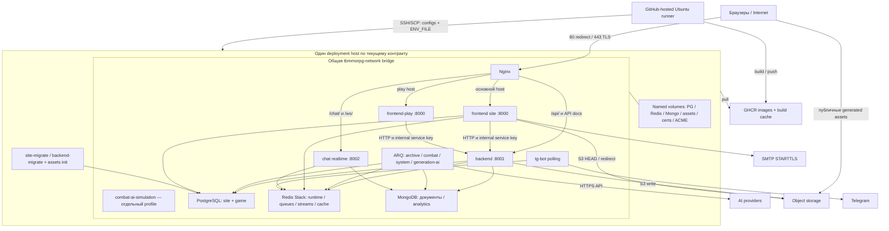

# Аудит 08/10 — Infrastructure Security, Deployment и Supply Chain

Дата: 09.10.2026, Europe/Berlin. Объект: Sealed World / TurnBasedMMORPG.
База сравнения: HEAD `6ccc92561c633f618eb7ee082c36caa44a1400f7`; проверено **текущее рабочее дерево**, включая существовавшие staged/unstaged изменения. Это не подтверждение состава выпущенного образа.

## 1. Executive Summary

Production-конфигурация имеет разумную внешнюю границу: опубликованы только Nginx 80/443, базы и приложения не публикуют host-порты, Python runtime работает непривилегированным пользователем. Однако публичный reverse proxy не отделяет внутренние API от пользовательских. Сервисы разделены по процессам и порядку обновления, но получают общий набор секретов и находятся в одной сети.

Главные результаты:

- **A08-01, High:** production-режим допускает известные defaults ключей подписи и внутреннего сервиса. При ошибке настройки это позволяет подделывать доверенную идентичность; цепочка к публичным administrative API прослеживается в коде.
- **A08-04, High, experimental:** новый hex-test API из незакоммиченных изменений по умолчанию включён и позволяет без авторизации создавать неограниченное число объектов, расходуя CPU, память и Redis. Наличие этих изменений на VPS не установлено.
- **A08-03, Medium:** `/api/internal/*` публично проксируются и не требуют авторизации; доступны сводки активных сессий и дополнительная нагрузка на Redis.
- **A08-05–07, Medium:** обнаружены три разных канала раскрытия: исходные URL в публичных метриках, URL-токены в Nginx access logs, значения локальных переменных в production exception logs. Последнее воспроизведено с искусственным секретом, без реальных credentials.
- **A08-02, Medium:** компрометация одного приложения открывает доступ к секретам соседних сервисов и общей инфраструктуре.
- Supply chain имеет lockfile и dependency-audit gate, но локальный источник `codex-ai` несовместим с одиночным checkout CI; Docker использует иной режим разрешения источников. Actions, base images и production image references не обеспечивают проверяемую неизменяемость всей цепочки.

Всего в реестре: **15 находок — 2 High, 11 Medium, 1 Low, 1 Observation; Critical не подтверждены**. Из них 3 описывают достижимую по исходникам уязвимость, 8 — подтверждённую конфигурационную проблему, 4 — непроверенный риск. Severity относится к описанным предусловиям, а не к недоказанному состоянию VPS. Это аудит для последующего общего плана, без исправлений.

## 2. Методология и охват

Прочитаны действующие AGENTS.md, global security-review/cost-aware-delegation/project-skill-loader, project/backend/release/quality skills и соответствующие references, deployment contract и deployment documentation. Три read-only проверки покрыли контейнеры/сеть, CI/CD/recovery, dependencies/build; ведущий проверил ключевые цепочки, секреты и observability. Предыдущие `audit/01_project_inventory.md`, `02_architecture_boundaries.md`, `05_persistence_consistency.md` использованы как навигация. `audit/07_application_security.md` на момент проверки отсутствует. Graphify не использовался как доказательство.

Охвачены все 3 `.github/workflows/*.yml`, production/local/test/tools/observability Compose, все 7 Dockerfile в `deploy/`, Nginx, certbot, PostgreSQL init, `.dockerignore`, `.gitignore`, `.env.prod.example`, `pyproject.toml`, `uv.lock`, `.pre-commit-config.yaml`; связанные settings, security, routing, logging/metrics, storage adapters и operational tools. `.github/actions/`, отдельные requirements-файлы и каталог `scripts/` в текущем дереве не найдены; старые инструкции на удалённые scripts не считаются действующим механизмом.

Выполненные безопасные проверки:

| Проверка | Результат и предел доказательства |
| --- | --- |
| `docker compose --env-file .env.prod.example -f deploy/compose.prod.yml config --no-env-resolution --quiet` | Exit 0. Проверены модель/синтаксис с шаблоном, не настоящие secrets, не runtime и не TLS. Контейнеры не запускались. |
| Локальное чтение tracked files с редактированным выводом | Проверены 2703 текстовых файла текущего дерева из Git index; 588 больших/бинарных пропущены. По шаблонам private key/GitHub/provider/AWS key совпадений нет. Из чувствительных имён tracked только `.env.prod.example`. Это ограниченный поиск, не доказательство отсутствия любых секретов или утечек в Git history. |
| Settings без `.env` и прикладного startup | AST-извлечение классов с теми же validators, `_env_file=None`, очищенными прикладными env, `debug=False`: оба класса принимают declared default signing key; dev routes остаются включены; secure auth cookie у frontend остаётся false. Значения ключей не печатались. |
| Production logging canary | Реальный wrapper `setup_logging`, установленный `codex-core 0.4.0`, `debug=False`, sink в памяти: искусственное значение локальной переменной попало в exception log. Установленная версия совпадает с `uv.lock:528–530`; образ production не исследован. |
| Metrics label probe | Выполнено AST-извлечение текущего `PrometheusMiddleware.dispatch` с инертными Request/metrics/next-handler. Даже когда handler назначает шаблон route, сохраняется ранее вычисленный URL с искусственным токеном. Это проверка алгоритма, не полноценный HTTP smoke. |
| Проверка запуска quality gate | Прочитан установленный `codex_core/dev/check_runner.py`: CI запускает configured security command, тесты и extra checks; nonzero блокирует build. Сам scanner не запускался. |

Полный TestClient/ASGI probe в этой среде не завершился и был остановлен; положительный end-to-end HTTP результат не заявляется. Первая logging-проба после чрезмерной очистки Windows environment завершилась `WinError 10106`; повтор с сохранением системных переменных успешен. Офлайн экспорт uv помощника был ограничен доступом к interpreter/cache; `--no-sources --frozen` отвергается самим CLI. Установка пакетов, build/pull images, сетевые запросы к приложению, SSH и внешние CVE scanners не выполнялись.

## 3. Deployment и trust boundaries

### 3.1. Карта по конфигурации репозитория

Стрелки показывают штатные обращения, **не firewall allowlist**. Каждый участник общей bridge-сети потенциально может обратиться к другим; namespace Redis или отдельная SQL database сами по себе не являются сетевой изоляцией.

Все production layers задают `name: tbmmorpg`: это один Compose project с несколькими operational files, а не три изолированных security domains. `compose.prod.yml:3–7` агрегирует infra/site/game/tg-bot. `compose.game.yml:164–184` включает simulation-worker только profile `combat-ai-simulation`; обычный deploy его не активирует. Assets-init jobs могут получить автоматически созданную Compose default network, но не публикуют порты и работают с одним assets volume; это не отдельная защищённая сеть для runtime.

| Слой | Процессы, доступ и данные | Основание |
| --- | --- | --- |
| infra | Postgres 17, Redis Stack 7.2.0-v14, Mongo 8, Nginx, manual certbot | `deploy/compose.infra.yml:4–94` |
| site | site-migrate, frontend/site, frontend-play, assets init; оба frontend используют один image | `deploy/compose.site.yml:4–124` |
| game | backend-migrate, backend, chat, chat archive, combat, system, generation-ai, optional simulation worker | `deploy/compose.game.yml:17–229` |
| tg-bot | Redis Streams + outbound Telegram polling; host ports нет | `deploy/compose.tg-bot.yml:4–25` |
| storage | Named volumes PG/Redis/Mongo/certs/challenge; общий writable generated-assets у site/backend/generation worker | `compose.infra.yml:96–106`, `compose.site.yml:66–67,111–112`, `compose.game.yml:66–67,222–223` |
| tools | CloudBeaver 8978 и RedisInsight 5540 только loopback; подключаются к общей external network | `deploy/compose.tools.yml:4–34,42–45` |
| local | Дополнительно Mailpit и Studio, прямые app/DB порты | `deploy/docker-compose.yml:4–69,274–302` |
| observability | Отдельный локальный overlay Prometheus/Grafana; Alloy-файл является инструкцией добавления блоков на host | `deploy/docker-compose.observability.yml`, `deploy/alloy/config.alloy.prod:4–6` |

### 3.2. Что известно о production

Документы описывают Linux VPS, `/opt/turnbasedmmorpg/deploy`, GHCR, site/play domains, S3-compatible storage и host Alloy. Workflow реализует SSH/SCP на secret `HOST`. Не проверялись фактическое число серверов, firewall/security groups, работающий состав контейнеров, overrides, rootless Docker, настройки daemon, TLS certificates, GitHub settings, bucket policy и установленные timers. Упоминание сервера в документации не является снимком его состояния.

Границы доверия: Internet→Nginx; Nginx→application; application→data stores; одна служба→другая; runtime secrets→logs; maintainer/GitHub→runner→registry→VPS; repository/lock→package registry/action publisher; VPS→AI/SMTP/Telegram/S3. Наиболее слабая внутренняя граница — общий credential bundle и общая сеть.

## 4. Docker/container security

Python images используют multi-stage build, отдельный venv, `USER appuser` UID 1000 и ограниченные `COPY src/...`, без переноса `.env` в runtime (`deploy/backend/Dockerfile:4–35`, frontend `:4–36`, worker `:4–35`; chat/tg-bot аналогичны). `uv==0.11.8` закреплён; apt/apk и base images — по mutable repositories/tags. В `.dockerignore:12–20` исключены env, tests/tools/docs, generated data и logs. Секретных build args/BuildKit secret mounts в этих workflow не найдено. Отсутствие build secret mounts здесь не дефект: сборке runtime secrets не нужны.

В production Compose не найдены `privileged`, host PID/network или Docker socket mount. Nginx стандартно имеет root master и nginx workers (`deploy/nginx/nginx.conf:1`); assets init запускается root для `chown` только выделенного volume. Это не доказательство escape на host. Runtime `/app` принадлежит appuser и writable; venv скопирован отдельно. Отсутствуют `cap_drop`, `no-new-privileges`, read-only rootfs, memory/CPU/PIDs limits — A08-13, Low, с учётом существующего non-root контроля.

`restart: unless-stopped` есть у долгоживущих production services; migration/init jobs имеют `restart: no`. PG/Redis/Mongo имеют healthchecks, frontend/backend/chat — HTTP probes. У workers, bot и Nginx Compose healthcheck отсутствует. `restart` помогает при exit, но не обнаруживает зависший worker. Ни отсутствие одного hardening-флага, ни использование Nginx root master не классифицированы как High.

## 5. Network/Nginx/TLS

В production только `compose.infra.yml:69–71` публикует 80/443. App `expose` не создаёт host port; PG/Redis/Mongo ports отсутствуют. По этим файлам прямого обхода Nginx через 8000/8001/8002/5432/6379/27017 с Internet нет. Host firewall и дополнительные overrides неизвестны. В local Compose ситуация другая — A08-08.

Nginx имеет default reject 444, HTTP→HTTPS, TLS 1.2/1.3, HSTS, anti-dotfile rule, body limit 10 MB, `server_tokens off`; API 10 r/s с burst 20, general 30 r/s с burst 50 (`nginx.conf:13,43–44`, `site.conf.template:1–79,120–131,179–186`). Rate limit не является авторизацией и не ограничивает общее число накопленных объектов. `/chat/`, WebSocket и docs locations не наследуют `limit_req` из соседнего `location /`; для них отдельного лимита нет. WebSocket корректно получает Upgrade/Connection и read timeout 3600s (`:151–172,291–312`).

Оба host-а проксируют `/api/` без разделения public/internal/admin/dev — A08-03/04. `/docs`, `/redoc`, `/openapi.json` прямо направляются в backend (`:133–140,273–280`); backend FastAPI не выключает docs (`src/backend/app.py:43–46`). `/health/*` показывает liveness. Frontend `/admin` защищён app middleware с `is_superuser` (`src/frontend/features/cabinet/middleware/admin_auth.py:16–24`); это не защищает backend `/api/admin`.

`X-Forwarded-Proto` устанавливается Nginx, но доверенный диапазон Uvicorn в Compose не задан — A08-14. `X-Forwarded-For` добавляется через `$proxy_add_x_forwarded_for`; входящее значение нельзя автоматически считать доверенным client IP. Rate-limit key использует `$remote_addr`, а не этот header. CORSMiddleware с permissive origins в проверенных app roots нет; нельзя приравнивать отсутствие CORS middleware к серверной авторизации. Realtime имеет точный Origin allowlist и проверку game session (`src/backend/realtime/api/ws.py:67–76,98–132`).

Frontend выдаёт CSP и baseline headers; CSP допускает inline/eval для текущего UI (`src/frontend/core/security_headers.py:20–28,44–63`). Nginx `location /static/` объявляет собственный `add_header Cache-Control`; blanket-утверждение о security headers на абсолютно всех ответах без runtime проверки не делается.

Certbot renew script/timer реализованы (`deploy/certbot/*`), но установка timer на host не подтверждена. При отсутствии сертификата Nginx генерирует self-signed certificate на 7 дней; при отсутствии отдельного play cert использует основной (`deploy/nginx/entrypoint.sh:10–37`). Это bootstrap fallback, не доказательство валидного TLS/SAN и не успешный production readiness check — A08-15.

## 6. Secrets management

Источники: GitHub secrets `HOST`, `USERNAME`, `SSH_KEY`, `ENV_FILE`; job `GITHUB_TOKEN`; plaintext `.env` на host; затем environment контейнеров. Docker secrets API не используется. `.gitignore:115–119` исключает конкретные local env-файлы, `.dockerignore:12–14` — `.env` и `.env.*`; сам `.gitignore` не защищает произвольно названную копию credentials. По проверенным current tracked файлам действующий provider token/private key не выявлен; история, GitHub secret values, локальные реальные env, dumps и server logs не выгружались.

`.env.prod.example` — шаблон с placeholders; содержит shared `SECRET_KEY`, внутренние service keys, SQL/Redis/Mongo URLs, SMTP, AI, S3, bot token. Значения placeholder нельзя считать production validation. DB Compose требует непустые credentials через `:?`, но это не проверяет их качество. Для frontend/backend нет аналогичного обязательного проверки signing/internal keys — A08-01. Secure cookies в template включены (`:72–75`), но class defaults false; отсутствие env приводит к возврату defaults.

Полный `.env` передаётся frontend, backend, chat, workers, migrations и bot даже при перечислении отдельных `environment` fields: последние не фильтруют `env_file` — A08-02. Поэтому frontend process compromise может раскрыть Mongo root URL, game DB, AI/S3/bot secrets, которые frontend напрямую не использует. Общий HMAC key дополнительно связывает site/game/chat; audience/type checks полезны, но не защищают от владельца signing key.

Секреты Redis/Mongo попадают в container command/healthcheck configuration; это не публичная утечка, но Docker administration/inspect следует считать секретным доступом. Права host `.env` не фиксируются deploy script — A08-12. `docker login --password-stdin` избегает token в командной строке, но logout/credential lifecycle не описан; фактический credential helper неизвестен, job token ограничен сроком job.

Shared secret rotation не атомарна: каждый deploy переписывает весь `.env`, перезапуская только выбранный слой. Некоторое время службы могут использовать разные версии credentials. Dual-key/key-id rollout, coordinated restart/revocation runbook в исследованной конфигурации не реализованы. Это operational риск, не доказательство компрометации. Реальные IAM scopes, AI spend caps и отзыв provider keys неизвестны.

## 7. GitHub Actions/CI security

| Workflow | Действующий контроль | Ограничение |
| --- | --- | --- |
| CI | PR в main и main/develop push; `contents: read`; нет `pull_request_target`, нет production secrets в PR job | Develop выполняет lint/types, PR в develop не является trigger; protections обязательных checks вне checkout |
| Full quality | `tools/dev/check.py --ci`, тесты, docs, security command | Сейчас external path dependency мешает clean runner; некоторые advisory IDs исключены |
| Build Release Images | v* tag/manual; `needs: quality`; GHCR version/SHA/latest tags; GitHub-hosted Ubuntu runner | `packages: write` задан workflow-wide, включая quality; tags не digest, signing/verification gate не найден |
| Deploy Production | Только manual dispatch; слой — choice; contents/packages read; SSH `set -euo pipefail`; `up --wait` | Нет объявленного GitHub environment gate/ref allowlist/concurrency; выбранный image_ref не связан с прошедшим build |

Основания: `.github/workflows/ci.yml:3–13,19–71`, `build-images.yml:3–43,61–79`, `deploy-production.yml:3–45,64–136`. Ключевой контроль подтверждён чтением установленного runner: `.venv/Lib/site-packages/codex_core/dev/check_runner.py:323–330,470–500`; `tools/dev/check.py:23–40` добавляет fixtures/docs. Это не утверждение, что текущий workflow был успешно выполнен.

Прямой fork PR→production secret/package write путь не обнаружен. Cache GHA используется в main-only Docker verification, registry buildcache — в release job; доказанного cross-trust cache poisoning не найдено. Отдельного upload/download artifact потока в трёх workflow нет. Action inputs берутся из env, а не прямой подстановкой PR title/body в shell. `image_ref` всё же идёт в sed replacement без валидации (`deploy-production.yml:85–100`): некорректный ввод может испортить `.env`. Для этого нужен dispatch-authorized actor; самостоятельная публичная command injection/эскалация не заявляется.

Большинство Actions закреплены mutable tags, включая SSH/SCP с production secrets — A08-09. В workflow нет SSH host fingerprint (`deploy-production.yml:33–39,52–77`); реализация/настройки Actions вне checkout не изучены, поэтому MITM не объявляется установленной уязвимостью. Проверка host identity остаётся пунктом независимой приёмки.

## 8. Supply chain

`uv.lock` содержит точные версии и SHA256 registry artifacts, в том числе `codex-core 0.4.0`, `loguru 0.7.3`, `uvicorn 0.46.0`. В pyproject многие constraints — нижние границы; это допустимо вместе с используемым lock, но CI `uv sync` не имеет `--locked`, Docker export также не требует неизменности lock. Абсолютный local Windows path не записан в production Dockerfiles. Есть внешний **относительный** directory source `../../codex_tools/codex-ai` (`pyproject.toml:34–35`, `uv.lock:470–471,2674`), отсутствующий по этому относительному пути и не создаваемый CI — A08-10.

Dockerfiles экспортируют requirements с `--no-sources` и устанавливают их pip (`deploy/backend/Dockerfile:7–13`, frontend/chat/worker/tg-bot аналогично; studio `:19`). Это не доказывает одинаковый artifact с локальной библиотекой: source overrides отключаются. Возможны иной опубликованный источник либо отказ сборки; содержимое registry package, фактический wheel и полный export не подтверждены. Dependency confusion не объявляется уже произошедшей атакой. Project hatch build backend тоже задан диапазонами (`pyproject.toml:1–3`). Итого: есть полезный lock, но end-to-end reproducible build не доказан.

Base images: Python `3.13-slim`, Nginx `1.27-alpine`, PostgreSQL `17-alpine`, Redis Stack `7.2.0-v14`, Mongo `8`, certbot `v2.11.0`, assets-init Alpine `3.20`; Prometheus `v2.53.0`, Grafana `11.0.0`, tools `latest` в дополнительных файлах. Ни один из этих tags не является digest pin. Это риск изменяемости/происхождения, не автоматическое утверждение CVE/EOL.

Dependency audit **есть**: `pyproject.toml:198–199` задаёт project `pip-audit` и 8 ignored advisory IDs. Pre-commit pip-audit hook (`.pre-commit-config.yaml:39–61`) проверяет собственное окружение и не заменяет project gate. Bandit/detect-secrets/hadolint hooks также есть. Комментарии «no fix yet» у exclusions — неподтверждённые на дату аудита утверждения авторов; актуальные advisories не запрашивались, версии не объявляются уязвимыми на основании комментариев. Для исключений нужен последующий review применимости и срока.

JS распространяется vendored `/static` файлами без найденного package.json/JS lock. Shared scripts и Phaser test template загружают локальные assets (`src/frontend/templates/shared/scripts.html:2–10`, `src/frontend/templates/game/test_hex_rift.html:67`). Это убирает обязательную runtime CDN-загрузку основного UI, но затрудняет автоматический inventory/version audit. Google analytics scripts условны по настроенным IDs (`templates/shared/analytics_head.html:1–13`); это явная внешняя trust boundary, не отдельная уязвимость. Подпись образов/SBOM/attestation verification в deploy не найдены; наличие автоматически созданной build provenance в registry не проверялось.

## 9. Database/Redis hardening

| Компонент | Реализовано | Ограничения |
| --- | --- | --- |
| PostgreSQL | Password required, private bridge, named volume, pg_isready, init двух БД | Template использует один bootstrap username для site/game. Отдельные runtime/migration principals, REVOKE/GRANT policy и TLS в repo не заданы. Фактические roles/pg_hba неизвестны. |
| Redis Stack | requirepass required, private bridge, `/data` volume, PING healthcheck | Общий default-user password и DB 0 у служб; ACL/key/command separation не задана. Namespace не ограничивает доступ. AOF/RDB policy не закреплена собственным конфигом, фактические defaults образа не проверялись. |
| MongoDB | `--auth`, обязательные initial root credentials, `/data/db`, authenticated ping, host ports нет | Template MONGO_URL использует initial root identity с `authSource=admin`; per-service roles отсутствуют в repo. Неправильно считать этот URL least privilege. |
| S3-compatible | Canonical storage keys, normalization, HTTPS endpoint в template, клиентские credentials из env | Public GetObject — ожидание frontend code, не проверенная bucket policy; same credential variables у frontend reader и backend writer. IAM permissions, versioning, lifecycle, encryption и backups неизвестны. |

Основания: `compose.infra.yml:4–60`, `deploy/postgres/init/01-create-databases.sql:1`, `.env.prod.example:41–58,123–131`, `src/backend/features/generation_ai/asset_storage.py:95–140,185–193`, `src/frontend/integrations/generated_assets.py:44–65,92–123`.

Frontend сначала выполняет S3 HEAD, затем redirect на прямой object URL; это публичные изображения, не доказательство открытия bucket listing/write. Generated-assets volume доступен на запись frontend и backend, поэтому локальный storage режим даёт дополнительную поверхность изменения shared media после компрометации — часть A08-02.

Внутренние URLs используют plaintext HTTP/redis/postgresql/mongodb. Для одного доверенного host bridge отсутствие mTLS/TLS не получает автоматически High: внешний пассивный Internet-клиент туда не попадает. При разнесении на hosts границу надо пересмотреть. При root/Docker-host compromise общая сеть, env и volumes оказываются в одном blast radius независимо от TLS.

## 10. Deployment/rollback

Реализованы: отдельные migration jobs, `service_completed_successfully` перед runtime, остановка shell при ошибке, layer-specific pull/up с `--wait --wait-timeout 120`, version/SHA image tags, named volumes. Full deploy идёт infra→site→game→bot (`deploy-production.yml:104–128`). Site-only не обязан перезапускать game и наоборот; `--remove-orphans` не используется.

Ограничения:

- `.env` перезаписывается целиком и все шесть image refs обновляются при каждом layer deploy (`:83–100`). Файл уже описывает новую версию всех слоёв, хотя работает новый только выбранный. **Не утверждается**, что следующий workflow сам возьмёт старый ошибочный ref: он снова перепишет refs из собственного input. Реальная проблема — drift saved config/running state и частичная rotation общих secrets.
- Скопированные Compose configs относятся к checkout запуска workflow, а образы — к произвольному `image_ref`. Совместимость этих двух revisions не проверяется.
- Нет workflow serialization, pre-migration backup gate, автоматического восстановления предыдущего release manifest/schema или проверки совместимости при старых живых workers. `--wait` не откатывает ранее завершённые шаги.
- HTTP `/health` у site/backend/chat возвращает статический ok (`src/frontend/app.py:220–223`, backend `:97–99`, chat `:28–30`). Это liveness после startup, не текущая готовность PG/Redis/Mongo. У workers/Nginx нет соответствующих readiness probes.
- Certbot systemd timer существует, но workflow не устанавливает его. Nginx fallback certificate и running container не доказывают доверенный TLS.

**A05-13 сохраняет свой ID.** Перепроверены baseline с live ORM и следующая security migration (`src/frontend/alembic/versions/0001_site_schema_baseline.py:12–24`, `0002_security_baseline.py:22–31`, `features/auth/models/refresh_token.py:15–24`). Clean restore/deploy может остановиться на повторном добавлении уже созданной колонки. Отдельного нового security impact, требующего дублирующего migration ID, не установлено. Image rollback не отменяет committed migration и не восстанавливает volume.

## 11. Logging/monitoring

Полезные механизмы: structured JSON stdout при `DEBUG=False`, service/request/correlation context, LogContext cleanup, ARQ task outcome/duration, AuthLoginRejected/AuthRefreshRejected/EmailVerificationConsumed и Origin rejection events. Источники: `src/shared/infrastructure/logging_config.py:42–56`, `log_middleware.py:18–36`, `log_task_wrapper.py:30–58`, `frontend/features/auth/services/site_auth_service.py:69–131`, `backend/realtime/api/ws.py:98–101`.

Три существенных дефекта раскрытия описаны отдельно: A08-05 (metrics), A08-06 (access logs), A08-07 (exception diagnostics/PII). Нормальный production logging не должен считаться редактирующим секреты только потому, что используется JSON. Email sender также явно записывает recipient/subject (`src/frontend/features/email/services/email_service.py:53,62`), а ошибка заявки — email (`account/services/account_service.py:103`).

Prometheus scrape config есть для backend/frontend/chat, Grafana provisioning/dashboard есть. Alloy файл предлагает подключить log parser и host scrape `127.0.0.1:8000/8001/8002` (`deploy/alloy/config.alloy.prod:63–78`). Production Compose не публикует эти порты: такая инструкция без отдельной адаптации не обеспечивает scrape. Комментарий в самом файле предлагает другой network arrangement; факт его применения неизвестен. Это не причина открывать app ports наружу.

Nginx Docker logs ограничены 10 MB × 3 (`compose.infra.yml:77–81`). Для прочих контейнеров repo не задаёт logging driver retention; daemon-wide policy неизвестна. Alert rules, alert delivery, security incident runbook, tamper-resistant audit trail, retention и restore drill evidence в рассмотренных operational файлах не найдены. Наличие метрик/дашборда само по себе не доказывает security monitoring; отсутствие Grafana как такового не было бы дефектом — A08-15.

## 12. Threat scenarios

| Сценарий | Ограничения, которые уже есть | Возможный blast radius | Неустановленные условия |
| --- | --- | --- | --- |
| Компрометация публичного frontend | Non-root, нет Docker socket/host ports приложения | Полный env bundle, site/game DB/Redis/Mongo/provider keys; shared assets; подделка HMAC/service identity | Наличие исходной RCE не доказано; actual IAM/DB grants неизвестны |
| Доступ к backend | Nginx TLS/rate limits; auth у ряда APIs | Без RCE доступны internal summaries; при process compromise — game runtime/queues/DB и общий env | A08-03 не означает SQL/host RCE |
| Утечка одного service credential | Constant-time service-key comparison; game audience/type/session controls | Один internal key открывает доверенные backend operations; Redis password — общие key spaces; shared signing key — identities | Какие credentials реально независимы и scopes на host неизвестны |
| Компрометация Actions workflow | PR read-only token, отсутствие pull_request_target, manual deploy | На privileged release/deploy ref — package publication, SSH/ENV_FILE, изменение всех сервисов доступных deploy account | Требуются права изменения/dispatch/compromised action; fork-PR путь не доказан |
| Вредоносный dependency update | Lock hashes, quality/security gates | Выполнение в CI/build, затем runtime; смена registry tag/action особенно опасна в secret-bearing job | Вредоносный artifact не обнаружен; provenance действующих images неизвестен |
| Утечка production .env | Git/build exclusions | Общие signing/service/DB/AI/S3/SMTP/bot credentials; online impersonation + data/cost impact | Файл не читался; actual file permissions/credential scopes неизвестны |
| Внешний доступ к DB/Redis | Production host ports отсутствуют; Redis/Mongo password/auth | По обычной prod-модели соединение извне не достигает сервиса; local stack на доступном host раскрывает данные | Host firewall, overrides, tunneling и запущенный stack не проверены |
| Утечка AI provider key | Bootstrap AI scheduling по template выключен | Расход квоты/денег и provider-side действия в рамках key scopes | Provider budgets, rate limits и scopes неизвестны; это не автоматически доступ к game DB |
| Неудачная миграция | Failure gate перед новыми runtime services | Частично обновлённая schema/runtime, downtime; A05-13 блокирует clean restore | Snapshot, transaction scope конкретной deployed migration, maintenance mode неизвестны |
| Потеря volume | Named volumes переживают обычную замену containers | PG/Mongo persistent state, Redis-only runtime/queues, local assets или TLS keys потеряны | Off-host backup/restore ability и RPO/RTO не установлены; volume не backup |
| Отказ worker | Restart on exit; structured task logs | Queue lag, невыполненные игровые операции, архивирование задерживается | Живой зависший worker не обнаруживается Compose healthcheck; alert coverage неизвестно |
| Отказ reverse proxy / certificate | Restart policy, renew helper, default host rejection | Все публичные site/game/chat surfaces недоступны либо TLS browser rejection | Timer installation, expiry alerts и внешняя доступность не проверены |
| Публичные metrics / token logs | Request rate limits; email feature default off; tokens имеют свои TTL | Survey token disclosure, URL/identifier inventory, retained metrics memory; при feature on — email tokens | Scrape всех worker/process replicas не гарантирован; logs требуют read access |

## 13. Подтверждённые уязвимости и конфигурационные проблемы

В каждой карточке статус «достижимая уязвимость» означает установленную цепочку в текущем коде/конфигурации, а не выполненную атаку на VPS. Неназванные production условия не считаются доказанными.

### A08-01 — High — Production принимает известные ключи по умолчанию

**Статус:** подтверждённая конфигурационная проблема. **Компоненты:** settings, JWT, internal authentication, Compose. **Актуальность:** production/alpha при отсутствии либо сохранении шаблонного значения; не утверждение о действующих secrets. **Уверенность:** высокая.

**Доказательства:** `src/backend/config/settings.py:49–59`, `src/frontend/config/settings.py:30–34,55–62`; production site/game ставят DEBUG=False, но не требуют `SECRET_KEY`/internal key в `environment` (`deploy/compose.site.yml:39–54`, `compose.game.yml:43–54`). Settings probe подтвердил принятие defaults. `src/backend/core/game_auth.py:58–70` отвергает только пустой и `change-me-` internal key, но выбранный default `frontend_internal_service_key` имеет иной prefix. `src/backend/core/security.py:15–22` использует settings signing key. Full stack bot требует лишь непустой SECRET_KEY (`compose.tg-bot.yml:15`), что не устраняет возможность публичного placeholder.

**Предусловия и цепочка:** оператор запускает слой с неполным env или не заменяет placeholder → приложение не прекращает startup → Internet клиент через `/api/` использует известный internal identity либо известный signing key. `src/backend/features/admin_players/api.py:22–39,63–78` доверяет service-key dependency для чтения/генерации персонажей; frontend admin middleware к этому backend endpoint не применяется. Подделка JWT дополнительно затрагивает user identity (`src/backend/core/auth.py:16–42`).

**Нарушенная граница/последствия:** Internet→trusted service/account; административные операции и impersonation при ошибке конфигурации. Известный ключ сам по себе не отменяет все дополнительные owner/session checks и не доказывает host compromise.

**Минимальное исправление:** production startup validation всех security-critical keys, отказ на defaults/placeholders/слабой длине, отдельные scoped keys, обязательные secure cookies и dev flag off; не полагаться только на `.env.example`. **Regression:** prod settings без keys/с placeholders должны отвергаться; валидные distinct keys работают; известный default даёт 401/403 на admin API; секреты не выводятся при validation failure.

### A08-02 — Medium — Общие secrets и сеть расширяют последствия компрометации

**Статус:** подтверждённая конфигурационная проблема. **Компоненты:** все runtime services, PG/Redis/Mongo/S3. **Актуальность:** production/alpha. **Уверенность:** высокая по bundle/network, средняя по реальным DB/IAM grants.

**Доказательства:** `deploy/compose.site.yml:39–54,85–99`, `compose.game.yml:43–54,124–134`, `compose.tg-bot.yml:8–25`: полный env_file плюс общая сеть. `compose.infra.yml:108–111`: одна bridge network. `.env.prod.example:41–58`: общий SQL principal, Redis URL DB0, Mongo initial root URL; `compose.infra.yml:45–47`. Assets shared writable: site `:66–67`, game `:222–223`.

**Предусловия:** уже получено выполнение/чтение environment одного приложения. **Цепочка:** например frontend/bot→полный env→credentials неиспользуемых этим сервисом stores/providers→соединение по общей сети. **Граница/последствия:** публичный UI/бот→game data plane и внешние credentials; изменение чужих данных/очередей/медиа и расширение incident scope. Исходная RCE не доказана; host escape не заявляется.

**Минимум:** service-specific env, SQL/Mongo runtime roles отдельно от migration/bootstrap, Redis ACL на команды/key spaces, writer/reader S3 credentials; сети по реальным нуждам. **Regression:** frontend/bot не получают лишние keys; запрещённые DB/key operations дают отказ; разрешённый workflow сохраняется; role tests выполняются под runtime identity.

### A08-03 — Medium — Внутренние session API доступны через публичный proxy

**Статус:** достижимая уязвимость. **Компоненты:** Nginx, backend internal routers, Redis managers. **Актуальность:** production/alpha по repo. **Уверенность:** высокая, статическая цепочка.

**Доказательства:** `deploy/nginx/site.conf.template:120–131,260–271` сохраняет `/api/` path; `src/backend/app.py:43–59` регистрирует internal routers без общей auth dependency. `features/scenario/api/internal_router.py:7–12`, `features/exploration/api/internal_router.py:7–12`, `features/combat/api/internal_router.py:9,27–55` не проверяют caller. Backend middleware (`core/middleware.py:16–40`) вызывает handler и не является auth guard. Managers: `infrastructure/scenario/managers/session_manager.py:79–111`, `infrastructure/combat/managers/session.py:199–223`.

**Предусловия:** развёрнута проверенная конфигурация, существуют runtime sessions. **Цепочка:** anonymous GET `/api/internal/.../sessions`→Nginx→router→Redis summaries; combat detail возвращает весь session meta. **Граница/последствия:** Internet→служебная диагностика, раскрытие char/session/quest/state metadata; повторные scans нагружают Redis. Здесь не доказана модификация прогресса или извлечение DB credentials. Например, scenario manager использует аргумент `limit=100` только как `SCAN count`, собирает все batches и затем читает каждый key: это не верхняя граница ответа.

**Минимум:** auth/authorization на API и отдельный запрет public `/api/internal/` на edge; bounded pagination/limits. **Regression:** anonymous public и direct-container requests отвергнуты; разрешённый studio/service caller получает только допустимые данные; большие списки ограничены.

### A08-04 — High — Experimental генератор открыт и не ограничивает накопление инстансов

**Статус:** достижимая уязвимость. **Компоненты:** dev Rift API, hex runtime, Redis, Nginx. **Актуальность:** experimental, staged/uncommitted текущего дерева; production deployment не доказан. **Уверенность:** высокая по цепочке, средняя по времени до exhaustion.

**Доказательства:** `src/backend/config/settings.py:59` default true; `features/rift/api/router.py:179–190` включает hex router отдельно от DEBUG; `src/backend/app.py:68`; `deploy/compose.game.yml:53–54` выключает DEBUG, но не этот flag. `features/rift/api/hex_test_router.py:20,36–81` не содержит auth и создаёт world; `services/hex_runtime_service.py:21,42–81` хранит объекты в process-global dict без eviction, генерирует новые IDs, `get_or_create` создаёт и по произвольному ID. Генерация синхронна; Redis write находится в `api/hex_test_router.py:69–75`, `infrastructure/rift/managers/hex_world.py:35–40`.

**Предусловия:** этот checkout выпущен, ENABLE_DEV_RIFT_ROUTES не выключен. **Цепочка:** anonymous public `/api/dev/rift/hex-test/start` либо state для новых IDs→генерация→накопление объектов; повторение расходует память/CPU, часть путей пишет Redis. **Граница/последствия:** Internet→experimental management workload внутри game API; нарушение доступности API/общих данных при exhaustion. Nginx rate limit снижает скорость. Redis world имеет TTL 1 час (`hex_world.py:24,35–39`), но этот TTL не удаляет запись из process-global `HEX_RIFT_INSTANCES`; именно память процесса не ограничена retention. Реальные player inventory/progress этим доказательством не затрагиваются; load attack не выполнялся.

**Минимум:** prod default false с fail-closed enforcement, edge deny `/api/dev/`, auth даже в разрешённом dev environment, quotas/eviction/TTL и пределы генерации. **Regression:** prod router table и public requests не содержат dev API; unit test bounded instance count, повторный unknown-ID GET не создаёт неограниченную работу; тестировать на малом локальном fixture.

### A08-05 — Medium — Публичные metrics сохраняют исходные URL, включая bearer identifiers

**Статус:** достижимая уязвимость. **Компоненты:** Prometheus middleware/endpoint, frontend, Nginx. **Актуальность:** production/alpha; email-токены только при включённой email feature, surveys подключены штатно. **Уверенность:** высокая по алгоритму/маршруту; полный HTTP probe не завершён.

**Доказательства:** `src/shared/infrastructure/metrics_middleware.py:23–40,45–50` вычисляет label до `call_next`, когда routing ещё не назначил route, и сохраняет raw path; `metrics.py:9–21` использует его в Counter/Histogram. Endpoint без auth: `metrics_endpoint.py:12–17`; frontend подключает его `app.py:212`, Nginx generic `location /` проксирует (`site.conf.template:179–186`). Account/Admin middleware защищают только свои prefixes, не `/metrics`; CSRF пропускает metrics. `frontend/features/surveys/routes/pages.py:16–24,51–68` использует URL token; email paths: `features/account/routes/email_verify.py:87–155` при `core/routing_site.py:27–28`.

**Предусловия:** хотя бы один соответствующий URL обработан конкретным процессом. **Цепочка:** legitimate visit→raw URL label→anonymous `/metrics`→token/identifier disclosure. Metric children остаются в памяти процесса; произвольные новые paths создают неограниченную cardinality. AST probe с fake metrics подтвердил сохранение token path даже после установки route в handler.

**Граница/последствия:** user request secrets→публичная telemetry; возможно чтение/отправка ещё не завершённого survey. Email consume требует также login на site и не позволяет произвольно заменить target email; эта находка не объявляется универсальным account takeover. Увеличение memory/metrics size — дополнительный availability risk, не измеренный нагрузкой.

**Минимум:** вычислять route template после routing, сводить unmatched paths к фиксированной метке, не экспортировать пользовательские IDs; закрыть metrics внутренним collector-ам. **Regression:** уникальный synthetic URL token отсутствует в exposition, unauthenticated external `/metrics` запрещён, 100 разных unknown paths не создают 100 labels.

### A08-06 — Medium — Nginx access log содержит URL-токены

**Статус:** подтверждённая конфигурационная проблема. **Компоненты:** Nginx logs, survey/email/WS. **Актуальность:** production/alpha; email feature off в example; query WS token — diagnostic fallback. **Уверенность:** высокая.

**Доказательства:** `deploy/nginx/nginx.conf:20–31` пишет `$request_uri` с path/query; survey paths `src/frontend/features/surveys/routes/pages.py:16,51`; email paths `account/routes/email_verify.py:87,107,126,146`; WS `_extract_token` принимает query fallback (`src/backend/realtime/api/ws.py:79–90`). Явного redaction/filter для этих locations нет.

**Предусловия:** URL с токеном реально использован; атакующий читает logs до истечения/потребления token. **Граница/последствия:** bearer credential→log-reader/collector; replay в рамках capability токена. Query token не штатный способ browser WS auth. Email token имеет TTL 24h/consumed check (`email_verification_service.py:25,87–115`), target email задан ранее, start-change требует текущий password, `/account` требует login — поэтому не заявляется произвольный захват чужой почты.

**Минимум:** mask чувствительных path segments/query, отдельная безопасная форма access log, production query fallback off; применять и на collector. **Regression:** synthetic survey/email/WS token не встречается ни в Nginx, ни в app/central logs; обычные request/status/correlation данные сохраняются.

### A08-07 — Medium — Production exception logging раскрывает locals; явно логируется PII

**Статус:** подтверждённая конфигурационная проблема. **Компоненты:** общий logging wrapper, codex-core/Loguru, email. **Актуальность:** production/alpha для проверенной библиотечной версии. **Уверенность:** высокая, canary воспроизведён.

**Доказательства:** `src/shared/infrastructure/logging_config.py:42–56` делегирует setup без redactor. Установленный `.venv/Lib/site-packages/codex_core/common/loguru_setup.py:287–296` в production добавляет sink без `diagnose=False`; Loguru defaults true (`.venv/Lib/site-packages/loguru/_defaults.py:43–44`). Версия codex-core 0.4.0 совпадает с lock (`uv.lock:528–530`), но это не исследование image bytes. Реальная wrapper canary с debug=False записала локальный synthetic credential. Явный PII: `src/frontend/features/email/services/email_service.py:53,62`, `account/services/account_service.py:103`, `cabinet/modules/messaging/bridge.py:102`.

**Предусловия:** exception происходит в стеке, содержащем чувствительное локальное значение/аргумент; атакующий имеет logs read access. **Граница/последствия:** runtime secrets/PII→diagnostic audience/retention. Это возможность раскрытия, не доказательство наличия настоящих credentials в production logs. JSON serialization не удаляет diagnostic text.

**Минимум:** отключить diagnose/backtrace enrichment чувствительных значений в production sinks, ввести redaction и минимизировать recipient/body/context; correction библиотеки делать в её canonical source. **Regression:** canary exception и SMTP failure содержат event/trace id, но не credential, token, body, email; проверить stdout и central collector.

### A08-08 — Medium — Local/observability Compose публикует чувствительные сервисы на всех interfaces

**Статус:** подтверждённая конфигурационная проблема. **Компоненты:** local DB/apps/Studio/Mailpit, Grafana/Prometheus. **Актуальность:** dev-only/optional overlay, не подтверждённая production экспозиция. **Уверенность:** высокая по files.

**Доказательства:** `deploy/docker-compose.yml:9–14,26–34,45–51,62–69` — известные dev credentials и Mongo без auth, bind без host IP; app/Studio ports `:117–118,197–198,246–247,294–295,333–334`. `deploy/docker-compose.db.yml:7–11` также публикует PG. `deploy/docker-compose.observability.yml:7–24` публикует Prometheus/Grafana, задаёт известный initial admin password и anonymous Viewer. Overlay не включён в production workflow. Studio содержит возможность production endpoints через local tunnel (`docker-compose.yml:286–302`), но туннель/credentials не проверены.

**Предусловия:** запуск этих файлов на доступном из чужой сети host и допускающий соединение firewall; Grafana на свежем volume сохраняет initial password. **Граница/последствия:** соседняя сеть→dev data/admin/diagnostics, bypass TLS/proxy; при действующем Studio production connection может раскрыться и удалённая диагностическая информация. Это не утверждение о работающем production tunnel.

**Минимум:** default bind 127.0.0.1, требовать секрет при внешнем bind, защищать dashboards/Studio, явно отделить local deployment. **Regression:** resolved port model содержит loopback для dev data/admin endpoints; anonymous/admin-default login запрещены там, где предполагается внешний доступ.

### A08-09 — Medium — Mutable Actions/images не фиксируют цепочку происхождения

**Статус:** подтверждённая конфигурационная проблема. **Компоненты:** Actions, GHCR, base images, deploy. **Актуальность:** production/CI. **Уверенность:** высокая по конфигурации; compromise не обнаружен.

**Доказательства:** `deploy-production.yml:34,53,65` — mutable appleboy tags с SSH/ENV_FILE; `build-images.yml:21,24,59,62,69` — action tags и packages write. Python/Nginx Dockerfile `:4/:16` и `nginx/Dockerfile:1`, `compose.infra.yml:5,24,41,84` — images по tags. SHA image **tag** публикуется (`build-images.yml:75–77`), но deploy не проверяет digest/attestation (`deploy-production.yml:95–107`). `setup-uv` закреплён commit SHA — исключение, которое учтено.

**Предусловия:** upstream publisher/tag/registry write compromise либо нерассмотренная смена содержимого mutable ref. **Цепочка/граница:** внешний executable→CI/build с привилегиями→deployment artifacts или secrets. **Последствия:** подмена релиза/утечка credentials в пределах job; обычный fork PR этими правами не обладает.

**Минимум:** Actions commit SHA, digest manifest для release и critical base images, управляемое обновление с review, проверка provenance на deploy. **Regression:** все privileged actions pinned; release manifest связывает source revision/прошедший gate/image digest; несовпадение отвергается до SSH rollout. Подпись сама по себе не заменяет проверку source trust.

### A08-10 — Medium — CI зависит от отсутствующего local source, Docker меняет source policy

**Статус:** подтверждённая конфигурационная проблема; фактическая подмена registry package — непроверенная часть. **Компоненты:** uv, CI, Python Docker builds. **Актуальность:** текущий checkout/CI/production build. **Уверенность:** высокая по path gap, средняя по конечному artifact resolution.

**Доказательства:** `pyproject.toml:28,34–35,50`, `uv.lock:470–471,2674,2694`; directory вне checkout отсутствует по объявленному пути. `.github/workflows/ci.yml:24–35,48–59`, `build-images.yml:21–32` выполняют единственный checkout и uv sync. Docker export с `--no-sources`: backend/frontend/chat/worker/tg-bot Dockerfiles `:9–13`, studio `:19`.

**Предусловия:** clean hosted runner/build. **Цепочка/граница:** repo checkout→неполученный external source→quality gate не может корректно установиться; Docker отдельно отключает sources overrides и должен разрешить published dependency либо остановиться. **Последствия:** блокировка проверки/релиза; локально проверенный и поставляемый код не доказаны одинаковыми. Это fail-closed gate failure, не доказанный обход quality gate и не установленная dependency confusion.

**Минимум:** единый доступный immutable источник codex-ai и lock validation; если отдельный checkout нужен, явно получать approved ref; сверять wheel provenance между CI и image. **Regression:** clean checkout без соседних folders проходит locked install; export не изменяет resolution незаметно; image содержит ожидаемый artifact hash. Офлайн export здесь не завершён из-за ограничений cache/interpreter.

### A08-13 — Low — Нет дополнительных ограничений post-compromise ресурсов и файловой системы

**Статус:** подтверждённая конфигурационная проблема уровня hardening. **Компоненты:** production containers. **Актуальность:** production/alpha. **Уверенность:** высокая по файлам; daemon policy неизвестна.

**Доказательства:** service definitions `deploy/compose.infra.yml:4–94`, `compose.site.yml:35–124`, `compose.game.yml:39–229` не задают caps drop/no-new-privileges/read-only rootfs/resources/PIDs; runtime `/app` writable для appuser (`deploy/backend/Dockerfile:34–35`). При этом USER appuser, отсутствие privileged/socket/host namespace — реальные компенсирующие controls.

**Предусловия:** уже произошёл RCE либо workload exhaustion. **Граница/последствия:** приложение→доступные writable paths/processes/общие host resources; контейнерная эксплуатация/DoS проще, но escape не доказан. **Минимум:** ограничения по измеренной нагрузке, cap_drop/no-new-privileges, read-only rootfs с необходимыми writable mounts/tmpfs. **Regression:** штатный startup/migrations/assets работают под ограничениями; запрещённая запись/лишняя capability недоступны; малый bounded resource test не влияет на соседние службы.

## 14. Непроверенные риски

### A08-11 — Medium — Production dispatch не привязан к отдельному approval/ref/provenance gate

**Статус:** непроверенный риск. **Компоненты:** GitHub deploy/release governance. **Актуальность:** production. **Уверенность:** высокая в отсутствии деклараций YAML, средняя в возможности их обхода с учётом неизвестных settings.

**Доказательства:** `.github/workflows/deploy-production.yml:3–19,28–45,64–77,95–107` — manual input и secrets без `environment`, ref allowlist, successful-build/digest validation; `concurrency` отсутствует. Release manual workflow имеет packages write (`build-images.yml:7–11`). Repository rulesets/actor permissions не читались.

**Предусловия:** актор может dispatch privileged ref и внешние protections не блокируют его; либо два разрешённых запуска пересекаются. **Граница/последствия:** право запуска→production mutation без доказанного независимого review; непроверенный/несовместимый image_ref, interleaved config/migrations. **Не является** privilege escalation само по себе: оператор уже имеет назначенные deployment права.

**Минимум:** проверить реальные protections; production environment/review, trusted ref + digest provenance, concurrency и проверка image_ref до SSH. **Regression:** неразрешённый ref/caller blocked; stale/unverified image rejected; два deploy не смешиваются. Никаких GitHub settings в ходе аудита не менялось.

### A08-12 — Medium — Права production .env не закреплены при записи

**Статус:** непроверенный риск. **Компоненты:** deploy SSH, host filesystem. **Актуальность:** production при multiuser/shared host. **Уверенность:** высокая по операции записи, средняя по экспозиции.

**Доказательства:** `deploy-production.yml:72,77–83` пишет весь ENV_FILE обычным redirect; до записи нет `umask`/mode check; update через sed `:85–92`. **Предусловия:** новый файл создаётся с разрешающим umask и deploy directory читается другим local principal; либо уже существует файл с широкими правами. **Граница/последствия:** секреты приложения→посторонний host user; дальнейший blast radius A08-02. Реальный umask, ACL и mode неизвестны; 0644 на VPS не утверждается.

**Минимум:** restrictive umask до первой записи, atomic replacement с mode 0600/проверенным owner, ограничить directory traversal. **Regression:** новая и повторная запись под permissive umask всё равно создают private файл, соседний unprivileged principal не читает; проверять stat/ACL без вывода содержимого.

### A08-14 — Medium — Недоверенные forwarded headers могут давать HTTP-ссылки с токеном

**Статус:** непроверенный риск. **Компоненты:** Nginx→Uvicorn, email verification. **Актуальность:** production только при включённой email feature и отсутствии корректного proxy trust override. **Уверенность:** высокая по статическому несоответствию, средняя по фактической экспозиции.

**Доказательства:** `deploy/nginx/site.conf.template:179–186` передаёт HTTPS scheme; `compose.site.yml:55–63,100–108` не задаёт trusted proxy range. Установленный Uvicorn default — env `FORWARDED_ALLOW_IPS` либо loopback (`.venv/Lib/site-packages/uvicorn/config.py:340–344`). Docker Nginx обращается с bridge IP. Email service получает `request.base_url`, а не configured SITE_BASE_URL (`src/frontend/features/account/routes/email_verify.py:25–32`), затем вставляет token в link (`services/email_verification_service.py:48–56,68–75`). Feature off по `.env.prod.example:77` и `core/routing_site.py:27–28` — существенное ограничение.

**Предусловия:** feature включена, effective trusted proxies не настроены, ссылка открыта клиентом без уже применяемого HSTS/preload/HTTPS upgrade, наблюдатель присутствует на HTTP участке. **Граница/последствия:** TLS-terminated scheme теряется→email HTTP bearer link→токен виден до redirect. HSTS уменьшает reachability; preload header не доказывает включение домена в browser preload list. **Минимум:** строить security links из проверенного HTTPS canonical origin, ограниченно доверять реальному proxy и не произвольному XFF. **Regression:** synthetic email links всегда HTTPS; forged external forwarded headers не меняют origin/client trust; проверить through-proxy локально при отдельной реализации.

### A08-15 — Observation — Recovery и security monitoring не доказаны operational evidence

**Статус:** непроверенный риск. **Компоненты:** backups/readiness/log retention/alerts/TLS/incident response. **Актуальность:** production/alpha. **Уверенность:** высокая в ограничениях repo evidence; неизвестна на VPS.

**Доказательства:** image-only rollback description `docs/ru/management/deployment.md:179–189`; deploy без backup/restore phase `deploy-production.yml:104–136`; static health (`src/backend/app.py:97–99`, frontend `:220–223`, chat `:28–30`); Alloy host targets не соответствуют production publishing (`deploy/alloy/config.alloy.prod:63–78`, `compose.infra.yml:69–71`); self-signed fallback (`nginx/entrypoint.sh:10–37`). В checked operational files нет restore drill/alert delivery evidence; это не доказывает отсутствие внешних backups/alerts.

**Предусловия:** volume loss, failed migration, зависший worker, cert expiry, security event; внешний контроль может компенсировать. **Граница/последствия:** failure→необнаруженный отказ/неизвестное время и полнота восстановления, осложнённое расследование. **Минимум:** собрать evidence существующих backup schedules, off-host copies, restore drills/RPO/RTO, retention/access policy, alert routes, certificate validity и revoke procedure; затем закрывать конкретные gaps. **Regression:** изолированный restore в пустую среду, smoke security/auth после restore, искусственный alert доставлен, readiness отличает lost DB/worker, TLS проверяется без insecure skip. A05-13 остаётся отдельным existing blocker, новый migration ID не создаётся.

## 15. Сильные решения

1. Production ingress ограничен Nginx; data stores и app ports не публикуются. Дополнительные CloudBeaver/RedisInsight по умолчанию loopback.
2. Python runtime non-root, multi-stage images и выборочные COPY; нет privileged/socket mounts. Nginx читает certificates/challenge mounts read-only.
3. Redis requirepass, Mongo auth и обязательные DB password variables; secrets исключены из Git/build context. Наличие dev placeholders не объявляется утечкой настоящих ключей.
4. TLS 1.2/1.3, redirect/HSTS, unknown host rejection, body/request-rate limits, WebSocket Origin checks, auth cookie safeguards при корректном production env.
5. PR workflow имеет read-only token и не использует pull_request_target; release build требует quality gate с docs/tests/dependency audit. Один важный action уже pinned SHA.
6. Имеются lock hashes и version/SHA image tags, отдельные migration jobs и health-based ожидание web/data services. Эти меры полезны, хотя не дают полной воспроизводимости/rollback guarantee.
7. Раздельные layer deploy, named volumes, implemented certificate renewal helper, structured security-related events и Prometheus/Grafana конфигурация дают основу дальнейшей эксплуатации.

## 16. Пересечения с аудитами №5 и №7

**№5:** A05-13 повторно подтверждён как clean migration/restore blocker, не переименован. Redis является runtime/queue store, а не только cache; последствия volume loss учитываются здесь через infrastructure recovery, без повторения игровых race/idempotency findings. Named volume/persistence не равнозначны корректной игровой согласованности или off-host backup.

**№7:** отчёт отсутствует; номера A07 не выдумываются. A08-01, A08-03/04, A08-05–07 и A08-14 следует сверить с ним при интеграции десяти аудитов. Здесь owner — production configuration, ingress и telemetry; возможные application authorization/session issues за пределами описанных цепочек не объявлены дополнительно. Дедупликация должна сохранить доказательства и выбрать один canonical finding, а не считать риск дважды.

## 17. Реестр находок

| ID | Severity | Статус | Кратко | Актуальность | Уверенность |
| --- | --- | --- | --- | --- | --- |
| A08-01 | High | подтверждённая конфигурационная проблема | Defaults ключей проходят production settings | production/alpha, при misconfiguration | Высокая |
| A08-02 | Medium | подтверждённая конфигурационная проблема | Общий secret bundle, network и datastore identity | production/alpha, post-compromise | Высокая/средняя по grants |
| A08-03 | Medium | достижимая уязвимость | Public internal session API без auth | production/alpha по repo | Высокая |
| A08-04 | High | достижимая уязвимость | Открытый default-on hex generator, unbounded instances | experimental, uncommitted | Высокая/средняя по exhaustion |
| A08-05 | Medium | достижимая уязвимость | Raw URL/token в публичных metrics | production/alpha | Высокая статическая |
| A08-06 | Medium | подтверждённая конфигурационная проблема | URL tokens в access logs | production/alpha, feature-dependent | Высокая |
| A08-07 | Medium | подтверждённая конфигурационная проблема | Locals в prod exception logs, PII logging | production/alpha, library-version-dependent | Высокая, canary |
| A08-08 | Medium | подтверждённая конфигурационная проблема | Dev/observability ports на всех interfaces | dev-only/optional | Высокая по config |
| A08-09 | Medium | подтверждённая конфигурационная проблема | Mutable privileged Actions/images/provenance gap | CI/production | Высокая по config |
| A08-10 | Medium | подтверждённая конфигурационная проблема | Missing external path source и различие build sources | текущий checkout/CI/build | Высокая/средняя |
| A08-11 | Medium | непроверенный риск | Approval/ref/provenance/serialization gates | production, GitHub settings unknown | Средняя |
| A08-12 | Medium | непроверенный риск | `.env` permissions зависят от host | production | Средняя |
| A08-13 | Low | подтверждённая конфигурационная проблема | Дополнительное container hardening/resources | production/alpha | Высокая по repo |
| A08-14 | Medium | непроверенный риск | Proxy trust и HTTP token links | production, feature-dependent | Средняя |
| A08-15 | Observation | непроверенный риск | Недостаточно evidence recovery/security monitoring | production/alpha | Production неизвестен |

Для общего плана сначала требуется закрыть либо доказать неприменимость High предусловий, затем убрать публичные internal/telemetry disclosures, сократить credential blast radius и обеспечить проверяемый build/deploy. Это порядок подготовки remediation после всех десяти аудитов, не разрешение выполнять изменения сейчас.

## 18. Ограничения

- Нет доступа к production VPS, GitHub settings/secrets, registry manifests/image filesystem, bucket/provider policies, работающим logs/metrics/firewall/backup jobs. Не проводилось внешнее сканирование или атака.
- Working tree отличается от HEAD. Особенно A08-04 относится к новым staged файлам; нельзя приписывать их действующему релизу. Dockerfiles/lock также уже имели пользовательские изменения до аудита.
- Локальный library source подтверждает механизмы текущей установленной версии, но не устанавливает содержимое всех deployment images. CVE/EOL актуальность офлайн не подтверждалась; excluded IDs не объявлены уязвимостями.
- Pattern scan не охватывает Git history, binary/large artifacts и произвольные форматы секретов. Реальные env/log dump значения не выводились. Отсутствие совпадений не равно полной секретной гигиене.
- Compose config pass не проверяет runtime permissions, availability, migrations, TLS, network policy или real secrets. Не запускались полный CI, pytest suite, pip-audit, build, migration и recovery drill; pre-commit с auto-fix сознательно не выполнялся.
- Пробы settings/logging/metrics были локальными и инертными. Измерений атакующего throughput, времени до DoS, эксплуатации по настоящим bearer tokens или RCE нет.
- Единственный созданный результат аудита — этот Markdown. Код, конфигурации, images, secrets, migrations и skills не изменялись. Operational skill alignment не менялся, поскольку workflow/код не редактировались.

## Infrastructure Security Health Summary

| Область | Оценка по репозиторию | Главный вывод |
| --- | --- | --- |
| Container isolation | Частичная | Non-root и отсутствие socket/privileged — хорошо; общие secrets/сеть и слабые resource bounds увеличивают blast radius |
| Network exposure | Требует устранения подтверждённых путей | Production ports закрыты, но internal/dev APIs и metrics проходят через публичный ingress |
| Secrets security | Требует укрепления | Build/Git exclusions есть; fail-open defaults, full env bundle и logs disclosures остаются |
| CI/CD security | Частичная; production protections неизвестны | Read-only PR и quality gate полезны; privilege-bearing refs/actions/deploy approvals требуют подтверждения |
| Supply-chain integrity | Не доказана end-to-end | Lock hashes есть; local path source, no-sources Docker export, mutable refs и отсутствие deploy digest verification |
| Database isolation | Внешняя лучше внутренней | Нет prod host ports; shared identities/Redis password/Mongo root template ограничивают least privilege |
| Deployment safety | Частичная | Migration success gates и layer boundaries есть; A05-13, static health, partial env rotation и manual rollback остаются |
| Monitoring readiness | Диагностика реализована, security monitoring не подтверждён | Structured events/metrics есть, но telemetry сама раскрывает данные; alerting/retention evidence неизвестно |
| Recovery readiness | Не установлена | Named volumes и SHA rollback не заменяют backup/restore evidence; clean migration blocker уже известен |
