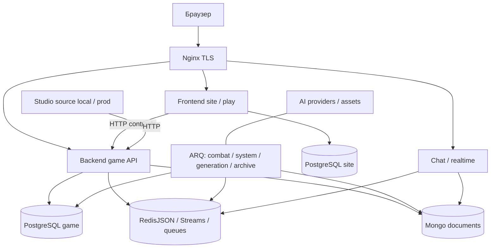

# Аудит 10/10 — Master Audit Sealed World

> **Обновление 19.10.2026:** это исторический срез. Отметки исправлений по коммитам и пределы проверки вынесены в [начало реестра](10_findings_registry.md#быстрая-сверка-исправлений--19102026); AG-01–04/07 — в [аудит 11](11_independent_verification_and_audit.md#быстрая-сверка-исправлений--19102026). Приведённые ниже количества не являются текущим числом открытых дефектов.

Дата: 09.10.2026, Europe/Berlin. Режим: READ → CONSOLIDATE → VERIFY → CLASSIFY → DOCUMENT → STOP.

## 1. Executive Summary

Sealed World — содержательный pre-alpha проект с модульным Python backend, серверным frontend, отдельными workers и гибридным хранением. Его техническая зрелость неоднородна: вычислительная логика Combat и часть локальных инвариантов хорошо выделены; границы публичного доступа, повторной доставки и восстановления между хранилищами существенно слабее. Наличие незавершённых механик само по себе не является дефектом. Количество High не измеряет готовность продукта.

Главные группы подтверждённых рисков: доступ к привилегированным и игровым API без единой policy; повторное начисление/неполное завершение многошаговых операций; потеря доставки и несогласованные runtime/checkpoint/archive contracts; неполная защита настоящих storage contracts тестами; непереносимая CI dependency и разрыв quality/provenance при deploy; повторная полная обработка растущих runtime документов. Эти группы требуют разных решений и не объединяются в один дефект.

**Отдельное security-сообщение:** A07-02/03 описывают privileged API без auth gate; A08 показывает публичное проксирование `/api/` и допускаемые known-default signing/service keys (A07-14/A08-01). При соответствующей публикации это потенциально опасная цепочка доступа к конфигурации и административным операциям. Чтение текущих router/settings/proxy подтверждает её предпосылки в репозитории, но не эксплуатацию, действующий VPS или реальные значения секретов. Critical и произошедшая компрометация не установлены. Никаких автоматических исправлений или production-проверок не выполнено. Источники: [A07, §12–13](07_application_security.md#12-подтверждённые-дефекты), [A08, §13](08_infrastructure_security.md#13-подтверждённые-уязвимости-и-конфигурационные-проблемы); текущие `src/backend/features/game_config/api/router.py:6,17–60`, `src/backend/config/settings.py:49–59`, `deploy/nginx/site.conf.template:120–132`.

Сильные решения следует сохранить: единый вычислительный executor Combat для live/simulation, чистые алгоритмы и DTO, доменные каталоги и DI, существующие JWT/session/ownership gates, полезные SQL transactions/locks/constraints, локальные Redis Lua/pipelines, раздельные worker queues, non-root images, TLS и отсутствие host-портов баз в production Compose. Они не обеспечивают автоматически сквозную correctness, но дают хорошую основу дальнейшей разработки.

## 2. Методология и база сравнения

### 2.1. Наличие источников и версии

Все девять отчётов найдены и учтены; `audit/09_performance_probes.py` присутствует, прочитан как дополнительное свидетельство методов A09, не исполнялся повторно. Отсутствующие отчёты не реконструировались. Ни один исходный отчёт не редактировался.

Текущий HEAD: `6ccc92561c633f618eb7ee082c36caa44a1400f7`. Все отчёты датированы 09.10.2026 и исследуют **рабочее дерево с изменениями**, а не чистый commit. A01–04/A08 приводят полный HEAD; A06/A07 — сокращённый `6ccc9256`; A05/A09 отдельно не фиксируют SHA. Их нельзя автоматически аттестовать той же версией только по дате и соседним отчётам. Совпадение SHA остальных не доказывает тождество исследованного dirty tree. Исходные отчёты не содержат общего content-addressed снимка всех исходников. Поэтому нельзя установить точный состав дерева между каждым аудитом или идентичность выпущенного образа.

| Источник | Предмет | Ограничение хронологии |
| --- | --- | --- |
| [01](01_project_inventory.md), строка 3 | Инвентаризация/ownership/процессы | Карта, а не проверка correctness |
| [02](02_architecture_boundaries.md), строка 3 | Границы/дрейф | Рабочее дерево; сохраняются O02 observations |
| [03](03_combat_runtime.md), строка 3 | Combat lifecycle | Часть concurrency — гипотезы |
| [04](04_rift_world_generation.md), строка 3 | Rift/World/AI | Старый runtime и Hex отличаются |
| [05](05_persistence_consistency.md), строка 3 | Storage/consistency | Реальные БД не проверены полностью |
| [06](06_testing_quality.md), строка 3 | Тесты/gates | Локальная Python 3.14 и CI 3.13 различаются |
| [07](07_application_security.md), строка 3 | Application security | Статические цепочки ≠ production exploitation |
| [08](08_infrastructure_security.md), строка 3 | Deployment/supply chain | При написании A07 ещё отсутствовал |
| [09](09_performance_scalability.md), строка 3 | Performance | При написании A06–08 ещё отсутствовали |

Утверждения A08 об отсутствии A07 и A09 об отсутствии A06–08 описывают момент их подготовки. Сейчас файлы есть; это не противоречие findings и не причина игнорировать последующие результаты. Точное время и порядок создания не восстанавливаются по дате файлов. Перенос project skills из `docs/agent-skills` в `.agents/skills` и новые Hex файлы уже отражены в dirty tree; числа skills в A01 также являются историческим срезом: remediation skill теперь существует.

Начальное чтение Git показало многочисленные staged/unstaged/untracked изменения: 376 tracked entries в `status --porcelain -uno`, включая Dockerfiles, dependency manifest/lock, перенос skills, удалённые scripts, Rift/Hex, frontend assets/templates и tests. Это исходное состояние пользователя, не изменения master audit. Git читался с process-local `-c safe.directory=...` после ownership refusal; global/local config, index, ветка и HEAD не изменялись. Graphify не обновлялся и не использовался как актуальное доказательство.

### 2.2. Проверки и пределы

Работа разделена на независимый реестр, архитектуру/skills и системные причины; ведущий сверяет исходные IDs, консервативную дедупликацию, ссылки и ключевые текущие цепочки. Применены AGENTS, cost-aware-delegation, project/backend/combat/rift/quality/release и audit-remediation с относящимися references. Владелец явно ограничил scope четырьмя документами; implementation/planning шаги remediation skill здесь не выполняются.

В A10 выполнены чтение, поиск, сверка IDs и ссылок, read-only Git и статическая проверка текущих config/Rift/Combat/archive paths. Старые pytest/probes/logging canaries приводятся **как результаты A03–09**, а не новые выполненные тесты. Полный quality runner, pytest, Docker/services, AI, реальные хранилища и production не запускались; зависимости не устанавливались. Не воспроизводились атаки или нагрузка.

Классификация сохраняет исходную severity; доказательность и стадия — независимые поля. «Подтверждён failure window» означает установленный порядок шагов при конкретном отказе; «воспроизведено тестом» указывает автора/границы исторической проверки. Отсутствие стенда не превращает гипотезу в факт. Срочность не вычисляется из severity и не является очередью реализации. Публичная надпись `alpha` в release contract не отменяет заданную владельцем общую **pre-alpha** стадию. Статус Production не назначается компоненту только по наличию Compose.

## 3. Общая картина проекта

Это модульное приложение с несколькими процессами, а не независимо развёртываемый микросервис на каждый feature. Backend features разделены Python-каталогами, но используют прямые imports, shared DTO, HTTP, Streams и общие storage adapters. Site и gameplay разделены процессами и собственными SQL migration trees; site/play используют общий frontend image и identity model. Chat/realtime, ARQ, Studio и Telegram — отдельные execution surfaces. Подробная инвентаризация: [A01, §3–7](01_project_inventory.md#3-архитектурная-карта); реальные import/call границы: [A02, §3](02_architecture_boundaries.md#3-фактическая-карта-зависимостей).

Схема показывает зависимости, не firewall allowlist и не живую production topology. SQL сохраняет identity/ownership/relationships/status, Redis — runtime и транспорт, Mongo — тяжёлые payload. Но общий тезис «SQL source of truth» недостаточен для восстановления конкретной Redis runtime версии: требуется согласованный checkpoint и readable document pointer. См. [A05, §3/7](05_persistence_consistency.md#3-карта-persistence-и-ownership).

## 4. Компактная архитектурная карта

В таблице «stage» означает назначение и наблюдаемую готовность; действующий deployment каждой поверхности неизвестен. Идентификаторы ведут к полному [реестру](10_findings_registry.md).

| Домен | Назначение и реализованное | Владелец данных; public/internal contracts | Зависимости и стадия |
| --- | --- | --- | --- |
| Frontend/site/play | Identity, account, public content, cabinet, SSR/HTMX игровые экраны; один image, два surfaces | Site owns users/refresh/email/site DB; browser forms/CSRF, HTTP game clients | Backend API, site PG, Redis, cabinet; Pre-alpha, public label Alpha. A01 §4.2/§7 |
| Backend/game | FastAPI routing, feature services/integrations, game orchestration | Feature owns semantics; app/DI owns composition; HTTP/Streams/ARQ | Game PG, Redis/Mongo; Pre-alpha. `src/backend/app.py:43,53–72`, A02 §3 |
| Shared | DTO/enums/security/utilities и cross-side contracts | Cross-side DTO owner; internal runtime DTO здесь спорны | Frontend/backend; Shared infrastructure. A02-08, O02-02 |
| FastAPI Cabinet | Registry/modules/menu/rendering для кабинета и Studio | UI library owns components; consuming site owns access/content | Frontend/Studio templates; Shared infrastructure. A01 §4.2 |
| Character | Actor hydration, vitals/progression/skills, active selected session | Character owns persistent progression; actor_state manager owns AC key-space; snapshots_requested/HTTP/session ops | Inventory, monsters/catalog, Redis, SQL; Pre-alpha. A02-03/04/06, A03-10 |
| Inventory/Items/Loot | Placement/wallet, stats/projections, generation/preorder/claim, durability | Items/Inventory persistent item/resource facts; Loot claim workflow; HTTP/events/internal payload | Character/Expedition, SQL/Redis, AI; Pre-alpha. A02-01/04/05, A05-01–04 |
| Combat | Start, queue/exchange, resolver, results, analytics, live AI/simulation | Combat runtime/finalization; Character reward owner; executor snapshot/DTO, API/Streams/ARQ | Character, loot, Rift, Redis/PG/Mongo; Pre-alpha; simulation Experimental. A03/A05-11/A09-01/05 |
| Старый Rift | Graph/run/travel/events, guards/real combat, exit, membership/snapshot | Rift owns run/instance/presence and SQL membership; player API, result integration | Combat/character/loot, Redis/PG/Mongo; Legacy по отношению к новому направлению, ранее действующий pre-alpha runtime; A04/A05 |
| Новый Hex Rift | Генерация hex-структуры, перемещение, тестовые action/combat imitation | In-memory instances + optional Redis world snapshot (`hex_test_router.py:69–82`); `/api/dev/rift/hex-test` | Generator/resources/frontend scene; Experimental, dev-only purpose; A07-15/A08-04. Не готовый игровой цикл |
| World/Exploration | Square world shell/static nodes, cache, navigation/encounters/knowledge | World SQL geography + Redis projection; Exploration progress/character refs; internal services/API | Monsters/combat/AI/character; Pre-alpha, часть discoveries stub. A04-08–10 |
| Scenario/NPC | Nodes/evaluation/steps/resume and effects | Scenario flow state; NPC effect identity; typed DTO/event/state transitions | Character/world/Rift/city services; Pre-alpha. A01 §4; A05 §15 |
| GenerationAI | SQL task lifecycle, Mongo input/result, JSON/image generation, assets | SQL task/status/pointers; Mongo payload; provider and worker contracts | Providers, World/monsters/items, ARQ, asset storage; Pre-alpha/shared generation infrastructure. A04-11–13/A05-07/08/A09-09/10 |
| Chat/Realtime | Topic/DM history, messages, socket handshake/broadcast, archive | Chat access/history metadata, Mongo bodies; Redis buffer, in-process subscriptions; REST/WS | Identity/session/character, Redis/PG/Mongo; Pre-alpha. A07-06–08/16, A05-06/15, A09-03/04/08/11 |
| PostgreSQL | Relational facts, constraints/locks, site/game migration roots | Respective site/game domain owners; SQL repositories/UoW | Alembic/SQLAlchemy; Shared infrastructure. A05-01/02/12/13 |
| Redis/RedisJSON/Streams | AC/combat/Rift/inventory runtime, leases, buffers, request/reply and ARQ | Domain managers own keys/paths/TTL; bus adapter owns delivery protocol | All runtime services/workers; Shared infrastructure. A03-03/09/10, A05-05 |
| MongoDB | Heavy combat/chat/AI/Rift documents and snapshots | Document family owners, stable identity/schema/pointers | PG metadata/Redis snapshots; Shared infrastructure. A05-07/09–11/15 |
| ARQ workers | Combat, system, GenerationAI, chat archive; optional simulation profile | Feature jobs and queue-specific registries | Redis queue, stores/services; Shared infrastructure; simulation Experimental. A01 §7, A09 §9 |
| Docker/Nginx | Images, Compose layers, TLS/proxy and release execution | Deployment configuration; image/env/ingress contracts | GitHub/GHCR/VPS, stores, providers; Shared infrastructure; actual production unverified. A08 |
| Testing/CI/CD | pytest/coverage/validators/hooks/mypy/security/build/deploy jobs | Quality manifest/runner; workflows gate artifacts | codex-core/codex-ai, local/CI Python; Shared infrastructure. A06/A08-09–11 |
| Studio/Telegram | Analytical source switching/cabinet; announcements through bot | Studio consumes data; intended read-only. Bot consumes Streams | HTTP source/front UI reuse, Redis/Telegram; Studio Dev-only, bot deployment unknown. A07-12; A01 §4.2/7 |

## 5. Готовность доменов, защиты и неизвестное

| Домен | Сильное решение | Известный дефект | Что остаётся неизвестным |
| --- | --- | --- | --- |
| Site/frontend | Собственная identity DB, cabinet superuser gate/CSRF | Refresh split commits, clean migration mismatch; client/server tests раздельны (A05-12/13, A06-07) | Реальные sessions, migrated schema, browser flows |
| Backend/shared/cabinet | Feature grouping, DI, frontend не импортирует backend internals | Internals/raw state crossing (A02); неравномерные route gates (A07) | Закрытые consumers и окончательная shared utility policy |
| Character | Snapshot and projection separation, SQL-backed progress | Raw AC paths/non-CAS dirty and expensive scans (A02-03, A03-10, A09-02/06) | Реальная concurrency и размер AC population |
| Inventory/Items/Loot | SQL constraints, batch reads, некоторые run locks/dedup | Safe claim conservation/source mismatch, snapshot/flush race (A05-01–04) | Fault/retry behavior настоящих SQL/Redis contracts |
| Combat | Pure kernel/common executor, typed snapshots, Lua queue ops | XP duplicate/inactive early/destructive create/non-atomic commit; crit-bleed (A03) | Реальные expiry races, complete archive/recovery, balance всех abilities |
| Старый Rift | Graph invariants, event/exit/encounter gates | Client-controlled outcome, false victory, missing initial snapshot и partial restore (A04/A05) | Будет ли runtime поддерживаться/мигрироваться; approval истории |
| Hex Rift | Проверяемые hex graph/connectivity invariants | Открытый накопительный dev ingress (A08-04); не отсутствие ресурсов/настоящих боёв | Публикация прототипа, утверждённый следующий этап |
| World/Exploration/Scenario | Pure algorithms/static validation; owner checks Scenario | XP cap wiring/cache publication/move refusal (A04-08–10) | План discovery mechanics и fault-resume полнота Scenario |
| GenerationAI | Task identities, separate queue, commit before enqueue | Input/result durability, retry limits, schedule gap/long SQL transaction (A04/A05/A09) | Provider latency, task backlog, orphan assets/recovery |
| Chat/Realtime | JWT/session/Origin checks и safe text rendering | Membership/send scope, archive skip/cap, sequential local broadcast (A07/A05/A09) | Настоящий message rate, revocation, multi-process requirement |
| Stores/workers | SQL UoW/locks, Lua owner-aware release, queue isolation | Cross-store replay/fencing/pending recovery неполны | DB server behavior, operational restore/RPO/RTO, deployed package versions |
| Infra/quality/Studio | Non-root/TLS/lockfile/main gates; selected-source validation | Defaults/common credentials/provenance gaps; collection/test false pass; Studio write surface | VPS/security settings/backup drills; actual exposure of Dev-only Studio |

Legacy — отношение старого Rift к новой разработке в этом отчёте, **не доказательство его отключения**. В исходных аудитах он также называется основным/experimental runtime. Его data-integrity дефекты сохраняются, если им пользуются. Новому Hex не приписываются эти пути автоматически. World — третья реализация географии/контента, а не ещё одно имя Hex Rift.

## 6. Подтверждённые риски и дедупликация

Полный контроль IDs, исходной severity, canonical и пяти типов отношений находится в [10_findings_registry.md](10_findings_registry.md). Отдельные записи сохраняются даже при полном дубликате. Общее исправление и совместимая проверка необходимы для полного объединения; сходство системы или симптома недостаточно.

Принципиальные разграничения:

- A04-01/A07-05 — клиентская власть над server outcome; A07-01 — identity/ownership caller. Это разные инварианты: auth не делает клиентский outcome достоверным.
- A07-14/A08-01 — один default-key defect с усилением конфигурационного доказательства; реальное production значение остаётся неизвестным.
- A07-04/A08-03 пересекаются на internal sessions, но A07 дополнительно включает combat analytics; общий proxy не стирает разные role/read contracts.
- A06-05/A08-10 совпадают по clean-checkout path dependency; Docker source-policy difference сохраняется как дополнительное последствие и ограничение объединения.
- A03-01/02/03/04 — duplicate rewards, incomplete finalization, partial exchange commit, destructive create. Общее отсутствие end-to-end гарантий не превращает их в один дефект.
- A03-09 — fencing schedule; A03-10 — AC generation clear; A05-03/09 — отдельные Inventory/Rift snapshot paths. Один общий concurrency vocabulary не является общей реализацией.
- A04-02 усиливает доказательство конкретного false-victory аспекта A03-11, но не доказывает concurrent completion/reward duplication.
- A04-03 — нет initial checkpoint; A05-10 — некорректный partial restore уже существующего checkpoint; A05-11 — unreadable archive fallback. Это разные переходы и независимые последствия.
- A06-02 — ложноположительный тест, A03-13 — игровой trigger defect. Исправление теста не исправляет runtime.
- A05-06 — cursor skip после write failure; A09-03 — arrival/drain budget; A09-08 — returned Mongo bytes; A05-15 — seq/replay/server-valid update. Все четыре независимы.
- A07-15/A08-04 пересекаются на dev exposure, но A08 включает unbounded instance accumulation; mock combat в Hex не считается дефектом прототипа.
- A06-09/A08-11 пересекаются на deploy provenance; approval/ref/environment properties A08 не следует объявлять проверенными по одному workflow.

Сверены **120 исходных ID**: A02 — 10, O02 — 5, A03 — 13, A04 — 21, A05 — 15, A06 — 12, A07 — 18, A08 — 15, A09 — 11. Четыре полных объединения — A04-01/A07-05, A04-12/A05-07, A04-17/A05-09, A07-14/A08-01 — оставляют **116 canonical записей**. Исходные severity: 40 High, 66 Medium, 5 Low, 8 Observation, у A04-21 severity не назначена (нужен продуктовый контракт). Это не число «подтверждённых багов»: canonical включают observations и риски. Severity полного дубликата сохраняется отдельно у каждого источника; например input persistence A04/A05 не усредняется.

## 7. Сильные решения с источниками

| Решение | Чем полезно и где граница результата | Источник |
| --- | --- | --- |
| Изолированное ядро Combat | Математика/resolver не обязана знать SQL/Redis; testability и возможность профилирования. Ambient RNG/catalog ещё ограничивают native extraction | A02 §10; [A03 §13](03_combat_runtime.md#13-сильные-решения-которые-следует-сохранить), O02-03 |
| Общий executor production/simulation | Снижает drift вычисления; не доказывает parity reward/archive side effects | A03 §7/13 |
| Domain boundaries/DI | Локализуют владельцев и composition; имеющиеся нарушения конкретны, не опровергают всю модульность | A02 §3/10 |
| Чистые algorithms/graph tests | Нормализованные graph/hex invariants можно проверять без БД; seed reproducibility отдельно | A04 §6; A06 §15 |
| JWT/session/ownership | Signature/type/audience/expiry, game session lock, inventory/scenario owner, admin players service key | [A07 §15](07_application_security.md#15-положительные-security-boundaries) |
| SQL UoW/transactions/locks | Expedition cashout сохраняет общей SQL границей items/resources/progression; placement PK/resource unique и NPC dedup полезны | [A05 §15](05_persistence_consistency.md#15-сильные-решения) |
| Redis pipelines/Lua | Queue transitions и owner-aware release; batching снижает transport RT. Non-transactional pipeline не обеспечивает exchange atomicity | A03 §13; A05 §15; A09 §6 |
| Отдельные worker queues | Generation/simulation work не обязана занимать combat worker; system queue всё же объединяет несколько задач | A09 §9.1; A01 §7 |
| Non-root images | Ограничивают часть post-compromise возможностей, не заменяют app authorization/credential isolation | [A08 §4](08_infrastructure_security.md#4-dockercontainer-security) |
| Nginx TLS/host-port isolation | TLS config и только Nginx ports в prod Compose; конкретные сертификаты/firewall неизвестны | A08 §3/5/15 |
| Lockfile/main quality/build gates | Есть воспроизводимая намеренная цепочка quality→build; dependency/provenance gaps ограничивают гарантию | A06 §8/15; A08 §7–8/15 |
| SQL-backed projections/document identities | Runtime можно перестраивать; stable document IDs/schema полезны. Partial restore/readable pointers требуют отдельной проверки | A05 §15 |

Ни одно из этих решений не требует переписывания ради единообразия. И наоборот, сложность схемы/количество сервисов не являются самостоятельным достоинством.

## 8. Cross-domain проблемы и системные причины

Выделено **17 системных механизмов**. Подробные доказательства, компенсирующие защиты и confidence — [10_root_causes.md](10_root_causes.md). Системная причина группирует независимые дефекты и не заменяет canonical ID. Число зависит от выбранной гранулярности анализа и не является метрикой качества: отдельно рассмотрены auth, server authority, credential lifecycle, publication defaults, least privilege, diagnostics, operation identity, state versions, acceptance/recovery, durable delivery, feature ownership, tests, gates, source/provenance, full-state amplification, work budgets и knowledge drift.

Основные механизмы: route policy подключается локально и непоследовательно; повторяемость операции не всегда закреплена authoritative owner claim; effect/commit/enqueue разделены без durable replay; runtime версии, dirty acknowledgements и restore не всегда согласованы; реальные storage/transport semantics скрыты fakes; архитектурные правила и CI gates шире исполняемого enforcement; local/CI sources расходятся; whole-state serialization повторяет растущий payload; назначение internal/dev не закреплено ingress; документационные anchors/stage notes отстают от реализации.

Это объяснения по текущим контрактам, не реконструкция автора или AI-модели. Не доказано, какая модель писала конкретный участок или каким процессом он появился. Возможные направления стабилизации оставлены без сроков, очереди и решения о реализации.

## 9. Security и data integrity

Authorization caller, authoritative outcome и storage ownership — три разные границы. Existing session decoder не защищает router, который его не вызывает. Owner check не гарантирует once-only reward. Single Redis lease не обеспечивает fencing при expiry между check и commit. SQL uniqueness не заменяет точный predicate источника transferable item. Эти различия объясняют, почему security findings нельзя автоматически слить с persistence и архитектурными.

Данные риска: combat XP/durability; loot resource conservation/source transfer; runtime exchange/creation/dirty checkpoint; Rift lifecycle и restore; Streams pending и chat cursor; AI input/result/scheduling; site migration/refresh. Статические failure windows конкретны, но не являются журналом production потерь. Потенциальный отказ публичного доступа оценивается отдельно от незавершённости gameplay.

A07-12 — Dev-only Studio c нарушением intended read-only и возможными backend writes. Это технический High при выполнении условий доступа; публичное production-развёртывание Studio не доказано. A07-17 — unsafe HTML sinks при неизвестном untrusted source; подтверждённого XSS нет. A08-05/06/07 — разные telemetry leakage mechanisms; canary A08 с искусственным local secret доказывает logging behavior, не реальную утечку credentials.

## 10. Testing/CI

По A06 существует большая полезная база чистых tests/DTO/компонентов. Историческая collection: 2787 cases из 303 modules плюс ошибка stale script import; AST 304 files/2606 functions. Завершённая выборка 362 passed завершилась exit 1 по глобальному coverage, а широкий запуск с 1707 PASSED остановлен лимитом без итогового verdict. Нельзя называть suite полностью прошедшим или оценивать общий coverage по focused run. См. [A06, §2](06_testing_quality.md#2-методология-и-охват).

Windows sandbox async hang воспроизводился ещё при создании event loop; outside-sandbox контроль прошёл. Это объясняет пределы A03/A09 probes и **не доказывает deadlock приложения**. Локальный Python 3.14.3 и CI 3.13 — дополнительная граница переносимости.

Главный gap — observables и внешние contracts: parry test выключает trigger; fake storage не подтверждает RedisJSON atomicity, Mongo update validity, PG migrations/concurrency, Streams pending/ARQ replay; раздельные клиент/server fixtures не доказывают сквозной DTO contract. Line threshold 74% существует; текущая стратегия не требует 100% patch coverage, A06-10 Observation не объявляется нарушением такого требования.

CI gaps независимы: collection (A06-01), dependency source (A06-05/A08-10), develop trigger/behavioral job (A06-06), architecture validator (A06-08), hook environment (A06-12), image provenance (A06-09/A08-11), immutable supply chain (A08-09). Настройки GitHub approvals/environments не исследованы; отсутствия нужной защиты в UI нельзя вывести из YAML.

## 11. Performance и масштабируемость

По A09 подтверждены формы работы, а не server capacity: Combat full history merge/read/write даёт O(T²) суммарного payload при равном приросте; AC scan каждые две секунды может читать весь набор, `limit=100` ограничивает кандидатов; chat archive 500/topic/10min имеет номинальный потолок 3000/hour/topic; broadcast sequential и process-local; clean repeated sync делает full SQL writes. Остальные A09-05–11 фиксируют hydration/full rewrites, Rift scans, growing Mongo returned buckets, provider-bound SQL transactions, sync image CPU и unlimited browser history. [A09 §4](09_performance_scalability.md#4-реестр-подтверждённых-ограничений).

Fake Redis methods/AC command counts/slow socket probes проверяют алгоритм и causal order. Миллисекунды Python assembly и простой PNG normalization — ограниченная синтетика, не end-to-end latency. Нет CCU/RPS/p95/p99, реальных RTT, размеров документов, pool waits или EXPLAIN/ANALYZE. Python/native rewrite и контейнер на каждый feature не обоснованы этими данными.

Улучшение cost может конфликтовать с consistency: delta commit требует version/retry semantics; cache AI snapshot — контроля актуальности; ускорение archive не закрывает cursor skip; дополнительные WS replicas требуют межпроцессной доставки. Это зависимости будущих решений, не предписанный implementation plan.

## 12. Неизвестные production условия

Не установлены: deployed image/SHA/package versions и фактический feature flag; secrets defaults/rotation; overrides/firewall/network ACL; GitHub branch/environment permissions; TLS/cert renewal; живые WS/proxy quotas; DB schema/data sizes/version/isolation; Redis AOF/RDB/volumes durability; off-host backups/restore drills и RPO/RTO; Mongo server semantics; provider quotas/latencies; S3 bucket policy; traffic/concurrency; реальные instances и personal data exposure.

Compose описывает intended topology и не подтверждает фактический deployment. Отсутствие operational evidence не равно отсутствию backup или контроля. A08-15 сохраняется как Observation с недостаточными данными. Master не обращался к production и не запросил secrets.

## 13. Восстановление решений и необъяснённые причины

| Решение | Тип обоснования | Проверяемый источник и предел |
| --- | --- | --- |
| Separate site identity/game data | Явно следует из действующего ownership contract | `src/frontend/core/database/model_imports.py:1`, `src/backend/core/database/model_imports.py:6`; A01 §3/6. Исторический выбор даты/автора не восстановлен |
| PG facts + Mongo heavy documents | Документированная действующая policy; дата/мотив принятия не восстановлены | `.agents/skills/turnbasedmmorpg-backend/references/storage-ownership.md:6–55`; запрет Mongo authority на rewards/permissions. Конкретный drift отмечен A05 |
| Redis live state/temporary actor snapshots | Обоснование явно следует из контракта | `.agents/skills/turnbasedmmorpg-project/references/project-rules.md:77–79`; runtime/derived projections различаются. Причина всех TTL неизвестна |
| Common executor live/simulation | Подтверждённая реализация; parity — контрактное обоснование | A03 §7/13. Исторический ADR выбора не заявляется |
| Site/play separate processes, one image | Факт конфигурации; load/routing rationale — контрактная интерпретация | `deploy/compose.site.yml:43,89`; A01 §3. Историческая мотивация полного разделения не восстановлена |
| Hex as local prototype | Прямое уточнение владельца в A10; реализация прототипа подтверждена | `src/backend/features/rift/services/hex_runtime_service.py:36–42,133,167`; исторический документ выбора Hex не восстановлен |
| Ранний approved Rift harness | Описание в действующем reference; первоисточник отсутствует | Rift `references/implementation-boundaries.md:3–13` ссылается на отсутствующий `docs/planning/tasks/rift/approved_stages/phase_01_local_dev_harness.md`. Reference не называет Hex. Не подтверждены содержимое/approval исчезнувшего документа или последующее разрешение старых persistence paths |
| Release stages and wipe promises | Документированная действующая policy; история принятия неизвестна | `.agents/skills/turnbasedmmorpg-release/references/stage-branches-and-versions.md:22–45`; public Alpha ≠ оценка технической зрелости |
| Thin handlers/semantic integrations/key owner | Документированная действующая архитектурная policy; история принятия неизвестна | Project rules/backend references; A02 демонстрирует конкретный drift |
| Shared security/logging/metrics beyond DTO | Правдоподобная гипотеза полезного cross-cutting reuse, причина неизвестна | O02-02 и current modules; буквальный shared contract уже. Нужна policy владельца |
| Direct feature constructors/ORM writes despite boundary rules | Причина неизвестна | A02-01/02/04/07. Общая SQL transaction полезна; это не доказательство исторического разрешения internals |
| Long-lived WS, process-local delivery, archive batch/TTL | Причина конкретных значений неизвестна | A07-16/A09-03/04; текущая single-process config совместима с частью решений, но не объясняет backlog budget |
| Live-model baseline migrations / local path source | Причина неизвестна | A05-13/A06-05/A08-10. Удобство локальной разработки — гипотеза, не исторический факт |

Наличие кода не является задним числом owner approval. При отсутствии документированного основания оно так и обозначено. Подробная skill/documentation оценка и ссылки — [10_skill_gaps.md](10_skill_gaps.md). Отдельный список для позднего пересмотра: shared utility policy; semantic cross-feature calls versus Streams; поддержка/архивирование старого Rift; авторитет snapshot/TTL/checkpoint; reward/finalization guarantees; migration history; CI source reproducibility; public/dev/internal ingress; Studio read-only scope; chat multi-process target. Master не выбирает варианты за владельца.

## 14. Качественная оценка pre-alpha

| Область | Оценка по доказательствам |
| --- | --- |
| Архитектура | Полезная модульная основа; ownership/import/storage boundaries проницаемы. Массовая смена архитектуры не обоснована |
| Игровая логика | Реальный Combat и алгоритмы есть; конкретные trigger/outcome/XP defects значимы. Неполный Hex loop допустим для прототипа |
| Persistence | Хорошие локальные SQL invariants; cross-store lifecycle/retry/checkpoint/readback недостаточно надёжны |
| Security | Рабочие identity/CSRF/Origin/owner механизмы существуют; route coverage/internal exposure и secrets fail-closed непоследовательны |
| Testing | Большая полезная база чистой логики; collection blocker, false pass и пробелы настоящих storage/recovery contracts снижают уверенность |
| CI/CD | Main quality/build structure разумна; reproducibility/develop coverage/provenance/immutable chain ограничивают гарантию |
| Performance | Конкретные amplification/drain/fanout ограничения найдены; production скорость не измерена |
| Масштабируемость | Queue separation помогает; WS process locality/global scans/full state мешают простому увеличению реплик |
| Deployment/recovery | Intended Compose/TLS/non-root понятны; clean migration blocker и отсутствие operational restore evidence существенны |
| Документация | Skills/карта дают навигацию; placeholders/stale anchors/стадии мешают восстановить прежние решения |
| Дальнейшая разработка | Продолжать можно на существующей основе при осознанном выборе границ и доказательств. Master даёт исходные контракты для владельца, а не готовый backlog реализации |

Процент готовности и общий числовой балл не рассчитываются. Техническая зрелость неоднородна; продуктовая завершённость ниже наличия инфраструктуры. Public exposure/data preservation требуют самостоятельной оценки независимо от права pre-alpha менять механики.

## 15. Вопросы владельцу

1. Какие поверхности сейчас действительно опубликованы, какими image refs и flags; какие из old Rift/Hex/Studio используются?
2. Какие обещания сохранности progression/rewards/archive уже даны тестерам; каковы допустимые recovery loss/latency и wipe policy?
3. Поддерживать ли старый Rift дальше, замораживать ли его или позднее переносить механику; каков утверждённый scope Hex?
4. Какие API являются player/admin/internal/dev; какая identity/role/session policy должна быть единой?
5. Допустимы ли semantic in-process операции с общей SQL UoW рядом со Streams; кто владеет outcome/finalization и transfer?
6. Какова целевая shared policy для cross-cutting security/metrics/logging; почему baseline migrations/source policy устроены нынешним образом?
7. Нужны ли multiple chat processes сейчас; какая реалистичная нагрузка/история/retention должна быть проверена?
8. Какие GitHub approvals, backups, secrets validation и restore drills фактически действуют вне репозитория?

Это список последующих решений и недостающих свидетельств; ответы не требуются для завершения консолидации. Никакое исправление не начинается автоматически.

## 16. Навигация и контроль полноты

- [Полный реестр](10_findings_registry.md): все A02–A09 и O02 IDs, исходные severities, stages/evidence, canonical, пересечения и количество по источникам; риски без ID сохранены отдельно.
- [Системные причины](10_root_causes.md): механизм, evidence, confidence, защиты и потенциальные направления стабилизации.
- [Skill gaps](10_skill_gaps.md): Knowledge/Workflow/Enforcement, существующие правила/validators и совместимость remediation skill.
- [Инвентаризация A01](01_project_inventory.md): подробная структура; [A02–09](10_findings_registry.md) — evidence по конкретным finding IDs.

Финальный контроль завершён: все девять источников присутствуют; 120 исходных ID совпали со 120 уникальными карточками (пропущенных/лишних нет); у каждой есть source, severity, evidence, stage, domain/contract, trigger/impact, проверка, ограничения, canonical и связи. Уникальных canonical 116; все ссылаются на существующие исходные ID. Low/Observation и 31 ненумерованная narrative-группа сохранены отдельно, без новых ID и без включения в 120/116. Полные дубли согласованы с четырьмя группами root-causes; системных механизмов 17. Master содержит все 16 запрошенных разделов.

В четырёх документах проверены 540 локальных Markdown-ссылок и 437 явных file:line anchors: отсутствующих target или номеров вне диапазона нет. Дополнительно проверены диапазоны номеров в подписях относительных skill/source links. Это проверка навигации, не обещание семантического совпадения каждой исторической строки. Недоступный старый Rift router anchor 195 при текущих 190 строках обозначен в реестре текстом, не рабочей ссылкой. Полная текущая correctness всех 116 записей не аттестуется.

Дедупликация обоснована; severity не задаёт срочность; prototype/legacy/dev выделены; production exploitation/capacity не заявлены; исторические причины не выдуманы; положительные результаты сохранены. SHA-256 всех девяти исходных отчётов и probes совпали с начальным снимком. HEAD и исходное количество tracked dirty entries (376) сохранены. Созданы только четыре документа A10; исправления, окончательный implementation plan, code/tests/CI/skills/migrations/dependency/production операции не выполнялись. Реестр пригоден как вход audit-remediation с обязательной узкой повторной проверкой перед выбором исправления.

### Снимок источников для повторной обработки

SHA-256 исходных аудитов сняты при консолидации; финальная проверка сравнивает их без изменения файлов. Это идентичность **отчётов**, не полного source tree и не доказательство тождества версий кода.

| Файл | SHA-256 |
| --- | --- |
| 01_project_inventory.md | `910ADE95A09D7CB6CD9A439C5E7A391935A35CAC835F10F120737B71ED2E67FA` |
| 02_architecture_boundaries.md | `A5AEBB78793FA14B481FE47FDC72EBE2050AD0117A6840015ED2B4BAF014BDAE` |
| 03_combat_runtime.md | `2BA3D3AE5D07438DD69A4DAC9474634AD1F087EF307797AD57A59AC4CA30D5F4` |
| 04_rift_world_generation.md | `B05B4DB4C3D561779BFCEE1BE59B2355F3FF20B029593B41FCDAFAC918EA4DEA` |
| 05_persistence_consistency.md | `A13B82D7D3465372E119E523AF533A16F2B4FBD4E31B36FBE727789A0401EF94` |
| 06_testing_quality.md | `788A597117DBDC60C3CACF7903D1F04D6B730A5E5C36032032F0B6AAD62D85AC` |
| 07_application_security.md | `B8461270CCAEFDE9E99CE8213CC338EFEE712AFFEAA9862E4E1CFADFF255F829` |
| 08_infrastructure_security.md | `0D66A284A969AACE40C2CEAA9D721D5B9F07CBD18D0ADB8F4431DA7CC75F029B` |
| 09_performance_scalability.md | `4EDC6B1980010F5DF432BB09AF6FEE11B083F7F93026817D21A70079EA3B0951` |
| 09_performance_probes.py | `20F4063B7281ED94BC203E9F553F262CE3B238714BE5128E9DE651DD18030F53` |
